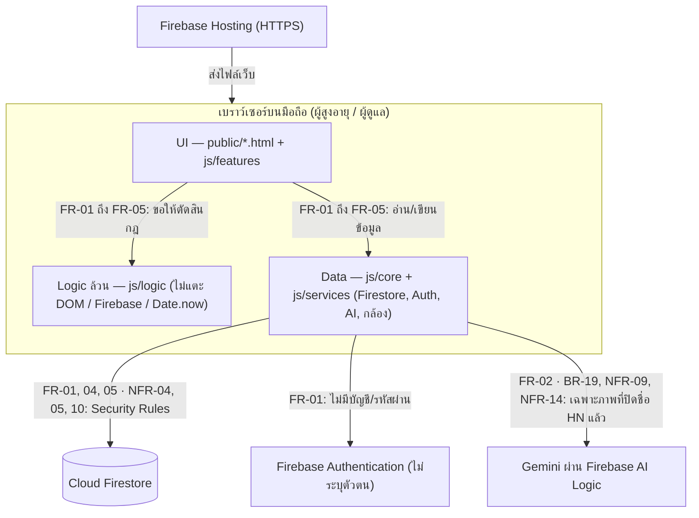
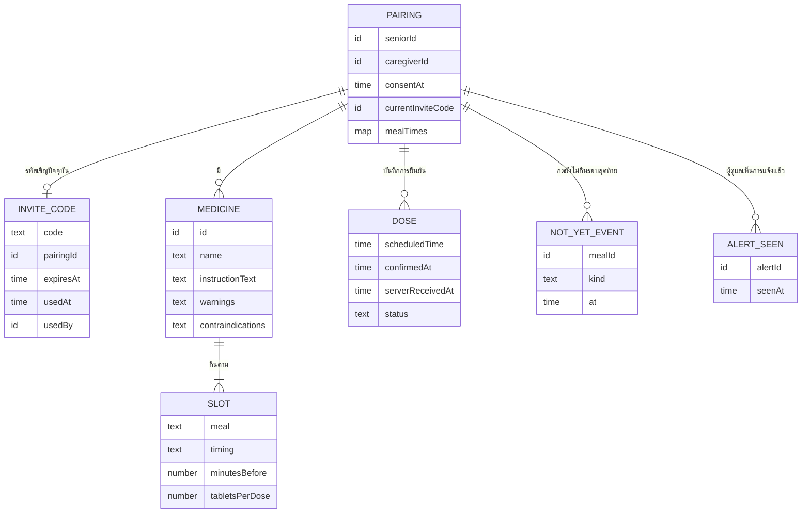
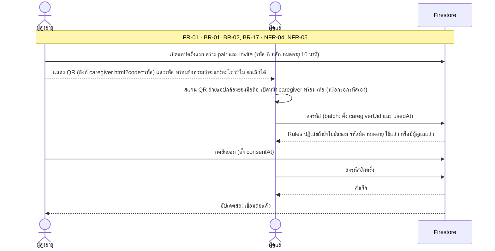
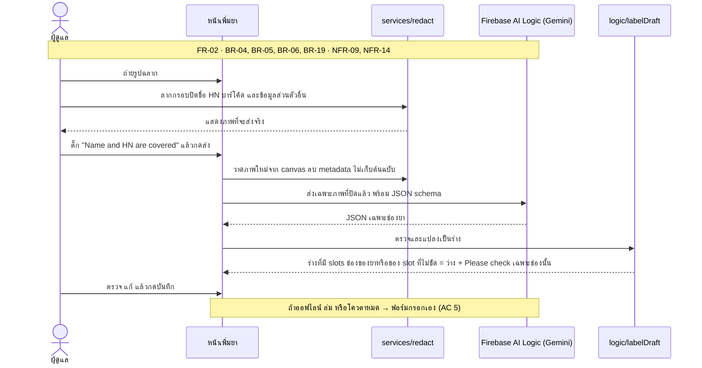
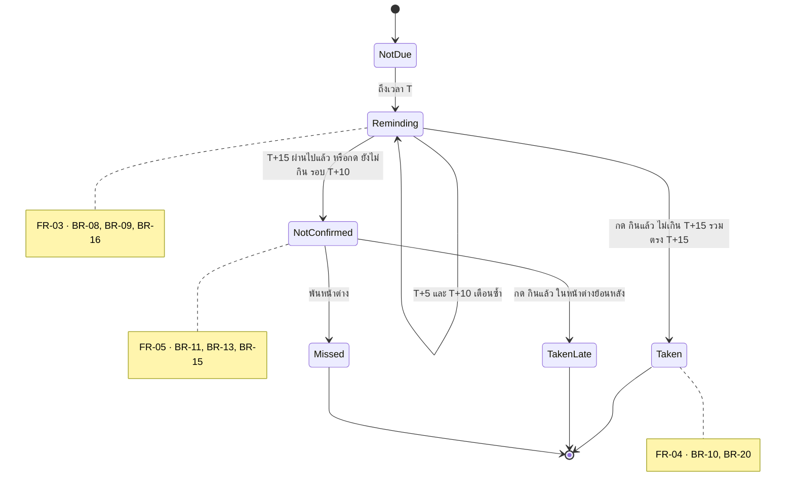
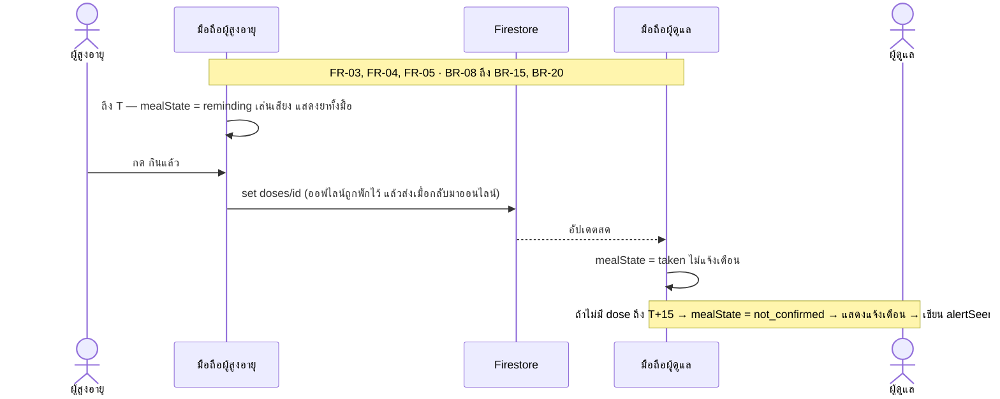
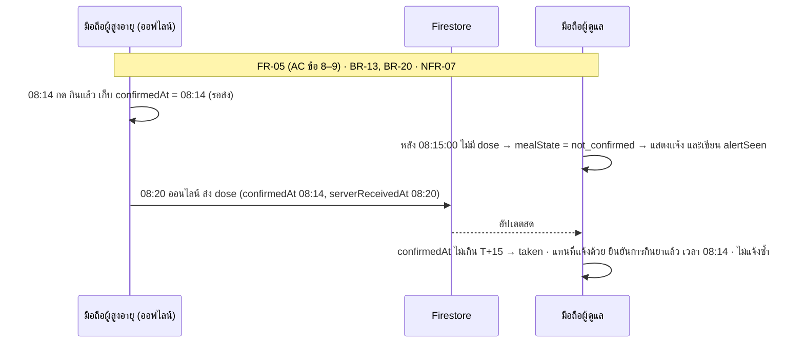

# Architecture & Design — MedMind

> เอกสารออกแบบ (M2 Design) · **ฉบับร่างเริ่มต้น 31 ต.ค. 2569** — ร่างด้วย AI จาก SRS v1.5 (รวมมติ A1 และ A5 จากผลรีวิวของทีม และคำตอบที่ PM แจ้งเมื่อ 1–2 พ.ย. 2569 — ดู decision-log) แล้ว **System Designer ต้องตรวจ แก้ และตัดสินใจข้อใน §11** ก่อนถือเป็นฉบับสมบูรณ์ (บันทึกใน `docs/AI_USAGE_LOG.md`)
> Requirement อยู่ที่ [`docs/01-requirements/M2-SRS_MedMind.pdf`](../01-requirements/M2-SRS_MedMind.pdf) (สำเนาอ่านง่าย: [`spec.md`](../01-requirements/spec.md)) — เอกสารนี้ไม่เปลี่ยน requirement ถ้าต้องเปลี่ยนให้แก้ SRS ก่อน

## 1. ขอบเขตของเอกสาร
อธิบายว่าระบบ**สร้างอย่างไร**เพื่อให้ตอบ SRS ได้ครบ FR-01–05 (Must) และ FR-09 (Could): สถาปัตยกรรม, เหตุผลการเลือกเทคโนโลยี (ADR), โมดูลและสัญญาระหว่างโมดูล, โครงข้อมูล, พฤติกรรม (sequence / state), ความปลอดภัย, การทดสอบ ทุกหน้าจอและทุกตารางข้อมูลต้องโยงกลับไปที่ FR ได้ (ตารางใน §8)

## 2. สถาปัตยกรรมภาพรวม
รูปแบบ **Layered + Client–Server, Monolith ฝั่งไคลเอนต์** (ไม่มี server code ของเราเอง) — ตามที่ M3 สอน: UI → Logic → Data, cohesion สูง coupling ต่ำ



| ชั้น | โฟลเดอร์ | หน้าที่ | กติกา |
|---|---|---|---|
| UI | `public/*.html`, `public/css`, `public/js/features` | แสดงผล รับการกด ต่อ logic กับ data | ทุกหน้ามีป้าย "Covers: FR-xx" · escape ข้อความผู้ใช้ · ขนาด/สีตาม NFR-03 |
| Logic | `public/js/logic` | กฎธุรกิจ (BR), เวลาเตือน, state ของมื้อ, ตรวจร่างยา | **ฟังก์ชันล้วน** รับเวลาเป็นพารามิเตอร์ · ทุกฟังก์ชันมีเทสต์ |
| Data / Services | `public/js/core`, `public/js/services` | Firestore, Auth, เรียก AI, วาดภาพปิดชื่อ, เสียงเตือน | ไม่มีกฎธุรกิจ · แยกเพื่อสลับเป็นของปลอมในเทสต์ได้ |

**Cohesion และ coupling (M3 §4):** แต่ละชั้นรวมเรื่องเดียวกัน (cohesion สูง) — UI = แสดงผลและรับการกด, Logic = กฎ BR/NFR ที่ทดสอบได้, Data = อ่านเขียนและเรียกบริการภายนอก · ชั้นคุยกันผ่านสัญญาใน §5.1 เท่านั้น (coupling ต่ำ): UI ไม่ตัดสินกฎ, Logic ไม่แตะ DOM/Firebase/เวลาจริง (รับ `now`), Data ไม่มีกฎธุรกิจ · ผลคือเปลี่ยนหน้าตาไม่กระทบกฎ และสลับ `firestoreRepo` เป็น `localRepo` (Demo mode) ได้โดยไม่แก้ Logic

**Demo mode (ADR-8):** เปิด `demo.html` (หรือ `?demo=1`) → แอปใช้ `localRepo` + `clock` จำลอง + ร่างฉลากตัวอย่าง ไม่แตะ Firebase/AI เพื่อให้ผู้ตรวจคลิกเดินครบทุก Must FR และทางผิด (เช่น AI ล่ม → กรอกเอง, ไม่ยืนยันถึง T+15 → แจ้งผู้ดูแล) ในเบราว์เซอร์เดียว

**เทคโนโลยี (สรุป):** HTML/CSS/JavaScript (ES modules) ไม่มี build · Firebase Spark: Anonymous Auth + Cloud Firestore + Hosting · Firebase AI Logic (Gemini free tier) · เทสต์ด้วย `node --test` · ตรวจกฎความปลอดภัยด้วย Firebase Emulator

## 3. การตัดสินใจสำคัญ (ADR)
| # | Context | Decision | Consequence |
|---|---|---|---|
| ADR-1 | ทีมนักศึกษาปี 1, เวลาน้อย, อาจารย์ต้องเปิดดูในเบราว์เซอร์ได้ (M4) | เว็บแอป **vanilla JS ES modules ไม่มี build / framework** | เรียนรู้น้อย รันได้ด้วย static server · ต้องมีวินัยแยกโมดูลเอง (กติกาใน CLAUDE.md) · ไม่มี type check — ใช้ JSDoc + เทสต์ |
| ADR-2 | ต้องแชร์สถานะข้ามสองมือถือโดยไม่มีงบและไม่ผูกบัตร (NFR-13) · สไลด์ M3 ยกตัวอย่าง Spark ที่มี Cloud Functions (มีโควตา) แต่ **Takkan ตรวจแล้ว (ตามที่ PM แจ้ง 2 พ.ย.) ว่าใช้ไม่ได้โดยไม่เสียเงิน** — Takkan ต้องแนบภาพหน้าจอหรือลิงก์หน้า pricing ที่ตรวจไว้ใน decision-log DL-10 | **Firebase Spark: Anonymous Auth + Firestore + Hosting + AI Logic · ไม่ใช้ Cloud Functions** — Logic คือโมดูล `logic/` (ฟังก์ชันล้วน) บนเบราว์เซอร์ และกฎที่ต้องไม่ถูกเลี่ยง (NFR-04, 05, 10) บังคับด้วย Security Rules (เหมือนตัวอย่าง StudyMate ที่บังคับ NFR-5 ด้วย Rules) · **ทางเลือกที่พิจารณา:** (ก) Blaze เพื่อใช้ Functions/push — ต้องผูกบัญชีเรียกเก็บเงิน ขัด NFR-13 และ Charter (ข) ย้ายไป backend อื่นที่มี server function (เช่น Supabase Edge Functions, Cloudflare Workers) — ต้องออกแบบข้อมูลและกฎความปลอดภัยใหม่ภายในเวลา ~8 วัน และ **ยังไม่ได้ตรวจเงื่อนไขฟรีปัจจุบันของบริการเหล่านี้** (ค) ไม่มี server เลย — **ที่เลือก** | ฟรี ไม่ผูกบัตร มีโควตารายวัน (NFR-13 วัดผล) · ไม่มี push ตอนปิดหน้าเว็บ (SRS §6 ข้อ 6) · โค้ดฝั่งเครื่องแก้ได้โดยผู้ใช้ จึงต้องไม่พึ่ง Logic ฝั่งเครื่องเพื่อความปลอดภัย → ทดสอบ Rules ใน Emulator · ถ้าทีมย้ายไป Blaze ต้องแก้ ADR นี้ SRS §2.2/§6 และ Charter |
| ADR-3 | ต้องมีฟีเจอร์ AI และอ่านฉลากไทยให้แม่น แต่ห้ามให้ key รั่ว | อ่านฉลากด้วย **Gemini ผ่าน Firebase AI Logic** (proxy ถือ key; ใช้ structured output) · ผู้ดูแลปิดชื่อ/HN/บาร์โค้ดก่อนส่ง (BR-19) | แม่นกว่า OCR ในเครื่อง · รูปที่ปิดแล้วออกนอกเครื่อง → ต้องมี consent และข้อความเตือนว่า free tier อาจนำข้อมูลไปปรับปรุงผลิตภัณฑ์ · พึ่งโควตาและความพร้อมของบริการ → ต้องมีทางสำรอง "กรอกเอง" |
| ADR-4 | ต้องเทสต์ NFR/AC ได้โดยไม่พึ่งเครือข่ายและนาฬิกาจริง | แยก **logic เป็นฟังก์ชันล้วน** รับ `now` เป็นพารามิเตอร์ | เทสต์ด้วยนาฬิกาจำลอง (NFR-01) ง่าย · UI/Data ต้องส่งเวลาเข้าไปเสมอ |
| ADR-5 | ไม่มี server เพื่อรันตัวจับเวลาแจ้งเตือน | **คำนวณเตือน/แจ้งผู้ดูแลบนเครื่อง** จากข้อมูลที่แชร์ + นาฬิกา (state ของมื้อเป็น *ค่าที่คำนวณได้* ไม่ใช่ค่าที่เก็บ) | เตือนได้เฉพาะตอนเปิดหน้าเว็บ (ข้อจำกัดใน SRS §2.2) · ต้องมีกฎเปิดหน้ากลับ (BR-18) |
| ADR-6 | กดซ้ำต้องไม่เกิดบันทึกซ้ำ (NFR-07, BR-12) และออฟไลน์ต้องไม่หาย | **id ของบันทึกยืนยัน = `วันที่_เวลาเตือน`** (`2026-11-02_0800`) เขียนด้วย `set` · เปิด offline persistence ของ Firestore | กดซ้ำ = เขียนทับค่าเดิม · ต้องกันไม่ให้ทับเวลาเดิม (ตรวจด้วย Rules: ห้ามแก้ `confirmedAt` เมื่อมีอยู่แล้ว) |
| ADR-7 | PDPA: ข้อมูลยา/สถานะการกินยาเป็นข้อมูลสุขภาพ | **เก็บเท่าที่ FR ใช้** ไม่เก็บรูป/ชื่อ/HN · ลบทั้งคู่เมื่อ unpair (BR-17) | Schema ไม่มีช่องข้อมูลส่วนตัว · การลบต้องลบทุก sub-collection (ทำเป็น batch) |
| ADR-8 | M4 ให้คะแนน prototype ที่ "เปิดในเบราว์เซอร์ได้ ไม่ต้องมี server/DB" และคลิกเดินครบทุก Must FR แต่ระบบจริงต้องใช้ 2 มือถือ จับคู่ รอเวลา และใช้ AI — ผู้ตรวจคนเดียวเดิน flow ไม่ได้ | เพิ่ม **Demo mode** (`public/demo.html`): ข้อมูลตัวอย่าง + **นาฬิกาจำลอง** + เห็นจอผู้สูงอายุและผู้ดูแลคู่กันในหน้าเดียว · ใช้ `localRepo` (เก็บในหน่วยความจำ/`localStorage`) แทน Firestore และใช้ร่างฉลากตัวอย่างแทนการเรียก AI · ใช้ logic ชุดเดียวกับระบบจริง | ผู้ตรวจเปิดลิงก์เดียวแล้วเดินครบทุก FR ได้ (รวมทางผิด) · ต้องออกแบบ `core/repo.js` แบบ Repository ที่สลับได้สองแบบ (ADR-4 ช่วยให้ทำได้) · ต้องเขียนกำกับชัดว่าหน้านี้เป็นโหมดสาธิต ไม่ใช่ข้อมูลจริง · **ใช้บนคอม/นำเสนอเท่านั้น ไม่ใช่หน้าที่มือถือผู้ใช้เปิด** (ดู ADR-9) |
| ADR-9 | ผู้ใช้จริงมีคนละเครื่อง: มือถือผู้สูงอายุต้องแสดง QR และมือถือผู้ดูแลต้องใช้กล้องสแกน QR และถ่ายฉลาก — ถ้าแสดง 2 บทบาทในจอเดียวจะใช้ข้ามเครื่องไม่ได้ | **แยกแอปตามบทบาท 1 เครื่อง = 1 บทบาท**: `index.html` (เลือกบทบาทครั้งแรก แล้วจำไว้ในเครื่อง) → `senior.html` หรือ `caregiver.html` · **QR เป็นลิงก์** `https://<โดเมน>/caregiver.html?code=<รหัส 6 หลัก>` ให้ผู้ดูแลสแกนด้วยแอปกล้องของมือถือได้เลย (ไม่ต้องมีตัวสแกนในแอป) + ช่องกรอกรหัสสำรอง · ถ่ายฉลากด้วย `<input type="file" accept="image/*" capture="environment">` (เปิดกล้องของเครื่อง ทำงานได้ทั้ง Android/iPhone) | ทดสอบจับคู่ข้ามเครื่องและถ่ายฉลากจริงบนมือถือได้ · ต้องเปิดผ่าน **HTTPS** (Firebase Hosting / preview channel) เพราะ Firebase Auth, AI Logic และกล้องต้องใช้ secure context · ถ้าผู้ดูแลเปิดลิงก์ QR ในเบราว์เซอร์อื่นจากที่เคยใช้ จะได้ตัวตนใหม่ (Anonymous Auth ผูกกับเบราว์เซอร์) — ให้แนะนำใช้เบราว์เซอร์เดียวกันเสมอ |

## 4. Use case
แผนภาพอยู่ใน SRS §5.2 (สำเนา: [`diagrams/use-case-diagram.png`](diagrams/use-case-diagram.png)) — 3 actors, UC-1–7, sub-case 5 ตัว (รวม "Cover name and HN" ตาม BR-19)

## 5. โมดูลและสัญญาระหว่างโมดูล
เจ้าของตามตารางทีมใน README (ผู้รับผิดชอบชั่วคราว — ปรับได้ตามที่ทีมตกลง) ตัวหนา = ไฟล์ส่วนรวมที่หลายฟีเจอร์พึ่งพา

| ไฟล์ | ชั้น | FR / BR | หน้าที่ | เจ้าของ |
|---|---|---|---|---|
| `core/firebase.js` | Data | ทุก FR | เริ่ม Firebase, Anonymous Auth, เปิด offline persistence | **System Designer** |
| `core/repo.js` | Data | ทุก FR | ฟังก์ชันอ่าน/เขียนข้อมูลตาม §6 — มี 2 แบบที่หน้าตาเหมือนกัน: `firestoreRepo` (ระบบจริง) และ `localRepo` (Demo mode, ADR-8) | **System Designer** |
| `core/demoData.js`, `public/demo.html` | Data / UI | ทุก FR, ADR-8 | ข้อมูลตัวอย่าง (คู่ทดสอบ, ยา, เวลามื้อ, ร่างฉลากตัวอย่าง) + หน้าสาธิต 2 บทบาท + ปุ่มเลื่อนนาฬิกา (+5 นาที / ไปเวลาเตือนถัดไป) | **Prototype Developer** + ทุกคนเพิ่มข้อมูลของ FR ตัวเอง |
| `core/clock.js` | Data | NFR-01, ADR-8 | `now()` ที่เปลี่ยนเป็นนาฬิกาจำลองได้ในเทสต์และ Demo mode | **System Designer** |
| `logic/pairing.js` | Logic | FR-01, BR-01/02/17 | สร้างรหัส 6 หลัก, ตรวจหมดอายุ/ใช้แล้ว, ตรวจพร้อมเชื่อมต่อ | FR-01 |
| `logic/schedule.js` | Logic | FR-02/03, BR-05/06/07 | `validateSlot(slot)`, `reminderTime(slot, mealTimes)`, `groupMeals(medicines, mealTimes, dateKey)` — ดู §5.2 | FR-02 |
| `logic/labelDraft.js` | Logic | FR-02, BR-04/05/07 | แปลง JSON จาก AI → ร่างยาที่มี `slots`; ช่องของยาหรือของ slot ที่ไม่ชัด = null + "Please check" เฉพาะช่องนั้น; ยาเมื่อมีอาการ = ไม่รองรับ; `canSend()` | FR-02 |
| `services/redact.js` | Data | FR-02, BR-19, NFR-14 | วาดกรอบปิด, วาดภาพใหม่จาก canvas (ลบ metadata), ย่อภาพ | FR-02 |
| `services/aiLabel.js` | Data | FR-02, ADR-3 | เรียก Firebase AI Logic พร้อม JSON schema, จัดการโควตา/ออฟไลน์ → โยนข้อผิดพลาดให้ UI ไปกรอกเอง | FR-02 |
| `logic/mealTimeline.js` | Logic | FR-03, BR-08/13/15/16/18 | `mealState(...)` — แกนของไทม์ไลน์ (ดู §5.1) | FR-03 |
| `logic/confirm.js` | Logic | FR-04, BR-10/11/12/15/20 | สร้างบันทึกยืนยัน (`doseId`, `scheduledTime`, `confirmedAt`), `confirmStatus(scheduledTime, confirmedAt)` → `taken` / `taken_late` (กฎ T+15 ใน §5.1), ตรวจว่ายืนยันได้ไหม | FR-04 |
| `logic/status.js` | Logic | FR-05, BR-13/14/18/20 | สถานะรายวัน, `alertFor(...)` — แจ้งเตือนที่ต้องแสดง (ครั้งเดียวต่อมื้อ, ไม่แจ้งผิดจากการยืนยันที่มาถึงช้า — §7.4), ข้อความถึงผู้ดูแล | FR-05 |
| `logic/weeklySummary.js` | Logic | FR-09 (Could) | รวมสถานะ 7 วัน → ข้อมูลสำหรับ prompt (ไม่มีชื่อ/HN/ยา) | ภายหลัง |
| `features/*.js` | UI | ตามชื่อ | ต่อหน้าจอเข้ากับ logic + data | เจ้าของ FR นั้น |

### 5.0 หน้าเว็บ (entry points) — 1 เครื่อง = 1 บทบาท (ADR-9)
| ไฟล์ | ใครเปิด | ทำอะไร | ข้อมูล |
|---|---|---|---|
| `public/index.html` | ทุกคน ครั้งแรก | splash + เลือกบทบาท แล้วจำบทบาทไว้ในเครื่อง (`localStorage`) · เปิดครั้งถัดไปพาไปหน้าบทบาทเลย | — |
| `public/senior.html` | มือถือผู้สูงอายุ | จับคู่ (QR + รหัส + ยินยอม), หน้าหลักวันนี้, หน้าเตือน, ยืนยัน, ตั้งค่า/ยกเลิกจับคู่ | `firestoreRepo` |
| `public/caregiver.html` | มือถือผู้ดูแล | จับคู่ (สแกน QR ด้วยกล้องมือถือ / กรอกรหัส), ตั้งเวลามื้อ, เพิ่มยาด้วยการถ่ายฉลาก → ปิดชื่อ/HN → AI ร่าง → ตรวจ → บันทึก, สถานะรายวัน, การแจ้งเตือน, ตั้งค่า/ยกเลิกจับคู่ | `firestoreRepo` |
| `public/demo.html` | ผู้ตรวจ / นำเสนอบนคอม | จอผู้สูงอายุ + ผู้ดูแลคู่กัน + ปุ่มเลื่อนนาฬิกา (ADR-8) | `localRepo` + ข้อมูลตัวอย่าง |

ทั้ง `senior.html`, `caregiver.html` และ `demo.html` ใช้ `logic/` และ `features/` **ชุดเดียวกัน** ต่างกันแค่ repo ที่ส่งเข้าไปและหน้าจอที่แสดง

**ทดสอบข้ามเครื่องบนมือถือจริง:** deploy ขึ้น Firebase Hosting preview channel (ได้ลิงก์ HTTPS ชั่วคราว) → มือถือ A เปิด `index.html` เลือก "ผู้สูงอายุ" → มือถือ B เลือก "ผู้ดูแล" แล้วสแกน QR บนจอ A ด้วยแอปกล้อง → จับคู่ → B ถ่ายฉลากจริง (ปิดชื่อ/HN ก่อนส่ง) → A ได้รับเตือนตามเวลาที่บันทึก · การเปิดผ่าน IP ในวง Wi-Fi (`http://192.168.x.x`) ไม่ใช่ HTTPS กล้อง/Firebase อาจใช้ไม่ได้

### 5.1 สัญญากลาง (รูปข้อมูลที่ทุกโมดูลใช้ร่วมกัน)
> ตรวจกับของเดิมใน repo แล้ว: ชื่อ field และค่า enum ที่ใช้อยู่เดิม (`name`, `instructionText`, `timing`, `meal`, `minutesBefore`, `tabletsPerDose`, `warnings`, `contraindications`, `confirmedAt`, `status` = `taken` | `taken_late`, `state`, `caregiverAlert`) **คงชื่อเดิมทั้งหมด** — มติ A1 ย้าย `meal`, `timing`, `minutesBefore`, `tabletsPerDose` เข้าไปอยู่ใน `slots[]` (ไม่เปลี่ยนชื่อ) และ A5 **ไม่เพิ่มค่า `status` ใหม่** · สิ่งที่เพิ่มใหม่มีเพียง `slots`, `scheduledTime`, `serverReceivedAt` (เหตุผลอยู่ในตารางท้ายหัวข้อ)

```js
// Slot — 1 ช่องเวลากินของยา 1 ตัว (A1) ยาตัวเดียวมีได้หลาย slot
{ meal: 'breakfast' | 'lunch' | 'dinner' | 'bedtime',
  timing: 'after_meal' | 'before_meal' | 'at_bedtime',
  minutesBefore: number | null,        // ใช้เมื่อ timing = 'before_meal' (จำนวนเต็มบวก) ไม่ใช่ = null
  tabletsPerDose: number }             // จำนวนเต็มบวก (ไม่รองรับครึ่งเม็ด BR-07) — อยู่ระดับ slot เพราะแต่ละมื้อกินไม่เท่ากันได้

// Medicine — บันทึกหลังผู้ดูแลตรวจร่างแล้ว (BR-04, BR-05)
{ id, name, instructionText,           // instructionText = ข้อความวิธีกินตามฉลาก (ของยาทั้งตัว)
  slots: [Slot, ...],                  // อย่างน้อย 1 ช่อง
  warnings: string | null, contraindications: string | null }   // ของยาทั้งตัว

// Meal — กลุ่ม slot ที่เวลาเตือนเท่ากัน (BR-06) คำนวณได้ ไม่เก็บ
// medicines = "มุมมองยาของมื้อนี้" (ไม่ใช่ Medicine เต็ม): จำนวนเม็ดมาจาก slot ของมื้อนี้
{ dateKey: '2026-11-02', reminderTime: '08:00',
  medicines: [ { medicineId, name, tabletsPerDose, warnings, contraindications, slot: Slot }, ... ] }
// id ของมื้อ = `${dateKey}_${reminderTime ไม่มี :}`  เช่น '2026-11-02_0800'

// Dose — บันทึกยืนยัน 1 มื้อ (เก็บในที่เก็บข้อมูลที่แชร์กัน, id = id ของมื้อ → ไม่ซ้ำ) (A5)
{ scheduledTime: <T ของมื้อ เป็น ms>,        // เวลาที่กำหนดให้กิน — เก็บไว้เพื่อให้ผลตัดสินคงที่แม้ผู้ดูแลแก้เวลามื้อทีหลัง
  confirmedAt: <เวลาที่ผู้สูงอายุกด เป็น ms จากนาฬิกาเครื่อง>,   // ใช้ตัดสิน taken / taken_late เท่านั้น
  serverReceivedAt: <เวลาที่ที่เก็บข้อมูลที่แชร์กันได้รับ>,       // เก็บไว้ตรวจสอบ/วินิจฉัย ห้ามใช้ตัดสินสถานะ (วิธีได้ค่านี้ใน deployment: §6.2)
  status: 'taken' | 'taken_late' }          // = confirmStatus(scheduledTime, confirmedAt) เสมอ (กฎความปลอดภัยตรวจให้ — ดู firestore-rules-draft.md)

// confirmStatus(scheduledTime, confirmedAt) — ฟังก์ชันล้วนใน logic/confirm.js (A5, BR-20)
//   confirmedAt <= scheduledTime + 15 * 60 * 1000  → 'taken'       (กดที่ T+15 พอดี = 'taken')
//   ไม่เช่นนั้น                                      → 'taken_late'
//   ตัวอย่าง T = 08:00:  08:14:59 → taken · 08:15:00 → taken · 08:15:00.001 → taken_late

// mealState({ now, meal, dose, nextMealStart, notYetLastRoundAt }) → ผลลัพธ์ที่คำนวณ
// เวลาทุกตัวเป็นตัวเลข milliseconds (เช่น new Date(2026, 10, 2, 8, 5).getTime()) · now = เวลาที่ส่งเข้ามา ห้ามเรียก Date.now() ในฟังก์ชัน
{ state: 'not_due' | 'reminding' | 'taken' | 'not_confirmed' | 'taken_late' | 'missed',
  round: 0 | 1 | 2 | null,      // รอบเตือนปัจจุบัน T, T+5, T+10 (เฉพาะ state = 'reminding')
  canConfirm: boolean,           // ยังกด "กินแล้ว" ได้ไหม (BR-15)
  caregiverAlert: null | 'not_confirmed' | 'confirmed_late' }  // ต้องแจ้งผู้ดูแลไหม (BR-13) — PD-5 ตัดสินแล้ว: คงชื่อ 'confirmed_late' ใช้กับ "ข้อความยืนยันหลังแจ้ง" ทั้งกรณีช้าจริงและกรณีทันเวลาแต่มาถึงช้า
```
กฎของ `mealState` (T = เวลาเตือนของมื้อ · เทียบเป็นมิลลิวินาที):

| เงื่อนไข | state |
|---|---|
| `now < T` | `not_due` |
| มี Dose และ `confirmedAt ≤ T+15` (**รวมตรง T+15 พอดี**) | `taken` (ไม่มี alert) |
| มี Dose และ `confirmedAt > T+15` | `taken_late` (+ `caregiverAlert = 'confirmed_late'`) |
| ไม่มี Dose และ `T ≤ now ≤ T+15` (**รวมตรง T+15 พอดี**) | `reminding` — `round = min(2, floor((now−T)/5))` (0, 1, 2) · ยังไม่แจ้งผู้ดูแล เพราะการกดที่ T+15 พอดียังทันเวลา (A5) |
| ไม่มี Dose และ `now > T+15` (หลัง T+15 ผ่านไปแล้ว) และ `now ≤ nextMealStart` (**รวมขอบ** — BR-21; ไม่มีมื้อถัดไป = 23:59:59.999 ของวันนั้น) | `not_confirmed` (+ `caregiverAlert = 'not_confirmed'`, `canConfirm = true`) |
| `now > nextMealStart` (เลยขอบแม้ 1 ms) | `missed` (`canConfirm = false`) — สถานะที่ผู้ใช้เห็นยังเป็น "ยังไม่ยืนยัน" (BR-15) |
| ไม่มี Dose แต่มี `notYetLastRoundAt` (กด "ยังไม่กิน" รอบ T+10) | `caregiverAlert = 'not_confirmed'` ทันที ไม่รอ T+15 (BR-11) |

เปิดหน้ากลับ (BR-18): ฟังก์ชันคืนเฉพาะ `round` *ปัจจุบัน* — UI จึงไม่เล่นรอบที่ผ่านไปแล้ว

**ขอบเวลา (BR-21, SRS v1.5):** เทียบเป็นมิลลิวินาที · การกดของผู้ใช้ตรงขอบพอดีถือว่าทัน (`confirmedAt ≤ T+15` → `taken`; กดได้ถึง `nextMealStart` พอดี) · การแจ้งผู้ดูแลเกิดเมื่อ `now > T+15` เท่านั้น · ไม่มีมื้อถัดไป หน้าต่างสิ้นสุด 23:59:59.999

**สถานะที่ผู้ดูแลเห็น (BR-14, SRS v1.5):** `not_due` → "ยังไม่ถึงเวลา" · `reminding`, `not_confirmed`, `missed` → "ยังไม่ยืนยัน" (ช่วง T ถึง T+15 แสดง "ยังไม่ยืนยัน" แต่ **ยังไม่แจ้ง**) · `taken` → "กินแล้ว" + เวลา · `taken_late` → "กินแล้ว (ยืนยันย้อนหลัง)" + เวลา

**ข้อความ "ยืนยันการกินยาแล้ว เวลา …" (BR-13, SRS v1.5):** แสดงเมื่อ (ก) `taken_late` หรือ (ข) `taken` และเคยแสดงการแจ้ง `not_confirmed` ของมื้อนั้นแล้ว · แสดงครั้งเดียว

**สิ่งที่เพิ่ม/ย้ายและเหตุผล** (กฎ: ห้ามเปลี่ยนชื่อหรือสร้างโครงสร้างซ้ำซ้อนโดยไม่มีเหตุผล)
| การเปลี่ยน | เหตุผล | ชื่อ field เดิม |
|---|---|---|
| `slots[]` ใน Medicine | ยา 1 ตัวกินหลายมื้อ/หลายจำนวนได้ — `meal` ช่องเดียวเก็บไม่ได้ (A1) | `meal`, `timing`, `minutesBefore`, `tabletsPerDose` ย้ายเข้า slot **ชื่อเดิม** |
| `scheduledTime` ใน Dose | ผลตัดสิน `taken`/`taken_late` ต้องคงที่แม้ผู้ดูแลเปลี่ยนเวลามื้อภายหลัง และให้ Rules ตรวจ `status` ได้โดยไม่ต้องรู้ตารางมื้อ | ใหม่ (ไม่ซ้ำกับ `reminderTime` ของ Meal ซึ่งเป็นแค่ข้อความ HH:MM) |
| `serverReceivedAt` ใน Dose | แยกเวลาที่กดออกจากเวลาที่ข้อมูลมาถึง (A5) เพื่อวินิจฉัยการซิงก์และกันการใช้ผิดที่ | ใหม่ |
| `Meal.medicines` เปลี่ยนรูปสมาชิกเป็น "มุมมองยาของมื้อนี้" | แสดงจำนวนเม็ดของ slot นั้นได้ถูกต้อง | **ชื่อ field `medicines` คงเดิม** |
| `status` ของ Dose คงอยู่ | ค่าเดิมใน enum `taken` / `taken_late` ไม่เพิ่มค่าใหม่ — Rules บังคับให้ตรงกับ `confirmStatus` จึงไม่ซ้ำซ้อน (PD-7 ตัดสินแล้ว: คงเก็บ) | คงเดิม |

### 5.2 `groupMeals()` — interface และกฎ (A1)
| หัวข้อ | รายละเอียด |
|---|---|
| **Input** | `groupMeals(medicines, mealTimes, dateKey)` — `medicines`: รายการ Medicine (มี `slots`) · `mealTimes`: `{ breakfast, lunch, dinner, bedtime }` เป็น `'HH:MM'` · `dateKey`: `'YYYY-MM-DD'` |
| **Processing** | สำหรับทุก slot ของทุกยา: 1) `validateSlot(slot)` — ผิดให้คัดออกและบันทึกใน `skipped` 2) `reminderTime(slot, mealTimes)` ตาม BR-06 (หลังอาหาร = เวลามื้อ · ก่อนอาหาร N นาที = เวลามื้อ − N · ก่อนนอน = เวลาก่อนนอน) |
| **Grouping** | จัดกลุ่มด้วย **reminderTime เท่านั้น** (ไม่ใช้ชื่อยา ไม่ใช้ชื่อมื้อ) · slot ของยาคนละตัวที่เวลาเดียวกัน → มื้อเดียว · slot เหมือนกันทุกประการของยาตัวเดียวกัน (meal, timing, minutesBefore) ปรากฏในมื้อได้ **ครั้งเดียว** (ป้องกันเตือนซ้ำ) |
| **Output** | `{ meals: [Meal, ...], skipped: [{ medicineId, slotIndex, reason }] }` — `meals` เรียงเวลาเตือนจากน้อยไปมาก; `skipped` ใช้ให้หน้าร่างยาขึ้น "Please check" และให้เทสต์ตรวจ · ฟังก์ชันไม่ throw และไม่เดาค่า |
| **`validateSlot(slot)`** | ผิดเมื่อ: `meal` ไม่อยู่ใน 4 ค่า · `timing` ไม่อยู่ใน 3 ค่า · `before_meal` แต่ `minutesBefore` ไม่ใช่จำนวนเต็มบวก · `tabletsPerDose` ไม่ใช่จำนวนเต็มบวก · `at_bedtime` แต่ `meal` ไม่ใช่ `bedtime` (หรือกลับกัน) · ยาไม่มี slot เลย — เหตุผลที่คืน (ชื่อเป็นข้อเสนอ): `invalid_meal`, `invalid_timing`, `minutesBefore_required`, `invalid_tablets`, `meal_timing_mismatch`, `no_slot`, `duplicate_slot`, `conflicting_tablets` |
| **ที่ตัดสินแล้ว (PM แจ้ง 2 พ.ย.)** | PD-6: slot ซ้ำ หรือ slot ที่ได้เวลาเตือนเดียวกันแต่จำนวนเม็ดต่างกัน → ขึ้น "Please check" ในหน้าร่าง **ไม่ merge ไม่บวกเม็ด** และ `groupMeals` ใส่ slot เหมือนกันในมื้อเดียวเพียงครั้งเดียว (รายงานใน `skipped` ด้วยเหตุผล `duplicate_slot` / `conflicting_tablets`) · PD-1/A3: "วันละ N ครั้ง" ที่ไม่ระบุมื้อ และเวลาที่ไม่ผูกกับมื้อ ("ทุก 6 ชั่วโมง", "วันเว้นวัน") → ไม่เดา ช่องว่าง + "Please check" |
| **เทสต์** | A1-T01…T06 ใน `docs/TRACEABILITY.md` (ไฟล์ `tests/schedule.test.js`, `tests/labelDraft.test.js`) |

### 5.3 สัญญาระหว่างโมดูล FR-03/04/05 (**ตกลงแล้ว — decision-log DL-18, Issue #7**)
พฤติกรรมด้านบนเป็น requirement แล้ว (SRS v1.5) · ชื่อฟังก์ชันและรูปรับ/คืนด้านล่างเป็น **สัญญาที่ทีมตกลงแล้ว** (DL-18) — จะเปลี่ยนชื่อหรือรูปรับ/คืนต้องแก้หัวข้อนี้และ decision-log ก่อน แล้วแจ้งเจ้าของไฟล์ที่เรียกใช้ (RULES §1)

| ฟังก์ชัน | ไฟล์ | เจ้าของ | รับ → คืน | ผูกกับ |
|---|---|---|---|---|
| `scheduledTimeOf(meal)` + ค่าคงที่ `MINUTE_MS`, `REMINDER_OFFSETS_MIN = [0, 5, 10]`, `ALERT_DEADLINE_MIN = 15`, `ALERT_TOLERANCE_S = 5` | `logic/time.js` (ไม่พึ่งไฟล์อื่น) | Rossatorn | Meal → T (ms) | BR-06, BR-08, BR-21, NFR-01 |
| `nextMealStartFor(meals, meal)` | `logic/mealTimeline.js` | Rossatorn | รายการมื้อ + มื้อนี้ → เวลาเตือนแรกของมื้ออื่นที่เริ่มหลัง T+15 (ms) หรือ `null` | BR-15, BR-16, BR-21 |
| `mealState(...)` | `logic/mealTimeline.js` | Rossatorn | ตาม §5.1 | FR-03, BR-08, BR-18, BR-20, BR-21 |
| `doseId`, `confirmStatus`, `buildDose({ meal, confirmedAt })` | `logic/confirm.js` | Nichanan | `buildDose` → `{ scheduledTime, confirmedAt, status }` (ไม่มี `serverReceivedAt` — ชั้นข้อมูลเติม) | FR-04, BR-10, BR-12, BR-20 |
| `alertFor({ now, meal, dose, notYet, seen })` | `logic/status.js` | Suchitra | → `null` / `{ kind: 'not_confirmed' }` / `{ kind: 'confirmed_late', confirmedAt }` · ต่อยอดจาก `mealState` ไม่คำนวณเวลาซ้ำ · `seen` = ชนิดที่แสดงแล้วของมื้อนี้ | FR-05, BR-11, BR-13, BR-20 |
| `dailyStatus({ now, meals, doses })` | `logic/status.js` | Suchitra | → `[{ mealId, reminderTime, label, confirmedAt? }]` · `label` ∈ `taken`, `taken_late`, `not_confirmed`, `not_due` (หน้าจอแปลงเป็นข้อความ) | FR-05, BR-14 |

หลักที่ใช้: อินเทอร์เฟซเล็กและคนเรียกพึ่งแค่ลายเซ็น (M3) · ตรรกะไม่วาดหน้าจอ จึงคืน "ชนิด/label" ไม่คืนข้อความ (M3) · หนึ่งฟังก์ชันทำเรื่องเดียวและตั้งชื่อค่าคงที่ (สัปดาห์ 6) · เทสต์ที่ขอบ (สัปดาห์ 7) — เคส C-T01…C-T05 และ A5-T01…T07 ใน `docs/TRACEABILITY.md`

## 6. โมเดลข้อมูล

### 6.1 โมเดล logical (ไม่ระบุเทคโนโลยี) — เอนทิตี, ฟิลด์, ความสัมพันธ์
บอกว่า "ระบบเก็บอะไร" โดยไม่พูดถึงฐานข้อมูลตัวไหน (ตาม M3 §6) — ฟิลด์ทุกตัวต้องมี FR/NFR ที่ใช้ ถ้าไม่มี = ตัดทิ้ง (gold-plating)


| เอนทิตี | ฟิลด์สำคัญ | ที่มา (FR / BR / NFR) |
|---|---|---|
| **Pairing** (คู่ผู้สูงอายุ–ผู้ดูแล) | `seniorId`, `caregiverId` (ว่างจนจับคู่), `consentAt` (ว่างจนกดยินยอม), `currentInviteCode`, `mealTimes` {breakfast, lunch, dinner, bedtime} | FR-01 (BR-01, 02, 17) · FR-02 (BR-06) · NFR-04, 05, 09 |
| **InviteCode** | `code` 6 หลัก, `pairingId`, `expiresAt` (+10 นาที), `usedAt`, `usedBy` | FR-01 · BR-01 |
| **Medicine** | `id`, `name`, `instructionText`, `warnings`, `contraindications` | FR-02 · BR-03, 04, 05 · NFR-06 |
| **Slot** (อยู่ในยา 1..*) | `meal`, `timing`, `minutesBefore`, `tabletsPerDose` | FR-02, FR-03 · BR-05, 06, 07, 09 |
| **Dose** (บันทึกยืนยัน 1 มื้อ) | `scheduledTime`, `confirmedAt`, `serverReceivedAt`, `status` | FR-04, FR-05 · BR-10, 12, 15, 20 · NFR-07 |
| **NotYetEvent** | `mealId`, `kind`, `at` | FR-04, FR-05 · BR-11 |
| **AlertSeen** | `alertId` (`mealId` + ชนิด), `seenAt` | FR-05 · BR-13 |

**ฟิลด์ที่ตัดออกจากร่างก่อนหน้า (ไม่มี FR/NFR ใช้):** `status` ของ Pairing และ `createdAt` — ถ้าทีมต้องการ ให้ระบุ FR ที่ใช้ก่อนเพิ่มกลับ · ไม่มีชื่อ/HN/เบอร์/วันเกิด/รูป (NFR-09)

**ความสัมพันธ์:** Pairing 1 — 0..1 InviteCode (ปัจจุบัน) · Pairing 1 — 0..* Medicine · Medicine 1 — 1..* Slot · Pairing 1 — 0..* Dose / NotYetEvent / AlertSeen · Dose หนึ่งรายการต่อมื้อ (ID ของมื้อ = วันที่ + เวลาเตือน)

**Operations (ตั้งชื่อชัดเจน ผูกกับ FR):**
| FR | Operation | ทำอะไร |
|---|---|---|
| FR-01 | `createPairing`, `createInviteCode`, `recordConsent`, `joinWithCode`, `cancelPairing` | สร้างคู่, สร้างรหัส 10 นาที, ผู้สูงอายุยินยอม, ผู้ดูแลจับคู่ด้วยรหัส, ยกเลิกและลบข้อมูลคู่ |
| FR-02 | `setMealTimes`, `requestDraft`, `buildDraft`, `validateSlot`, `saveMedicine` | ตั้งเวลามื้อ, ส่งภาพที่ปิดแล้วให้ AI, แปลงผลเป็นร่าง, ตรวจ slot, บันทึกยาหลังผู้ดูแลตรวจ |
| FR-03 | `groupMeals`, `mealState` | จัดกลุ่ม slot เป็นมื้อ, คำนวณสถานะ/รอบเตือนของมื้อ |
| FR-04 | `confirmMeal`, `confirmStatus`, `reportNotYet` | บันทึกการยืนยัน, ตัดสิน taken/taken_late, บันทึกเหตุการณ์ยังไม่กินรอบสุดท้าย |
| FR-05 | `alertFor`, `dailyStatus`, `markAlertSeen` | ตัดสินว่าต้องแจ้งอะไร, สรุปสถานะรายวัน, บันทึกว่าแจ้งแล้ว |
| FR-09 (Could) | `summariseWeek` | สรุปสถานะ 7 วัน (ไม่มีชื่อ/HN/ยา) |

### 6.2 Deployment mapping — ลงบน Cloud Firestore (ชั้น architecture ไม่ใช่โมเดล logical)
| เอนทิตี logical | Collection / path | หมายเหตุ deployment |
|---|---|---|
| Pairing | `pairs/{pairId}` | `seniorUid`, `caregiverUid` = uid จาก Anonymous Auth · `consentAt` เป็น Timestamp |
| InviteCode | `invites/{code}` | id เอกสาร = รหัส 6 หลัก · ใช้ครั้งเดียว (Rules) |
| Medicine + Slot | `pairs/{pairId}/medicines/{id}` | `slots` เป็น **array ฝังในเอกสารยา** (ไม่แยก collection เพราะมีไม่กี่ช่องและต้องบันทึกพร้อมยา) · เขียนได้เฉพาะผู้ดูแล · ตรวจ slot ด้วย `validateSlot` ก่อนเขียน (Rules ตรวจแค่โครงหยาบ) |
| Dose | `pairs/{pairId}/doses/{doseId}` | `doseId` = `วันที่_เวลาเตือน` (กดซ้ำไม่ซ้ำ ADR-6) · `scheduledTime`, `confirmedAt` เก็บเป็น Timestamp (ในโค้ดเป็น ms) · `serverReceivedAt` = `serverTimestamp()` · `status` ต้องเท่ากับ `confirmStatus(...)` (Rules ตรวจ) · **ห้ามใช้ `serverReceivedAt` ตัดสินสถานะ** (BR-20) |
| NotYetEvent | `pairs/{pairId}/events/{doseId}` | `kind = 'not_yet_last_round'` เขียนโดยเครื่องผู้สูงอายุ |
| AlertSeen | `pairs/{pairId}/alertSeen/{doseId}_{kind}` | `kind` = `not_confirmed` หรือ `confirmed_late` (คงชื่อเดิม — PD-5 ตัดสินแล้ว) |

**Unpair (BR-17 / NFR-10):** ลบ `pairs/{pairId}` พร้อมทุกเอกสารใน sub-collection (batch) และ invite ที่เกี่ยวข้อง · หลังลบ กฎจะปฏิเสธทุกคำขอเพราะหา pair ไม่เจอ · ต้องมีเทสต์นับเอกสารที่เหลือ = 0

## 7. พฤติกรรม

### 7.1 FR-01 จับคู่ (ลำดับตาม AC 1–6: QR แสดงก่อนยินยอม แต่จับคู่ได้หลังยินยอมเท่านั้น)


### 7.2 FR-02 อ่านฉลาก (BR-04, BR-19)


### 7.3 FR-03/04/05 ไทม์ไลน์ของมื้อ



### 7.4 ความถูกต้องของการแจ้งผู้ดูแล — race, ออฟไลน์, ไม่แจ้งซ้ำ (A5)
ข้อจำกัดของระบบจริง: **ไม่มี server ที่ "ส่ง" การแจ้งเตือน** (ไม่ใช้ Cloud Functions) — "การแจ้ง" คือค่าที่ **คำนวณบนมือถือผู้ดูแล** ทุกครั้งที่ข้อมูลเปลี่ยนหรือนาฬิกาเดิน ดังนั้นการไม่แจ้งผิดและไม่แจ้งซ้ำทำได้ดังนี้

| ประเด็น | กลไก | เทสต์ |
|---|---|---|
| **ตัดสินด้วยเวลาที่กด ไม่ใช่เวลาที่ข้อมูลมาถึง** | `mealState`/`confirmStatus` ใช้ `confirmedAt` กับ `scheduledTime` เท่านั้น (BR-20) — `serverReceivedAt` ห้ามเข้าสูตร | A5-T06 |
| **ตรวจสถานะล่าสุดก่อนแสดงแจ้ง** | `alertFor` อ่านเอกสาร `doses/{doseId}` ที่ listener ได้ล่าสุด (cache + server) ทุกครั้งก่อนคืนผล · ถ้ามี Dose ที่ `confirmedAt ≤ T+15` → ไม่มี alert | A5-T04 |
| **กดตรง T+15 พอดีชนกับการประเมิน** | alert เกิดเมื่อ `now > T+15` เท่านั้น · ถ้าการยืนยันถึงเครื่องผู้ดูแลก่อนการประเมิน → ไม่แจ้ง · ถ้ามาหลังการประเมิน → เข้าข้อถัดไป | A5-T04, A5-T05 |
| **ออฟไลน์/ซิงก์ช้า (การยืนยันมาถึงหลัง alert แสดงแล้ว)** | Dose ที่ `confirmedAt ≤ T+15` มาถึง → `mealState = taken` (ไม่ใช่ `taken_late`) และการแจ้งเดิมถูกแทนที่ด้วยข้อความ "ยืนยันการกินยาแล้ว เวลา HH:MM" (ไม่สร้างแจ้งใหม่) | A5-T05 |
| **ไม่แจ้งซ้ำ** | marker `alertSeen/{doseId}_{kind}` สร้างได้ **ครั้งเดียว** (Rules ไม่มี update) · `alertFor` ไม่คืนชนิดที่มี marker แล้ว · refresh/เปิดหน้าซ้ำ/listener ยิงซ้ำจึงไม่แจ้งซ้ำ | A5-T05 |
| **ส่งการยืนยันซ้ำ** | id ของ Dose คงที่ (`วันที่_เวลา`) + Rules ไม่ให้ update → ครั้งที่สองถูกปฏิเสธ แอปถือว่าสำเร็จและ `confirmedAt` เดิมไม่เปลี่ยน (BR-12, NFR-07) | A5-T05, R-7 |
| **ใช้นาฬิกาเครื่อง** | ทั้งสองฝั่งใช้นาฬิกาเครื่องตามสมมติฐาน SRS §2.2 · `serverReceivedAt` ใช้ตรวจความผิดปกติ/วินิจฉัยเท่านั้น · PD-4 ตัดสินแล้ว: ไม่ใส่ขอบเขตของ `confirmedAt` และยอมรับว่าเป็นการรายงานด้วยตนเอง (SRS §2.2) | — |
| **ข้อจำกัดที่ยังเหลือ** | ผู้ดูแลอาจเห็นแจ้ง `not_confirmed` ชั่วครู่ก่อนการยืนยันที่มาถึงช้า แล้วถูกแก้เป็น "ยืนยันแล้ว" (ตาม AC FR-05 ข้อ 9) — PD-3 ตัดสินแล้ว: ไม่หน่วงการแสดงแจ้ง (แจ้งทันทีแล้วแก้ตาม AC FR-05 ข้อ 9) | — |



## 8. ตาราง FR → operation → เอนทิตี → หน้าจอ
| FR | Operation (§6.1) | เอนทิตี | หน้าจอ (ดู design-system.md) |
|---|---|---|---|
| FR-01 | `createPairing`, `createInviteCode`, `recordConsent`, `joinWithCode`, `cancelPairing` | Pairing, InviteCode | S-01 เริ่ม+ยินยอม, C-01 จับคู่, S-04 / C-09 ยกเลิกจับคู่ |
| FR-02 | `setMealTimes`, `requestDraft`, `buildDraft`, `validateSlot`, `saveMedicine` | Pairing (`mealTimes`), Medicine, Slot | C-02 เวลามื้อ, C-03 ถ่ายรูป, C-04 ปิดชื่อ+ยืนยันส่ง, C-05 ตรวจร่าง |
| FR-03 | `groupMeals`, `mealState` | Medicine, Slot, Dose (อ่าน) | S-03 หน้าเตือน |
| FR-04 | `confirmMeal`, `confirmStatus`, `reportNotYet` | Dose, NotYetEvent | S-03 หน้าเตือน, S-02 หน้าหลัก |
| FR-05 | `alertFor`, `dailyStatus`, `markAlertSeen` | Dose, NotYetEvent, AlertSeen | C-07 สถานะรายวัน, C-08 แจ้งเตือน |
| FR-09 (Could) | `summariseWeek` | Dose (อ่าน) | C-10 สรุปรายสัปดาห์ |

ตรวจย้อนกลับ (M3 §6): ทุก FR มี operation + เอนทิตี + หน้าจอ · ทุกเอนทิตีมี FR ใช้ (ตาราง §6.1) · ทุกหน้าจอใน Screen Map ชี้กลับ FR ได้

## 9. ความปลอดภัยและความเป็นส่วนตัว
| NFR / BR | กลไก | ตรวจด้วย |
|---|---|---|
| NFR-04 ผู้ดูแลเห็นเฉพาะคู่ของตน | Security Rules: ทุกเส้นทางใต้ `pairs/{id}` ต้องเป็น `seniorUid` หรือ `caregiverUid` ของ pair นั้น (ร่างใน `firestore-rules-draft.md`) | Emulator: ลองอ่าน pair อื่น → ถูกปฏิเสธ |
| NFR-05 ไม่เชื่อมต่อก่อนยินยอม | Rules: จับคู่ได้เมื่อ `consentAt != null` | Emulator (FR-01 AC 2) |
| NFR-06 ไม่บันทึกยาก่อนผู้ดูแลตรวจ | UI ให้บันทึกจากหน้าตรวจร่างเท่านั้น · Rules: เฉพาะผู้ดูแลเขียน `medicines` | เทสต์ logic + AC 1, 6 |
| NFR-09 เก็บเท่าที่จำเป็น | Schema §6 ไม่มีช่องชื่อ/HN/เบอร์/วันเกิด · ไม่เก็บรูป · JSON schema ของ AI ไม่มีช่องชื่อ | ตรวจทุกฟิลด์ใน §6 + ตรวจว่า Firestore ไม่มีรูป |
| NFR-10 ลบหลัง unpair | ลบ pair + ลูกทั้งหมด (batch) · Rules ปฏิเสธเมื่อไม่มี pair | Emulator: นับเอกสารที่เหลือ = 0 |
| NFR-14 / BR-19 ไม่ส่งชื่อ/HN ให้ AI | ปิดกรอบ + ภาพที่จะส่งจริง + ติ๊กยืนยัน + วาดภาพใหม่ลบ metadata | ทดสอบ 20 ฉลาก ตรวจภาพที่ถูกส่งด้วยตา (บันทึกในเครื่องเฉพาะ test build) |
| BR-20 / NFR-07 ความถูกต้องของเวลายืนยัน | `confirmedAt` ใช้ตัดสินเท่านั้น · `serverReceivedAt` ต้องเท่ากับเวลาของ Firestore ตอนเขียน (Rules บังคับ) · `status` ต้องเท่ากับ `confirmStatus(scheduledTime, confirmedAt)` (Rules ตรวจ) · Dose สร้างได้ครั้งเดียว · **ข้อจำกัด:** `confirmedAt` มาจากนาฬิกาเครื่องผู้สูงอายุ ปลอมได้ ซึ่งสอดคล้องกับข้อจำกัด SRS "การกดยืนยันเป็นการรายงานด้วยตนเอง" | Emulator R-7, R-9, R-10 |
| A1 ข้อมูล slot | `validateSlot` ก่อนเขียน (ฝั่งแอป) · Rules ตรวจโครงหยาบ: `slots` เป็นรายการและมีอย่างน้อย 1 ช่อง | A1-T05, Emulator R-11 |
| API key | อยู่ที่ proxy ของ Firebase AI Logic ไม่อยู่ในแอป · เปิด App Check | ตรวจว่าไม่มี key ใน repo (`check:secrets`) |

## 10. กลยุทธ์การทดสอบ
| ระดับ | เครื่องมือ | ครอบคลุม |
|---|---|---|
| Unit (logic ล้วน) | `node --test tests/` | AC ของ FR-01–05 ที่เป็นกฎ: `mealState`, `validateSlot`, `reminderTime`, `groupMeals`, `labelDraft`, `confirmStatus`, `confirm`, `alertFor`, `pairing` · NFR-01 ด้วยนาฬิกาจำลอง · NFR-07 (ไม่ซ้ำ) · **เคสจากมติ A1/A5: A1-T01…T06, A5-T01…T07 ใน `docs/TRACEABILITY.md`** |
| Rules | Firebase Emulator | NFR-04, 05, 10 · R-9, R-10, R-11 (ดู `firestore-rules-draft.md`) |
| Manual (บนมือถือ 2 เครื่อง) | ตาราง MT ใน `docs/TRACEABILITY.md` + ผลใน Final Report §5 | NFR-02, 03, 08, 11, 12, 13, 14 และ AC ที่ต้องเห็นหน้าจอ |
| Usability | Heuristic evaluation (ทีมอื่นประเมินตาม 10 ข้อของ Nielsen + ระดับความรุนแรง) และทดสอบ 5 คนแบบ think-aloud (UX primer §5.2, §5.4) | MT-14, MT-07 |

## 11. ความเสี่ยงและเรื่องที่ต้องตัดสินใจ (System Designer)
- [ ] **Takkan:** แนบหลักฐานที่ตรวจเรื่อง Cloud Functions บน Spark (ภาพหน้าจอ/ลิงก์ + วันที่) ใน decision-log DL-10
- [ ] เลือกและ **pin เวอร์ชัน Firebase JS SDK**: เลือกเวอร์ชันเสถียร (ไม่ใช่ -beta/-rc) ที่ **เผยแพร่มาแล้วอย่างน้อย 14 วันนับจากวันนี้** (ตัวอย่าง: ตรวจวันที่ 2 พ.ย. 2569 → เผยแพร่ไม่เกิน 19 ต.ค. 2569; ถ้า pin วันอื่น ให้ถอยหลัง 14 วันจากวันนั้น) แล้วใส่เลขเวอร์ชันตายตัว ไม่ใช้ `latest` — ตรวจวันเผยแพร่ด้วย `npm.cmd view firebase time --json` หรือหน้า Releases ของ firebase-js-sdk บน GitHub; เหตุผล: รุ่นใหม่มากอาจมีบั๊ก หรือโค้ดอันตรายที่ยังไม่ถูกตรวจพบ
- [ ] เลือกผู้ให้บริการ **App Check** แบบไม่มีค่าใช้จ่าย (เอกสารเตือนว่าบางแบบมีค่าใช้จ่าย) แล้วทดสอบกับ AI Logic
- [ ] เลือกไลบรารี **สร้าง QR** (การสแกนใช้แอปกล้องของมือถือเปิดลิงก์ ตาม ADR-9 — ตัวสแกนในแอปเป็นทางเลือก) และเช็ก license
- [ ] ตรวจ **โมเดล Gemini และโควตาของ free tier** ตอนใช้จริง + ตั้ง per-user rate limit · ข้อความยินยอมต้องบอกว่า free tier อาจนำข้อมูลไปปรับปรุงผลิตภัณฑ์
- [ ] **สถานะ Increment 1 ที่ยังไม่มีการจับคู่:** ใช้คู่ทดสอบจาก `core/demoData.js` (ใช้ร่วมกับ Demo mode) เขียนลง Firestore ด้วยสคริปต์ seed — งานแรกของ Increment 1
- [ ] รูปแบบหน้า/URL เมื่อโฮสต์ (Firebase Hosting หรือ GitHub Pages) และลิงก์เดโมสำหรับอาจารย์
- [ ] ไฟล์เสียงเตือน: แหล่งที่มา/ลิขสิทธิ์
- [ ] **ทดสอบบน Android และ iOS (DL-06)** — ความเสี่ยงบน iOS Safari ที่ต้องตรวจจริง (MT-16): (1) หน้าเว็บอาจถูกพักเมื่อล็อกจอ/สลับแอป ทำให้เตือนและแจ้งไม่ทำงาน (สอดคล้องข้อจำกัด SRS §2.2 แต่ผู้ใช้ iPhone อาจเจอบ่อยกว่า) (2) ข้อมูลในเครื่อง (รวมสถานะล็อกอินแบบไม่ระบุตัวตน) อาจถูกล้างเมื่อไม่ได้ใช้นาน — ตามที่ผมทราบ ยังไม่ได้ยืนยัน ทำให้ต้องจับคู่ใหม่ (3) การเล่นเสียงต้องแตะหน้าก่อน (4) Firestore offline persistence บน Safari ต้องทดสอบ (5) `<input capture>` และการสแกน QR ด้วยแอปกล้องของ iPhone เปิดลิงก์ได้ แต่ต้องทดสอบกับลิงก์ HTTPS จริง · **ทดสอบ iPhone 13 และ OPPO Reno 16 5G ทั้งสองบทบาท (PM แจ้ง 2 พ.ย.) — บันทึกเวอร์ชันระบบตอนทดสอบจริง**
- [x] **มติ A1 และ A5 (ทีมอนุมัติจากผลรีวิว 1 พ.ย.)** นำไปใช้ใน SRS v1.3 และเอกสารนี้แล้ว (§5.1, §5.2, §6, §7.4) — ปิดข้อ "ขอบเขตที่ T+15 พอดี" และ "ยา 1 ตัวหลายมื้อ"
- [x] **คำตอบที่ PM แจ้ง 2 พ.ย.** (PD-1…PD-8, PD-10, A3, A6–A8, D4) บันทึกใน `docs/01-requirements/decision-log.md` และนำไปใช้ในเอกสารนี้และ SRS v1.4 แล้ว · **ยังเปิดอยู่:** PD-9 (รายการเทคนิค D9 ด้านล่าง)
- [ ] นาฬิกาสองเครื่องไม่ตรงกัน: ยอมรับตามสมมติฐานใน SRS §2.2 หรือเพิ่มการชดเชยเวลา (ต้องแก้ SRS ก่อนถ้าเพิ่ม)
- [ ] โค้ดเดิมจาก repo ทีมเดิม (`SE-Project`) จะนำกลับมาใช้หรือไม่ — ถ้าใช้ ต้องให้เจ้าของโค้ดนั้นเป็นคนนำมา อธิบายได้ และบันทึกใน AI log / คำอธิบาย PR
