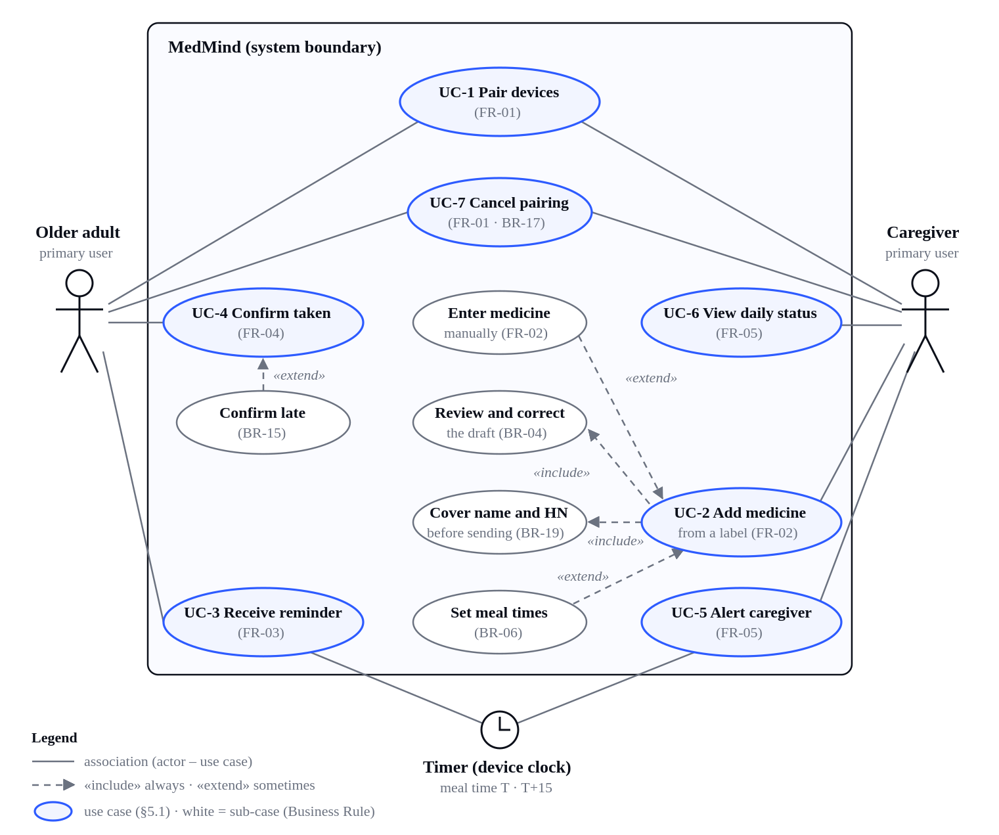

🌐 **ภาษา / Language:** [English](spec.md) · ไทย

# ข้อกำหนดความต้องการซอฟต์แวร์ (SRS) — ฉบับแปลภาษาไทย

> **ฉบับแปลภาษาไทยเพื่อความเข้าใจของทีม** — ฉบับที่ส่งอาจารย์คือภาษาอังกฤษ ([`M2-SRS_MedMind.pdf`](M2-SRS_MedMind.pdf), [`spec.md`](spec.md)) ถ้าสองฉบับขัดกัน **ให้ยึดฉบับอังกฤษ** · แก้ requirement ที่ฉบับอังกฤษ (Word → PDF → `spec.md`) ก่อนเสมอ แล้วจึงคัดมาอัปเดตฉบับนี้ · เลข FR / BR / NFR / AC ต้องเหมือนฉบับอังกฤษทุกจุด · แปลด้วย AI (บันทึกใน `docs/AI_USAGE_LOG.md`) ทีมต้องอ่านตรวจ

**MedMind — ระบบเตือนกินยาและแจ้งสถานะการกินยาให้ผู้ดูแลผู้สูงอายุ**

Introduction to Software Engineering (15031001) · Milestone 2 · Requirements & Specification

### คำศัพท์ที่ใช้ในฉบับแปล (ให้ตรงกันทั้งทีม)
| English | ไทย |
|---|---|
| older adult / senior | ผู้สูงอายุ |
| caregiver | ผู้ดูแล |
| meal (medication meal) | มื้อยา |
| reminder / repeat reminder | การเตือน / เตือนซ้ำ |
| confirm / late confirmation | ยืนยัน / ยืนยันย้อนหลัง |
| paired / pair / unpair | จับคู่ / คู่ / ยกเลิกจับคู่ |
| draft | ร่าง (รายการยาที่ AI อ่านได้ ยังไม่บันทึก) |
| "Taken" / "Not yet" (ปุ่ม) | "กินแล้ว" / "ยังไม่กิน" |
| "Medicine not yet confirmed" (ข้อความถึงผู้ดูแล) | "ยังไม่ยืนยันการกินยา" — **ห้ามใช้ "ไม่ได้กิน"** |
| "Medicine confirmed at HH:MM" | "ยืนยันการกินยาแล้ว เวลา HH:MM" |
| "Taken (late confirmation)" / "Not yet confirmed" / "Not due yet" | "กินแล้ว (ยืนยันย้อนหลัง)" / "ยังไม่ยืนยัน" / "ยังไม่ถึงเวลา" |
| "No medication meals today" | "วันนี้ไม่มีมื้อยา" |
| "Please check" | "โปรดตรวจสอบ" |
| "Create new code" | "สร้างรหัสใหม่" |
| "Name and HN are covered" | "ปิดชื่อและ HN แล้ว" |

ข้อความบนหน้าจอที่ระบุในเอกสารนี้เป็นข้อความภาษาไทยตามตารางข้างบน ส่วนฉบับอังกฤษคือข้อความภาษาอังกฤษของข้อความเดียวกัน

## ข้อมูลเอกสาร
| หัวข้อ | ค่า |
|---|---|
| ชื่อทีม | MedMind |
| ชื่อโครงงาน | MedMind — ระบบเตือนกินยาและแจ้งสถานะการกินยาให้ผู้ดูแลผู้สูงอายุ |
| SDLC ที่เลือกใน M1 + เหตุผล | Incremental — Increment 1 สร้างวงจรหลัก (เตือน → ยืนยัน → แจ้งผู้ดูแล, FR-03–05) บนข้อมูลจริงที่แชร์กัน โดยใช้คู่ทดสอบและยาทดสอบที่ทีมตั้งไว้; Increment 2 เพิ่มการจับคู่และการอ่านฉลาก (FR-01, FR-02) เพราะความแม่นยำในการอ่านฉลากภาษาไทยเป็นสิ่งที่ยังไม่รู้มากที่สุด และต้องไม่ทำให้วงจรหลักติดขัด |
| วันที่ / เวอร์ชัน | v1.2 · 31 ตุลาคม 2569 |
| GitHub repo | https://github.com/yaroo393-png/MedMind |

**ประวัติเอกสาร (Document history)**

| เวอร์ชัน | วันที่ | อะไรเปลี่ยนและเพราะอะไร |
|---|---|---|
| v1.0 | 30 ต.ค. 2569 | เริ่ม SRS ใหม่สำหรับ repo ใหม่ของทีม: ตัดลิงก์ repo เดิม เดโม และผลทดสอบเก่าออก; เติมช่องโหว่ (เงื่อนไขเสียงดังหลังแตะครั้งแรก, การเปิดหน้ากลับ BR-18, ความแม่นยำการอ่านฉลาก NFR-11, ตัววัดความสำเร็จ, ข้อนอกขอบเขต 2 ข้อ); จัดรูปแบบตามแม่แบบอาจารย์ |
| v1.1 | 30 ต.ค. 2569 | อธิบายระบบที่ทำงานจริงแทนต้นแบบที่คลิกได้: ฐานข้อมูลออนไลน์ที่แชร์กันบนแพ็กฟรี, การยืนยันตอนออฟไลน์ (FR-04 ข้อ 7), NFR-12 และ NFR-13; แก้จากการตรวจทาน — ผู้ดูแลได้รับแจ้งเฉพาะตอน MedMind เปิดอยู่ (NFR-01, BR-18), การยืนยันออฟไลน์ที่มาถึงช้า (BR-13), ไม่มีบัญชีและรหัสผ่าน |
| v1.2 | 31 ต.ค. 2569 | อ่านฉลากด้วยบริการ AI ภายนอกหลังผู้ดูแลปิดชื่อ HN และข้อมูลส่วนตัวอื่น (FR-02, BR-19, NFR-14) — รายวิชาต้องการฟีเจอร์ AI; เพิ่ม FR-09 AI สรุปรายสัปดาห์เป็น Could; วาด use case diagram ใหม่ให้มี "Cover name and HN"; ลิงก์ repo; ตารางประวัตินี้; ปรับปรุงบันทึกการใช้ AI |

## 1. บทนำ

### 1.1 วัตถุประสงค์และขอบเขต
ผู้สูงอายุที่ต้องกินยาประจำอาจลืมกิน กินผิดเวลา หรือจำไม่ได้ว่ากินแล้วหรือยัง ขณะที่ลูกออกไปทำงานและตามดูทั้งวันไม่ได้ วิธีที่ใช้อยู่ — นาฬิกาปลุก กล่องยา โทรศัพท์ และ LINE — ยืนยันสถานะการกินยาและรายงานให้ผู้ดูแลโดยอัตโนมัติไม่ได้

MedMind ตอบ 2 คำถาม: "มื้อนี้ต้องกินยาอะไร และกินแล้วหรือยัง" (ผู้สูงอายุ) และ "ยาทุกมื้อวันนี้ถูกกินครบหรือยัง โดยไม่ต้องโทรถาม" (ผู้ดูแล) ระบบจับคู่ผู้สูงอายุกับผู้ดูแล ใช้ AI อ่านฉลากยาเป็นร่างที่ผู้ดูแลตรวจก่อนบันทึก เตือนผู้สูงอายุทุกมื้อยา ให้ยืนยันทั้งมื้อด้วยการกดครั้งเดียว และแจ้งผู้ดูแลเมื่อมื้อใดยังไม่ยืนยันหลังเตือนสามรอบ MVP มี 5 FR ความสำเร็จหมายถึงผู้ดูแลไม่ต้องโทรหรือส่ง LINE ถามทุกมื้อยา (ผู้ให้สัมภาษณ์ 2): ถูกติดต่อเฉพาะมื้อที่ยังไม่ยืนยัน และทุกมื้อที่ไม่ยืนยันภายใน T+15 ถึงผู้ดูแลเป็นการแจ้งเตือน — ทันทีที่ MedMind เปิดอยู่บนมือถือผู้ดูแล ไม่เช่นนั้นเมื่อเปิดแอปครั้งถัดไป (NFR-01, BR-18)

### 1.2 ผู้ใช้และผู้มีส่วนได้ส่วนเสีย
| ชื่อ / บทบาท | ชนิด | สิ่งที่ต้องการ | สิ่งที่กลัว / ห้าม |
|---|---|---|---|
| ผู้สูงอายุ | ผู้ใช้หลัก | เสียงเตือน ตัวอักษรใหญ่ ปุ่มใหญ่ แตะน้อย; ลูกตั้งค่าให้ (ผู้ให้สัมภาษณ์ 1, 3) | ต้องสมัครและกรอกข้อมูลเอง (ผู้ให้สัมภาษณ์ 3) |
| ลูก / ผู้ดูแล | ผู้ใช้หลัก | แจ้งเตือนเฉพาะเมื่อมื้อยังไม่ยืนยัน; ถ่ายฉลากแล้วให้ระบบกรอกรายละเอียดให้ (ผู้ให้สัมภาษณ์ 2) | ต้องคอยตรวจทุกมื้อ; รายละเอียดยาผิดจากตัวอ่านฉลาก |
| เภสัชกร / โรงพยาบาล (ผู้ออกฉลาก) | ผู้มีส่วนได้ส่วนเสียรอง (เป็นผู้กำหนดกฎ) | คำสั่งบนฉลากถูกแปลงเป็นเวลาเตือนตรงตามที่เขียน | ระบบตีความ เปลี่ยน หรือแนะนำวิธีกินยา (§6) |
| ตัวอ่านฉลากด้วย AI (บริการภายนอกแบบฟรี) | ระบบภายนอก | ภาพฉลากที่ชัดและปิดชื่อ HN ของผู้ป่วยแล้ว | ได้รับชื่อ HN หรือข้อมูลส่วนบุคคลอื่นซึ่งเงื่อนไขแบบฟรีห้ามไว้ (BR-19, NFR-14); ระบบล่มหรือใช้ครบขีดจำกัดรายวัน — การกรอกเองต้องยังใช้ได้ (FR-02 ข้อ 5) |
| ฐานข้อมูลออนไลน์ (แพ็กฟรี) | ระบบภายนอก | การใช้งานอยู่ในโควตารายวันที่ใช้ฟรี (NFR-13) | ระบบล่ม — การยืนยันจะรออยู่บนมือถือแล้วส่งเมื่อกลับมาเชื่อมต่อ (FR-04 ข้อ 7) |

## 2. ภาพรวม

### 2.1 บริบทผลิตภัณฑ์ — ทำอะไร / ไม่ทำอะไร
MedMind จับคู่ผู้สูงอายุ 1 คนกับผู้ดูแล 1 คน แปลงรายละเอียดยาที่ผู้ดูแลตรวจแล้วเป็นมื้อยา และติดตามว่าแต่ละมื้อถูกยืนยันหรือไม่ ทุกอย่างด้านล่างคือ MVP ทั้งหมดของเทอมนี้ — ไม่มีอย่างอื่นแฝงอยู่

| อยู่ในขอบเขต (MVP เทอมนี้) | นอกขอบเขต (คำมั่นสัญญาที่ชัดเจน) |
|---|---|
| • FR-01 จับคู่ผู้สูงอายุกับผู้ดูแล (QR / รหัสเชิญ) | • การอ่านลายมือแพทย์ |
| • FR-02 สแกนฉลาก → ร่าง → ผู้ดูแลตรวจ → บันทึก | • การบันทึกผลที่อ่านจากฉลากโดยไม่ตรวจ |
| • FR-03 เตือนทุกมื้อ + เตือนซ้ำ | • การวินิจฉัยด้วย AI คำแนะนำเรื่องยา หรือคำแนะนำการชดเชยยาที่พลาด |
| • FR-04 ยืนยันทั้งมื้อ | • ระบบเพิ่ม ลด หรือเปลี่ยนวิธีกินยา |
| • FR-05 แจ้งผู้ดูแล + สถานะรายวัน | • การเตือนหรือแจ้งผู้ดูแลตอนปิดหน้าเว็บหรือล็อกจอ |
| | • ยาที่กินเมื่อมีอาการ ยาน้ำ และยาครึ่งเม็ด |
| | • ฟีเจอร์หลัง MVP (Should / Could): ดู §3 |

### 2.2 สมมติฐานและข้อจำกัด
- ข้อจำกัด: การกดยืนยันเป็นการรายงานด้วยตนเอง ไม่ใช่หลักฐานว่ากินยาจริง
- ข้อจำกัด: ผลที่อ่านจากฉลากทุกครั้งต้องได้รับการตรวจโดยผู้ดูแลก่อนบันทึก
- ข้อจำกัด: MVP รองรับเฉพาะยาเม็ดและแคปซูลที่กินเวลาตายตัว
- ข้อจำกัด: MedMind สร้างเป็นเว็บแอปที่ทำงานจริง ไม่ใช่ต้นแบบหลอก: การจับคู่ การเตือน การยืนยัน และการแจ้งผู้ดูแลทำงานจริงระหว่างมือถือผู้สูงอายุและมือถือผู้ดูแล ผ่านฐานข้อมูลออนไลน์บนแพ็กฟรี — ไม่มีบริการเสียเงินและไม่ต้องใช้บัตรเครดิต
- ข้อจำกัด: ระบบไม่มี server code ของตัวเอง แต่ละมือถือคำนวณการเตือนและการแจ้งผู้ดูแลจากข้อมูลที่แชร์กัน ดังนั้นผู้สูงอายุจะถูกเตือน และผู้ดูแลจะถูกแจ้ง เฉพาะตอน MedMind เปิดอยู่; เมื่อปิดหน้าเว็บหรือล็อกจอจะไม่มีการแจ้ง สิ่งที่เกิดเมื่อเปิดหน้ากลับกำหนดโดย BR-18
- ข้อจำกัด: ทั้งสองฝ่ายไม่มีรหัสผ่านและไม่ต้องสร้างบัญชี แต่ละมือถือถูกระบุตัวโดยอัตโนมัติเมื่อเปิด MedMind ครั้งแรก ถ้าข้อมูลเบราว์เซอร์ของมือถือเครื่องนั้นถูกล้าง เครื่องนั้นต้องจับคู่ใหม่
- ข้อจำกัด: ทั้งสองมือถือต้องมีอินเทอร์เน็ตเพื่อแชร์สถานะ; การยืนยันที่ทำตอนออฟไลน์จะเก็บไว้บนมือถือและส่งเมื่อกลับมาออนไลน์ (FR-04 ข้อ 7)
- ข้อจำกัด: การอ่านฉลากใช้บริการ AI ภายนอกแบบฟรี ก่อนส่งรูป ผู้ดูแลต้องปิดชื่อ HN บาร์โค้ด/QR และข้อมูลส่วนตัวอื่นบนมือถือ ส่งเฉพาะสำเนาที่ปิดแล้ว และ MedMind ไม่เก็บรูปใด ๆ (BR-19, NFR-09, NFR-14)
- ข้อจำกัด: AI แค่ร่าง ไม่เคยกำหนดเวลาเตือน ไม่ให้คำแนะนำเรื่องยา และไม่บันทึกอะไรเอง — ระบบคำนวณเวลาเตือนจากข้อความบนฉลาก (BR-06) และผู้ดูแลตรวจทุกร่าง (BR-04)
- ข้อจำกัด: บริการ AI แบบฟรีจำกัดจำนวนคำขอต่อนาทีและต่อวัน; เมื่อถึงขีดจำกัด มือถือออฟไลน์ หรือบริการล่ม ให้ใช้การกรอกเอง (FR-02 ข้อ 5)
- ข้อจำกัด: ในแบบฟรี ผู้ให้บริการ AI อาจนำสิ่งที่ส่งไปปรับปรุงผลิตภัณฑ์และเจ้าหน้าที่อาจตรวจดู และเงื่อนไขระบุว่าห้ามส่งข้อมูลอ่อนไหวหรือข้อมูลส่วนบุคคล MedMind จึงส่งเฉพาะภาพที่ปิดแล้วซึ่งไม่มีชื่อ HN บาร์โค้ด หรือข้อมูลส่วนตัวอื่น และหน้ายินยอมต้องบอกข้อนี้ก่อนส่งรูปครั้งแรก (BR-19)
- ข้อจำกัด: เบราว์เซอร์เล่นเสียงได้หลังผู้ใช้แตะหน้าเว็บอย่างน้อยหนึ่งครั้งหลังเปิดหน้า ดังนั้นเสียงเตือนจะดังหลังการแตะครั้งแรกเท่านั้น
- ข้อจำกัด: การสแกน QR หรือถ่ายฉลากต้องได้รับสิทธิ์กล้อง; ถ้าไม่ได้ ให้ใช้รหัสเชิญ 6 หลักหรือกรอกเอง (FR-02 ข้อ 5)
- ข้อจำกัด: ใน MVP ผู้สูงอายุ 1 คนมีผู้ดูแล 1 คน (หลายผู้ดูแลเป็น Should)
- ข้อจำกัด: เวลาเตือนมาจากคำสั่งบนฉลากเท่านั้น ระบบไม่เดาเวลา
- สมมติฐาน: ผู้สูงอายุและผู้ดูแลมีสมาร์ตโฟนที่เปิดเว็บแอปได้และเปิดค้างไว้ในช่วงเวลากินยา — ยังไม่ได้ยืนยันกับผู้ใช้
- สมมติฐาน: ทั้งสองมือถือตั้งนาฬิกาอัตโนมัติจากเครือข่าย เวลามื้อจึงตรงกันทั้งสองฝั่ง
- สมมติฐาน: ผู้ดูแลเป็นผู้ตั้งค่าหลักทั้งหมด (ผู้ให้สัมภาษณ์ 3)

## 3. ความต้องการเชิงหน้าที่ (FR)
รูปแบบ: As a \<บทบาท\>, I want \<เป้าหมาย\>, so that \<ประโยชน์\> (ฉบับอังกฤษเขียน user story ตามรูปแบบนี้ ฉบับแปลใช้ "ในฐานะ … ฉันต้องการ … เพื่อที่ …") ทุก story สืบกลับไปที่ problem statement และสิ่งที่ผู้ให้สัมภาษณ์พูด และทุกเกณฑ์การยอมรับ (AC) ครอบคลุมทางที่ถูกหรือทางผิด/กรณีขอบที่เทสต์ตรวจได้จริง เขียนแบบ Given–When–Then (คงคำว่า Given / When / Then ไว้) กฎธุรกิจ BR-01 ถึง BR-19 อยู่ในภาคผนวก A

**สรุปความสำคัญ (MoSCoW)**

| ID | ความต้องการ | Priority | ทำไมจึงมีความสำคัญนี้ |
|---|---|---|---|
| FR-01 | จับคู่ผู้สูงอายุกับผู้ดูแลด้วย QR / รหัสเชิญ | Must | ตอบคำถามที่ 2 |
| FR-02 | สแกนฉลากและสร้างบันทึกยา | Must | ตอบคำถามที่ 1 |
| FR-03 | เตือนทุกมื้อ + เตือนซ้ำ | Must | ตอบคำถามที่ 1 — หัวใจของ MVP |
| FR-04 | ยืนยันทั้งมื้อด้วยการกดครั้งเดียว | Must | ตอบคำถามที่ 1 และ 2 |
| FR-05 | แจ้งผู้ดูแล + สถานะรายวัน | Must | ตอบคำถามที่ 2 |
| FR-06 | หลายผู้ดูแลต่อผู้สูงอายุหนึ่งคน | Should | MVP รองรับผู้ดูแลหนึ่งคน |
| FR-07 | รายการยาทั้งหมดของผู้สูงอายุ | Could | หน้าเตือน (FR-03) แสดงยาของมื้อนั้นอยู่แล้ว |
| FR-08 | รูปยาบนหน้าเตือน | Could | ผู้ให้สัมภาษณ์ 1 ขอรูป; MVP ใช้เสียงเตือนอย่างเดียว |

รายวิชากำหนด Must ใน MVP ไว้ 3–5 ข้อ; เราเลือก 5 เพื่อให้ตอบทั้งสองคำถามใน §1.1 ได้ครบกระบวนการ FR-06 ถึง FR-09 รอหลัง MVP ได้ และระบบยังตอบทั้งสองคำถามได้ ส่วนที่จะไม่ทำ: ดู §6

### FR-01 — จับคู่ผู้สูงอายุกับผู้ดูแล [Must]
*User story: ในฐานะผู้ดูแล ฉันต้องการจับคู่กับมือถือของพ่อแม่ด้วยการสแกน QR หรือกรอกรหัสเชิญ เพื่อที่ฉันจะตั้งค่ายาและรับสถานะได้ โดยพ่อแม่ไม่ต้องสร้างบัญชี*

ปัญหาที่เชื่อมโยง: ผู้ดูแลไม่ได้อยู่ด้วยและต้องโทรถาม; ผู้สูงอายุสมัครบัญชียาก (ผู้ให้สัมภาษณ์ 3)

คำนิยาม: รหัสเชิญ (QR + 6 หลัก) ใช้ได้ครั้งเดียวและหมดอายุใน 10 นาที; ผู้สูงอายุกด "สร้างรหัสใหม่" ได้ ผู้สูงอายุต้องกดยินยอมก่อนจับคู่; ไม่ต้องมีบัญชีหรือรหัสผ่านทั้งสองฝ่าย หน้ายินยอมระบุ (1) ผู้ดูแลจะเห็นอะไร: ยา เวลามื้อ และสถานะการยืนยัน (2) ทำไม: เพื่อแจ้งผู้ดูแลเมื่อมื้อยังไม่ยืนยัน (3) ฝ่ายใดยกเลิกจับคู่ได้ทุกเมื่อ และข้อมูลของคู่นั้นจะถูกลบ (BR-17) ใน MVP ผู้สูงอายุมีผู้ดูแลได้ 1 คน ฝ่ายใดยกเลิกจับคู่ได้ (ต้องยืนยันซ้ำอีกครั้ง); ผู้ดูแลจะเสียสิทธิ์เข้าถึงทันที และยาและประวัติการยืนยันของคู่นั้นจะถูกลบ (สิทธิในการลบข้อมูลตาม PDPA)

1. Given ผู้สูงอายุเปิดแอปครั้งแรก, when หน้าเริ่มต้นปรากฏ, then แสดง QR และรหัสเชิญโดยไม่ต้องสมัครหรือพิมพ์ และก่อนยินยอม ผู้สูงอายุเห็นว่าข้อมูลอะไรจะถูกแชร์ ทำไม และยกเลิกได้ทุกเมื่อ
2. **ทางผิด.** Given ผู้สูงอายุยังไม่ได้กดยินยอม, when ผู้ดูแลพยายามจับคู่, then การจับคู่ล้มเหลวและบอกผู้ดูแลว่ากำลังรอการยินยอม
3. Given ผู้สูงอายุยินยอมแล้ว, when ผู้ดูแลสแกนหรือกรอกรหัสที่ถูกต้อง, then ทั้งสองหน้าจอแสดงว่าเชื่อมต่อแล้ว
4. **ทางผิด.** Given รหัสผิด เกิน 10 นาที หรือถูกใช้แล้ว, when ผู้ดูแลกรอก, then ถูกปฏิเสธพร้อมข้อความชัดเจนและไม่เกิดการเชื่อมต่อ
5. **ทางผิด.** Given ผู้สูงอายุมีผู้ดูแลแล้ว, when ผู้ดูแลคนที่สองสแกนหรือกรอกรหัส, then ถูกปฏิเสธด้วยข้อความ "ผู้สูงอายุคนนี้มีผู้ดูแลแล้ว" (This older adult already has a caregiver) และไม่เกิดการเชื่อมต่อ
6. **ทางผิด.** Given ผู้สูงอายุและผู้ดูแลที่จับคู่กันอยู่, when ฝ่ายใดยกเลิกจับคู่และยืนยัน, then ผู้ดูแลเข้าถึงข้อมูลของผู้สูงอายุไม่ได้ทันที ยาและประวัติการยืนยันของคู่นั้นถูกลบ และผู้สูงอายุเห็น QR ใหม่

### FR-02 — สแกนฉลากยาและสร้างบันทึกยา [Must]
*User story: ในฐานะผู้ดูแล ฉันต้องการถ่ายฉลากยาแล้วได้ร่างที่ AI กรอกให้ซึ่งฉันตรวจและแก้ได้ เพื่อที่ฉันไม่ต้องพิมพ์ยาทุกตัวเอง และยังคุมได้ว่าอะไรถูกบันทึก*

ปัญหาที่เชื่อมโยง: ผู้ดูแลอยากถ่ายฉลากแล้วให้ระบบกรอกให้ (ผู้ให้สัมภาษณ์ 2); ผู้สูงอายุอยากให้ลูกตั้งค่าให้ (ผู้ให้สัมภาษณ์ 3)

คำนิยาม: เฉพาะผู้ดูแลเพิ่มหรือแก้ยาได้ ช่องบังคับคือชื่อยา จำนวนเม็ดต่อครั้ง และมื้อ/เวลา; คำเตือนและข้อห้ามบันทึกเฉพาะเมื่อฉลากมี เวลาเตือนตามฉลากเท่านั้น: หลังอาหาร = เวลามื้อ; ก่อนอาหาร N นาที = เวลามื้อ − N; ก่อนนอน = เวลาก่อนนอน (ตัวอย่างใน BR-06) ผู้ดูแลตั้งเวลาเช้า กลางวัน เย็น และก่อนนอนตอนเพิ่มยาตัวแรก ยาที่เวลาเตือนเดียวกันถูกจัดเป็นมื้อเดียว ก่อนส่งรูป ผู้ดูแลปิดชื่อ HN บาร์โค้ด/QR และข้อมูลส่วนตัวอื่น (ที่อยู่ เบอร์โทร วันเกิด) โดยลากกรอบบนรูป ดูภาพที่จะถูกส่งจริง และติ๊ก "ปิดชื่อและ HN แล้ว" (BR-19) AI คืนเฉพาะช่องข้อมูลยาของ BR-05 โดยไม่มีช่องสำหรับชื่อหรือ HN

1. Given ภาพฉลากที่ชัดซึ่งปิดชื่อและ HN แล้ว, when ผู้ดูแลส่งให้ AI, then แสดงร่าง (ชื่อยา จำนวนเม็ดต่อครั้ง มื้อ/เวลา คำเตือน ข้อห้าม) และยังไม่บันทึกอะไร
2. Given ผู้ดูแลแก้ช่องในร่าง, when กดบันทึก, then ค่าที่แก้ถูกบันทึก ไม่ใช่ค่าที่อ่านจากรูป
3. **ทางผิด.** Given อ่านช่องใดไม่ได้ หรือฉลากเขียนว่า "ก่อนอาหาร" โดยไม่มีจำนวนนาที, when แสดงร่าง, then ช่องนั้นว่างและมีป้าย "โปรดตรวจสอบ" (ไม่เดาเด็ดขาด) และบันทึกไม่ได้จนกว่าช่องบังคับทุกช่องจะถูกกรอก
4. **ทางผิด.** Given ฉลากของยาที่กินเฉพาะเมื่อมีอาการ, when แสดงร่าง, then ระบบแจ้ง "ยังไม่รองรับยาที่กินเมื่อมีอาการ" และไม่สร้างตารางเวลา
5. **ทางผิด.** Given อ่านรูปไม่ได้ หรือบริการ AI ใช้ไม่ได้ (ออฟไลน์ ระบบล่ม หรือถึงขีดจำกัดรายวัน), when ผู้ดูแลส่งรูป, then ระบบบอกเหตุผลและเปิดฟอร์มเปล่าให้กรอกเอง
6. **ทางผิด.** Given ผู้ดูแลอยู่ที่หน้าร่าง, when กดยกเลิก, then ไม่บันทึกอะไร
7. Given ฉลากเขียน "30 นาทีก่อนอาหารเช้า" และตั้งมื้อเช้าไว้ 07:00, when บันทึกยา, then เวลาเตือนคือ 06:30
8. **ทางผิด.** Given ผู้ดูแลยังไม่ได้ติ๊ก "ปิดชื่อและ HN แล้ว", when พยายามส่งรูป, then ไม่ส่งอะไร และปุ่ม "ส่งให้ AI" ยังกดไม่ได้
9. Given ผู้ดูแลปิดชื่อและ HN แล้วและติ๊กยืนยัน, when กด "ส่งให้ AI", then เฉพาะสำเนาที่ปิดแล้วออกจากมือถือ โดยไม่มีข้อมูลในไฟล์ภาพ (metadata) และไม่เก็บรูปต้นฉบับไว้

### FR-03 — เตือนทุกมื้อ [Must]
*User story: ในฐานะผู้สูงอายุ ฉันต้องการการเตือนทุกมื้อที่แสดงยาทั้งหมดของมื้อนั้นบนหน้าจอเดียว และให้เตือนซ้ำถ้าฉันยังไม่ยืนยัน เพื่อที่ฉันจะไม่ลืมหรือกินยาสลับกัน*

ปัญหาที่เชื่อมโยง: ลืมกินหรือกินช้า (problem statement); ปิดนาฬิกาปลุกแล้วลืม (ผู้ให้สัมภาษณ์ 1)

คำนิยาม — ไทม์ไลน์การเตือน ใช้ร่วมกับ FR-04 และ FR-05 (T = เวลาเตือนของมื้อ):

| เวลา | เกิดอะไรขึ้น (เฉพาะขณะมื้อยังไม่ยืนยัน) |
|---|---|
| T | เตือนครั้งแรก พร้อม "กินแล้ว" / "ยังไม่กิน" |
| T+5 | เตือนซ้ำครั้งที่ 1 |
| T+10 | เตือนซ้ำครั้งที่ 2 — รอบสุดท้าย; "ยังไม่กิน" จะแจ้งผู้ดูแลทันที |
| T+15 | แจ้งผู้ดูแลว่า "ยังไม่ยืนยันการกินยา" (ถ้ายังไม่ได้แจ้งที่ T+10) |
| หลัง T+15 | ยืนยันย้อนหลังได้จนถึงเวลาเตือนของมื้อถัดไปที่เริ่มหลัง T+15 (ไม่มี = 23:59); จากนั้นแจ้งผู้ดูแลว่า "ยืนยันการกินยาแล้ว" |

การเตือนซ้ำอยู่ที่เวลาตายตัวนับจาก T และเฉพาะขณะมื้อยังไม่ยืนยัน หน้าเตือนแสดงยาทุกตัวในมื้อ (ชื่อ จำนวนเม็ด คำเตือน ข้อห้าม) ปุ่มเขียว "กินแล้ว" และปุ่มแดง "ยังไม่กิน" และเล่นเสียงทุกรอบขณะ MedMind เปิดอยู่และถูกแตะหนึ่งครั้งหลังเปิดหน้า; ไม่แสดงรูปยา การแจ้งผู้ดูแลส่งครั้งเดียวต่อมื้อ และไม่ใช้คำว่า "ไม่ได้กิน" มื้อที่เวลาซ้อนกัน (เช่น 06:45 ก่อนอาหารเช้ากับ 07:00 หลังอาหารเช้า) แต่ละมื้อมีการเตือน การแจ้งผู้ดูแล และช่วงยืนยันย้อนหลังเป็นของตัวเอง; หน้าจอแสดงทุกมื้อที่ยังไม่ยืนยันเรียงตามเวลาใต้หัวข้อแยก แต่ละมื้อมีปุ่มของตัวเอง และการเตือนที่ถึงเวลาพร้อมกันจะดังเสียงครั้งเดียว เมื่อเปิดหน้าเว็บกลับ ใช้ BR-18

1. Given มื้อ 08:00 ที่มียาสองตัว, MedMind เปิดอยู่บนมือถือผู้สูงอายุ และแตะหน้าอย่างน้อยหนึ่งครั้งหลังเปิดหน้า, when ถึง 08:00, then เสียงเตือนดัง และยาทั้งสองตัว (ชื่อ จำนวนเม็ด คำเตือน ข้อห้าม) แสดงบนหน้าเดียวพร้อมปุ่ม "กินแล้ว" / "ยังไม่กิน" และไม่มีรูปยา
2. **ทางผิด.** Given มื้อยังไม่ยืนยัน, when ถึง 08:05 และ 08:10, then มีการเตือนซ้ำครั้งที่ 1 และ 2 พร้อมเสียงทั้งสองครั้ง
3. Given มื้อยืนยันแล้ว, when ถึงเวลาเตือนซ้ำถัดไป, then ไม่มีการเตือน
4. **ทางผิด.** Given มื้อ A เวลา 06:45 (15 นาทีก่อนอาหารเช้า) ยังไม่ยืนยัน และมื้อ B เวลา 07:00, when ถึง 07:00, then หน้าเตือนแสดงทั้งสองมื้อเรียงตามเวลาใต้หัวข้อแยก มีปุ่มแยก และเสียงครั้งเดียว และผู้ดูแลถูกแจ้งเรื่องมื้อ A ที่ 07:00 ตามไทม์ไลน์ของมื้อ A เอง
5. **ทางผิด.** Given ปิดหน้าเว็บตอน 08:00 และมื้อยังไม่ยืนยัน, when ผู้สูงอายุเปิด MedMind ตอน 08:07, then หน้าเตือนแสดงมื้อนั้นทันที รอบ 08:00 และ 08:05 ไม่ถูกเล่นซ้ำ และรอบ 08:10 ยังเกิดขึ้น

### FR-04 — ยืนยันทั้งมื้อ [Must]
*User story: ในฐานะผู้สูงอายุ ฉันต้องการยืนยันทั้งมื้อด้วยการกดครั้งเดียว เพื่อที่ฉันไม่ต้องยืนยันทีละเม็ด และครอบครัวรู้ว่าฉันรายงานว่ากินแล้ว*

ปัญหาที่เชื่อมโยง: จำไม่ได้ว่ากินยาแล้วหรือยัง (problem statement); อยากมีวิธีง่าย ๆ บอกลูก (ผู้ให้สัมภาษณ์ 1); ปุ่มใหญ่และแตะน้อย (ผู้ให้สัมภาษณ์ 3)

คำนิยาม: ผู้สูงอายุยืนยันที่หน้าเตือน (FR-03) หรือที่หน้าหลัก ซึ่งแสดงมื้อของวันนี้พร้อมสถานะ และปุ่ม "กินแล้ว" สำหรับมื้อที่ยังอยู่ในช่วงยืนยันย้อนหลัง

1. Given หน้าเตือนมื้อ 08:00 กำลังแสดง, when ผู้สูงอายุกด "กินแล้ว" ตอน 08:03, then สถานะเป็น "กินแล้ว" บันทึกเวลา 08:03 และการเตือนของมื้อนั้นหยุด
2. **ทางผิด.** Given มื้อยืนยันแล้ว, when กด "กินแล้ว" ซ้ำ, then ไม่เกิดบันทึกซ้ำ
3. Given เตือนครั้งแรก 08:00, when ผู้สูงอายุกด "ยังไม่กิน", then ถูกเตือนอีกครั้งตอน 08:05
4. **ทางผิด.** Given เตือนรอบสุดท้าย 08:10, when ผู้สูงอายุกด "ยังไม่กิน", then ผู้ดูแลถูกแจ้งทันที (ไม่รอ 08:15)
5. Given มื้อยังไม่ยืนยันถึง 08:15, when ผู้สูงอายุกด "กินแล้ว" ที่หน้าหลักตอน 08:40, then สถานะเป็น "กินแล้ว (ยืนยันย้อนหลัง)" เวลา 08:40
6. **ทางผิด.** Given เวลาเตือนของมื้อถัดไป (12:00) ผ่านไปแล้ว, when ผู้สูงอายุพยายามยืนยันมื้อ 08:00, then ยืนยันไม่ได้และสถานะยังเป็น "ยังไม่ยืนยัน"
7. **ทางผิด.** Given มือถือผู้สูงอายุออฟไลน์, when กด "กินแล้ว" ตอน 08:03, then หน้าจอของผู้สูงอายุแสดง "กินแล้ว" ทันที และการยืนยันถึงผู้ดูแลพร้อมเวลา 08:03 ภายใน 10 วินาทีหลังกลับมาออนไลน์

### FR-05 — แจ้งผู้ดูแลและสถานะรายวัน [Must]
*User story: ในฐานะผู้ดูแล ฉันต้องการได้รับแจ้งเฉพาะเมื่อมื้อยังไม่ยืนยันหลังการเตือน และเห็นสถานะของทุกมื้อวันนี้ในที่เดียว เพื่อที่ฉันไม่ต้องโทรหรือส่งข้อความถามทุกมื้อ*

ปัญหาที่เชื่อมโยง: ต้องโทรหรือส่ง LINE ทุกมื้อ ไม่มีที่เดียวที่แสดงสถานะ (problem statement); อยากได้แจ้งเตือนเฉพาะเมื่อมื้อยังไม่ยืนยัน (ผู้ให้สัมภาษณ์ 2)

1. Given ผู้สูงอายุยืนยันตอน 08:12, when ถึง 08:15, then ผู้ดูแลไม่ถูกแจ้ง
2. **ทางผิด.** Given ไม่มีการยืนยัน, when ถึง 08:15, then ผู้ดูแลถูกแจ้งว่า "ยังไม่ยืนยันการกินยา" (ไม่ใช่ "ไม่ได้กิน")
3. Given มีหลายมื้อในวัน, when ผู้ดูแลเปิดหน้าสถานะ, then ทุกมื้อของวันแสดงเป็น "กินแล้ว" + เวลา, "กินแล้ว (ยืนยันย้อนหลัง)" + เวลา, "ยังไม่ยืนยัน" หรือ "ยังไม่ถึงเวลา"
4. **ทางผิด.** Given วันนี้ไม่มีมื้อยา, when ผู้ดูแลเปิดหน้าสถานะ, then แสดง "วันนี้ไม่มีมื้อยา"
5. Given ผู้สูงอายุกด "ยังไม่กิน" ในรอบ 08:10 (ผู้ดูแลถูกแจ้งไปแล้ว), when ถึง 08:15, then ผู้ดูแลไม่ถูกแจ้งซ้ำ
6. Given ผู้ดูแลถูกแจ้งว่า "ยังไม่ยืนยันการกินยา", when ผู้สูงอายุยืนยันย้อนหลังตอน 08:40, then ผู้ดูแลได้รับ "ยืนยันการกินยาแล้ว เวลา 08:40"
7. **ทางผิด.** Given หน้าเว็บของผู้ดูแลปิดอยู่ตอน 08:15 ขณะมื้อยังไม่ยืนยัน, when ผู้ดูแลเปิด MedMind ตอน 09:00, then แสดงการแจ้งที่ยังไม่ได้เห็น และสถานะมื้อเป็น "ยังไม่ยืนยัน" (หรือ "กินแล้ว (ยืนยันย้อนหลัง)" + เวลา ถ้ายืนยันไปแล้วในระหว่างนั้น)

### ความต้องการ Should และ Could
กำหนดในระดับ story ในรอบนี้ เกณฑ์การยอมรับเต็มจะเขียนเมื่อย้ายเข้า increment

| ID | Priority | User story |
|---|---|---|
| FR-06 | Should | ในฐานะผู้ดูแลที่ดูแลร่วมกับพี่น้อง ฉันต้องการให้ผู้ดูแลมากกว่าหนึ่งคนจับคู่กับผู้สูงอายุคนเดียวกัน เพื่อที่ใครว่างตอนนั้นจะดูสถานะและตามได้ |
| FR-07 | Could | ในฐานะผู้สูงอายุ ฉันต้องการเห็นยาและเวลาของทั้งวัน เพื่อที่ฉันรู้ว่าวันนี้กินอะไรโดยไม่ต้องรอการเตือน |
| FR-08 | Could | ในฐานะผู้สูงอายุ ฉันต้องการเห็นรูปยาแต่ละตัวบนหน้าเตือน เพื่อที่ฉันจะหยิบเม็ดถูก |
| FR-09 | Could | ในฐานะผู้ดูแล ฉันต้องการสรุปสั้น ๆ ที่ AI เขียนเกี่ยวกับการยืนยันของสัปดาห์ที่ผ่านมา เพื่อที่ฉันเห็นรูปแบบ (เช่น มื้อที่มักยืนยันช้า) โดยไม่ต้องอ่านสถานะทุกวัน ส่งให้ AI เฉพาะเวลามื้อและสถานะการยืนยัน — ไม่ส่งชื่อ HN หรือรายละเอียดยา — และสรุปไม่ให้คำแนะนำเรื่องยา ทำหลัง FR-01–05 เสร็จ |

## 4. ความต้องการที่ไม่ใช่เชิงหน้าที่ (NFR)
คำต้องห้ามถ้าไม่มีตัวเลข: เร็ว ง่าย ใช้ง่าย อัจฉริยะ ปลอดภัย · NFR-04 (ความปลอดภัย/ความเป็นส่วนตัว) เป็นข้อบังคับของ M2 — SRS ทุกฉบับต้องมีอย่างน้อยหนึ่งข้อ · ตัวเลขเป็นเป้าหมายของทีม วัดบนระบบจริงเมื่อแต่ละ increment เสร็จ

| ID | ชนิด | ข้อกำหนด (ทดสอบได้) | วิธีตรวจ |
|---|---|---|---|
| NFR-01 | ความน่าเชื่อถือ | เตือนซ้ำที่ T+5 และ T+10 และทุกมื้อที่ไม่ยืนยันก่อให้เกิดการแจ้งผู้ดูแลหนึ่งครั้งพอดีไม่เกิน T+15 (ที่ T+15 หรือทันทีที่กด "ยังไม่กิน" ในรอบ T+10); แสดงทันทีขณะ MedMind ของผู้ดูแลเปิดอยู่ ไม่เช่นนั้นเมื่อเปิดครั้งถัดไป (BR-18) | เทสต์อัตโนมัติด้วยนาฬิกาจำลอง |
| NFR-02 | การใช้งาน | ผู้สูงอายุอย่างน้อย 4 ใน 5 คนยืนยันภายใน 10 วินาทีหลังเห็นหน้าเตือน ในครั้งแรกและไม่มีใครช่วย (ถ้าหาได้แค่ 3 คน: 3 ใน 3 รายงานเป็นตัวอย่างเล็ก) | ยื่นแอปที่ทำงานจริงที่หน้าเตือน พูดเพียง "ถ้ากินยาแล้ว ต้องทำอะไรต่อ" แล้วจับเวลา — เมื่อ Increment 1 เสร็จ |
| NFR-03 | การใช้งาน | ปุ่ม "กินแล้ว" / "ยังไม่กิน" สูงอย่างน้อย 64 px เต็มความกว้าง; ชื่อยาบนหน้าเตือนอย่างน้อย 24 px; ตัวอักษรเนื้อหาอย่างน้อย 18 px; คอนทราสต์ตัวอักษรกับพื้นหลังอย่างน้อย 4.5:1 | วัดใน DevTools ของเบราว์เซอร์และเครื่องมือตรวจคอนทราสต์ — เมื่อ Increment 1 เสร็จ |
| NFR-04 | ความปลอดภัย / ความเป็นส่วนตัว (บังคับ) | ผู้ดูแลเห็นเฉพาะผู้สูงอายุที่จับคู่ด้วย; คำขอข้อมูลของผู้สูงอายุคนอื่นถูกปฏิเสธ | เทสต์อัตโนมัติของกฎการเข้าถึง: ผู้ดูแลขอข้อมูลของผู้สูงอายุคนอื่นแล้วถูกปฏิเสธ |
| NFR-05 | ความเป็นส่วนตัว | ไม่มีการเชื่อมต่อก่อนที่ผู้สูงอายุกดยินยอม (0 ครั้ง) | เทสต์อัตโนมัติ (FR-01 ข้อ 2) |
| NFR-06 | ความปลอดภัย (safety) | ไม่มีบันทึกยาถูกบันทึกโดยไม่ผ่านการตรวจของผู้ดูแล (0 รายการ) | เทสต์อัตโนมัติ (FR-02) |
| NFR-07 | ความน่าเชื่อถือ | กด "กินแล้ว" กี่ครั้งก็ตาม มีบันทึกการยืนยันของมื้อนั้นเพียงรายการเดียว | เทสต์อัตโนมัติ (FR-04 ข้อ 2) |
| NFR-08 | ประสิทธิภาพ | เมื่อข้อมูลสำหรับอ่านถูกดาวน์โหลดลงมือถือแล้ว ร่างจากรูปฉลากแสดงภายใน 10 วินาทีหลังส่งรูป อย่างน้อย 18 จาก 20 ฉลากจริง (90%) | จับเวลาตั้งแต่ส่งรูปจนเห็นร่าง ด้วยฉลากจริง 20 ใบบนมือถือ |
| NFR-09 | ความเป็นส่วนตัว / PDPA | ระบบเก็บเฉพาะสิ่งที่ FR-01–05 ใช้ (รายละเอียดยา เวลามื้อ สถานะการยืนยัน การจับคู่และบันทึกการยินยอม) และไม่เก็บเลขบัตรประชาชน ที่อยู่ วันเกิด เบอร์โทร หรือเลข HN ของผู้สูงอายุ (0 ฟิลด์) MedMind ไม่เก็บรูปฉลากเลย (0 รูป) ข้อมูลยาและสถานะการกินยาเป็นข้อมูลสุขภาพ (อ่อนไหวตาม PDPA) เก็บเท่าที่ FR ต้องใช้และแชร์หลังได้รับความยินยอมเท่านั้น (BR-02) | ตรวจทุกฟิลด์ในโมเดลข้อมูลในเอกสารออกแบบ และตรวจว่าฐานข้อมูลไม่มีรูป |
| NFR-10 | ความเป็นส่วนตัว / PDPA | หลังยกเลิกจับคู่ คำขอข้อมูลนั้นของอดีตผู้ดูแลสำเร็จ 0 ครั้ง และยาและประวัติของคู่นั้นเหลือ 0 รายการ | เทสต์อัตโนมัติ: หลังยกเลิกจับคู่ คำขอต้องถูกปฏิเสธและนับรายการที่เหลือ |
| NFR-11 | ความแม่นยำ | ช่องบังคับทั้งหมด (ชื่อยา จำนวนเม็ดต่อครั้ง มื้อ/เวลา) อ่านถูกโดยไม่ต้องแก้ อย่างน้อย 16 จาก 20 ฉลากจริง (80%) | เทียบร่างแต่ละใบกับฉลากด้วยตา โดยใช้ 20 ฉลากชุดเดียวกับ NFR-08 |
| NFR-12 | ประสิทธิภาพ | เมื่อทั้งสองมือถือออนไลน์ การยืนยัน หรือ "ยังไม่กิน" ในรอบสุดท้าย ปรากฏบนมือถือผู้ดูแลภายใน 10 วินาที อย่างน้อย 19 จาก 20 ครั้ง | จับเวลาบนมือถือจริง 2 เครื่องที่ใช้ข้อมูลมือถือ |
| NFR-13 | ต้นทุน | ใช้งาน 5 คู่ทดสอบ (มือถือและเบราว์เซอร์ของทีม) 7 วัน อยู่ในโควตารายวันที่ใช้ฟรีของฐานข้อมูลออนไลน์ (เกิน 0 วัน) และไม่ต้องผูกวิธีชำระเงิน | ดูการใช้งานรายวันในคอนโซลของฐานข้อมูลเมื่อจบสัปดาห์ทดสอบ |
| NFR-14 | ความเป็นส่วนตัว / PDPA | ในการทดสอบด้วยฉลากจริง 20 ใบ รูปที่ส่งให้บริการ AI 0 จาก 20 ใบ ที่เห็นชื่อผู้ป่วย HN บาร์โค้ด หรือข้อมูลส่วนตัวอื่นที่อ่านออก | ใน test build บันทึกแต่ละรูปก่อนส่ง (ไม่อัปโหลด) แล้วตรวจทั้ง 20 ใบด้วยตา |

## 5. Use case

### 5.1 รายการ use case
| Use case | ผู้กระทำ | FR ที่เกี่ยวข้อง | เรื่องย่อเมื่อสำเร็จ |
|---|---|---|---|
| UC-1 จับคู่อุปกรณ์ | ผู้ดูแล, ผู้สูงอายุ | FR-01 | ผู้สูงอายุกดยินยอม → ผู้ดูแลสแกน QR → ทั้งสองหน้าจอแสดง "เชื่อมต่อแล้ว" |
| UC-2 เพิ่มยาจากฉลาก | ผู้ดูแล | FR-02 | ผู้ดูแลถ่ายฉลาก ปิดชื่อและ HN แก้หนึ่งช่องในร่างที่ AI อ่านและกดบันทึก → ยาและมื้อของยาถูกบันทึก |
| UC-3 รับการเตือนมื้อยา | Timer → ผู้สูงอายุ | FR-03 | ตอน 08:00 ผู้สูงอายุเห็นยาสองตัวของมื้อเช้าบนหน้าเดียว |
| UC-4 ยืนยันการกินยา | ผู้สูงอายุ | FR-04 | ผู้สูงอายุกด "กินแล้ว" → มื้อถูกยืนยันและการเตือนหยุด |
| UC-5 แจ้งผู้ดูแลเมื่อยังไม่ยืนยัน | Timer → ผู้ดูแล | FR-05 | ไม่มีการยืนยันถึง T+15 → ผู้ดูแลได้รับ "ยังไม่ยืนยันการกินยา" |
| UC-6 ดูสถานะรายวัน | ผู้ดูแล | FR-05 | ผู้ดูแลเปิดหน้าสถานะและเห็นทุกมื้อของวันพร้อมเวลา |
| UC-7 ยกเลิกจับคู่ | ผู้สูงอายุ, ผู้ดูแล | FR-01 | ฝ่ายใดกดยกเลิกและยืนยัน → ผู้ดูแลเสียสิทธิ์เข้าถึงทันที ยาและประวัติของคู่นั้นถูกลบ |

FR-01 มี 2 use case (UC-1, UC-7) เพราะการยกเลิกจับคู่เป็นเป้าหมายแยกที่เกิดทีหลัง ไม่ใช่ขั้นตอนเสริมภายในการจับคู่ FR-05 มี 2 use case (UC-5, UC-6) เพราะรวมการแจ้งเตือนกับสถานะรายวัน

### 5.2 แผนภาพ use case

| องค์ประกอบ | แผนภาพแสดงอะไร |
|---|---|
| Actors | ผู้สูงอายุและผู้ดูแล (ผู้ใช้หลัก §1.2) · Timer (นาฬิกาเครื่อง) ซึ่งเริ่ม UC-3 ที่เวลามื้อ T และ UC-5 ที่ T+15 |
| Associations | ผู้สูงอายุ — UC-1, UC-3, UC-4, UC-7 · ผู้ดูแล — UC-1, UC-2, UC-5, UC-6, UC-7 · Timer — UC-3, UC-5 |
| «include» | UC-2 รวม "Cover name and HN" (ปิดชื่อและ HN) เสมอ — ไม่มีอะไรถูกส่งให้ AI ก่อนปิด (BR-19) — และรวม "Review and correct the draft" (ตรวจและแก้ร่าง) เสมอ — ไม่มีอะไรถูกบันทึกก่อนผู้ดูแลตรวจ (BR-04) |
| «extend» | "Set meal times" (ตั้งเวลามื้อ) → UC-2 ตอนยาตัวแรก (BR-06) · "Enter medicine manually" (กรอกยาเอง) → UC-2 เมื่อการสแกนล้มเหลว (FR-02 ข้อ 5) · "Confirm late" (ยืนยันย้อนหลัง) → UC-4 หลัง T+15 (BR-15) |
| การโยงกลับ | ทุก use case ใช้เลข ชื่อ และ FR ตาม §5.1 จึงโยงไปแถวเดียวกันใน §7; sub-case ระบุกฎธุรกิจ (ภาคผนวก A) ที่มา |

> หมายเหตุการใช้ AI: แผนภาพนี้วาดด้วย Claude จาก §5.1 และ BR-04, BR-06, BR-15, BR-17, BR-19; บันทึกไว้ใน §8

## 6. นอกขอบเขต
1. การอ่านลายมือแพทย์ — อ่านผิดง่าย ผู้สูงอายุอาจกินยาผิด
2. การบันทึกผลการอ่านฉลากโดยไม่ตรวจ — ผู้ดูแลต้องตรวจทุกครั้ง
3. การวินิจฉัยหรือคำแนะนำเรื่องยาด้วย AI — ทีมไม่ใช่ผู้เชี่ยวชาญทางการแพทย์ และคำแนะนำที่ผิดอาจเป็นอันตรายต่อผู้ป่วย
4. ระบบเพิ่ม ลด หรือเปลี่ยนวิธีกินยา — ทำตามฉลากหรือคำสั่งแพทย์เท่านั้น
5. คำแนะนำการชดเชยยาที่พลาด — เช่น การกินสองเท่าอาจเป็นอันตราย และเป็นคำแนะนำทางการแพทย์
6. การเตือนหรือแจ้งผู้ดูแลตอนปิดหน้าเว็บหรือล็อกจอ — ต้องใช้ push notification ที่ส่งโดย server code ซึ่งแพ็กฟรีที่ใช้ไม่รองรับ
7. ยาที่กินเมื่อมีอาการ ยาน้ำ และยาครึ่งเม็ด — MVP รองรับเฉพาะยาเม็ดและแคปซูลเวลาตายตัว (BR-07)
8. การส่งรูปฉลากที่ยังอ่านชื่อหรือ HN ของผู้ป่วยออก — ผู้ดูแลต้องปิดก่อน (BR-19)

## 7. ตารางโยงความต้องการ (Golden Thread)
เฉพาะ FR-03 (หัวใจของ MVP) กรอกครบทุกคอลัมน์ตามตัวอย่างอาจารย์ แถวอื่นจะเติมเมื่อเอกสารออกแบบและแต่ละ increment เสร็จ; คอลัมน์ Test จะกลายเป็นผลจริงเมื่อเทสต์รันบนระบบที่ทำงานจริงแล้ว

| ปัญหา / pain | ความต้องการ (FR) | วิธีแก้ / design | ฟีเจอร์ที่สร้าง | Test |
|---|---|---|---|---|
| ผู้สูงอายุสมัครบัญชียาก; ผู้ดูแลไม่อยู่ด้วย | FR-01 (UC-1, UC-7) | (Design) | (Increment 2) | FR-01 ข้อ 1–6 · NFR-04, NFR-05, NFR-10 |
| ผู้ดูแลอยากให้ช่วยกรอกรายละเอียดยาจากฉลาก | FR-02 (UC-2) | (Design) | (Increment 2) | FR-02 ข้อ 1–9 · NFR-06, NFR-08, NFR-09, NFR-11, NFR-14 |
| ลืมกินยา / กินช้า | FR-03 (UC-3) | state machine ของมื้อ: waiting → reminding (T, T+5, T+10) → taken / not yet confirmed / late confirmation (วางแผนไว้) | หน้าเตือน: ยาทุกตัวในมื้อ + เสียง + ปุ่ม "กินแล้ว" / "ยังไม่กิน" (Increment 1, วางแผนไว้) | FR-03 ข้อ 1–5 · NFR-01 (วางแผนไว้) |
| จำไม่ได้ว่ากินยาแล้วหรือยัง | FR-04 (UC-4) | (Design) | (Increment 1) | FR-04 ข้อ 1–7 · NFR-02, NFR-03, NFR-07, NFR-12 |
| โทรหรือส่งข้อความถามทุกมื้อ ไม่มีสถานะรวม | FR-05 (UC-5, UC-6) | (Design) | (Increment 1) | FR-05 ข้อ 1–7 · NFR-01, NFR-12, NFR-13 |
| ผู้ดูแลไม่อยู่ตลอด | FR-06 (Should) | (หลัง MVP) | (หลัง MVP) | (เขียนเกณฑ์เมื่อย้ายเข้า increment) |
| ไม่รู้ว่าวันนี้ต้องกินยาอะไร | FR-07 (Could) | (หลัง MVP) | (หลัง MVP) | (เขียนเกณฑ์เมื่อย้ายเข้า increment) |
| อยากเห็นรูปยา (ผู้ให้สัมภาษณ์ 1) | FR-08 (Could) | (หลัง MVP) | (หลัง MVP) | (เขียนเกณฑ์เมื่อย้ายเข้า increment) |
| ต้องอ่านสถานะทุกวันจึงเห็นรูปแบบทั้งสัปดาห์ | FR-09 (Could) | (หลัง MVP) | (หลัง MVP) | (เขียนเกณฑ์เมื่อย้ายเข้า increment) |

## 8. บันทึกการใช้ AI
ฉบับแปลนี้ไม่แปลตารางบันทึกการใช้ AI เพราะเป็นบันทึกข้อเท็จจริงที่ต้องตรงกับฉบับที่ส่ง — ดู §8 ของ [`spec.md`](spec.md) (ฉบับที่ส่ง) และบันทึกเต็มภาษาไทยที่ [`docs/AI_USAGE_LOG.md`](../AI_USAGE_LOG.md) · กติกา: ถ้าตารางว่างแต่เนื้อหาดูเหมือน AI เขียน milestone ถูกจำกัดที่ 50% — บันทึกทุกครั้งที่ AI ร่าง story หรือย่อหน้า ตามความจริง

## 9. ตรวจสอบตนเอง (Self-check)
☑ ทุก FR เป็น user story ที่มีประโยชน์ — ทั้ง 9 FR ใน §3 ลงท้ายด้วยประโยค "so that" (เพื่อที่…) และทุก FR ที่เป็น Must ระบุปัญหาที่เชื่อมโยง

☑ ทุก FR มีเกณฑ์การยอมรับที่ทดสอบได้จริง — 34 ข้อใน 5 FR ที่เป็น Must แต่ละข้อเป็นตัวเลข สถานะ หรือใช่/ไม่ใช่; 19 ข้อเป็นทางผิด

☑ ไม่มี FR ที่คลุมเครือ — ไม่มีคำเปล่า ๆ อย่าง "เร็ว" "ง่าย" หรือ "ใช้ง่าย" ใน §3 และไม่ระบุผลิตภัณฑ์หรือผู้ขายใน FR

☑ มี NFR รวมถึงความปลอดภัย/ความเป็นส่วนตัว — NFR-04 เป็นการตรวจการควบคุมการเข้าถึงตามที่บังคับ; NFR-05, NFR-09 และ NFR-10 ครอบคลุมการยินยอม การเก็บเท่าที่จำเป็น และการลบตาม PDPA; NFR-14 ตรวจว่าไม่มีชื่อหรือ HN ถึงบริการ AI; NFR ทั้ง 14 ข้อมีตัวเลข

☑ ทุก FR โยงกลับไปที่ปัญหาที่ระบุไว้ — ดู "ปัญหาที่เชื่อมโยง" ใต้แต่ละ FR และ §7

☑ มีขอบเขตและนอกขอบเขต — §2.1 และ §6; ตาราง MoSCoW ใน §3 ระบุ FR ที่เป็น Must ทั้ง 5 ข้อเป็น MVP

☑ รายการ use case ตรงกับรายการ FR — 7 use case ครอบคลุม FR ที่เป็น Must ทั้ง 5 (FR-01 และ FR-05 มีข้อละสอง); แผนภาพอยู่ใน §5.2

☑ บันทึกการใช้ AI ตรงตามจริง — §8 ของฉบับอังกฤษแสดงว่าขออะไร AI ร่างอะไร และเราแก้อะไรด้วยมือ

## ภาคผนวก A — กฎธุรกิจ (Business rules)
| ID | กฎ | FR |
|---|---|---|
| BR-01 | รหัสเชิญ (QR + 6 หลัก) ใช้ได้ครั้งเดียวและหมดอายุใน 10 นาที; ผู้สูงอายุกด "สร้างรหัสใหม่" ได้ | FR-01 |
| BR-02 | ผู้สูงอายุต้องกดยินยอมก่อนจับคู่; ทั้งสองฝ่ายไม่มีบัญชีหรือรหัสผ่าน; ผู้สูงอายุ 1 คนมีผู้ดูแล 1 คน หน้ายินยอมระบุ (1) ผู้ดูแลจะเห็นอะไร: ยา เวลามื้อ และสถานะการยืนยัน (2) ทำไม: เพื่อแจ้งผู้ดูแลเมื่อมื้อยังไม่ยืนยัน (3) ฝ่ายใดยกเลิกจับคู่ได้ทุกเมื่อ และข้อมูลของคู่นั้นจะถูกลบ (BR-17) | FR-01 |
| BR-03 | เฉพาะผู้ดูแลเพิ่มหรือแก้ยาได้ | FR-02 |
| BR-04 | ร่างที่สแกนมาไม่ถูกบันทึกจนกว่าผู้ดูแลตรวจและยืนยัน; ช่องที่อ่านไม่ได้ปล่อยว่างและมีป้าย "โปรดตรวจสอบ" (ไม่เดา); บันทึกไม่ได้ขณะช่องบังคับยังว่าง | FR-02 |
| BR-05 | ช่องบังคับ: ชื่อยา จำนวนเม็ดต่อครั้ง มื้อ/เวลา; คำเตือนและข้อห้ามบันทึกเฉพาะเมื่อฉลากมี | FR-02 |
| BR-06 | เวลาเตือนตามฉลากเท่านั้น: หลังอาหาร = เวลามื้อ; ก่อนอาหาร N นาที = เวลามื้อ − N; ก่อนนอน = เวลาก่อนนอน ผู้ดูแลตั้งเวลาเช้า กลางวัน เย็น และก่อนนอนตอนเพิ่มยาตัวแรก ฉลากไม่ระบุเวลาหรือจำนวนนาที → ช่องว่าง + "โปรดตรวจสอบ" (BR-04) ยาที่เวลาเตือนเดียวกันรวมเป็นมื้อเดียว ตัวอย่าง (เช้า 07:00, ก่อนนอน 21:00): "หลังอาหารเช้า" → 07:00 · "30 นาทีก่อนอาหารเช้า" → 06:30 · "ก่อนนอน" → 21:00 · "ก่อนอาหาร" ไม่มีจำนวนนาที → ช่องว่าง บันทึกไม่ได้ | FR-02, FR-03 |
| BR-07 | เฉพาะยาเม็ดและแคปซูลที่กินเวลาตายตัว; ไม่รองรับยาที่กินเมื่อมีอาการ ยาน้ำ หรือยาครึ่งเม็ด | FR-02 |
| BR-08 | เตือนที่ T ซ้ำที่ T+5 และ T+10 (เวลาตายตัวนับจาก T) เฉพาะขณะมื้อยังไม่ยืนยัน | FR-03 |
| BR-09 | หน้าเตือนแสดงยาทุกตัวในมื้อ (ชื่อ จำนวนเม็ด คำเตือน ข้อห้าม) ปุ่มเขียว "กินแล้ว" และปุ่มแดง "ยังไม่กิน" และเล่นเสียงทุกรอบ (T, T+5, T+10) ขณะ MedMind เปิดอยู่และถูกแตะหนึ่งครั้งหลังเปิดหน้า; ไม่มีรูปยา | FR-03 |
| BR-10 | การกด "กินแล้ว" ครั้งเดียวยืนยันทั้งมื้อ บันทึกเวลา และหยุดการเตือน | FR-04 |
| BR-11 | "ยังไม่กิน" ในรอบ 1 หรือ 2 → รอรอบถัดไป; ในรอบ 3 → แจ้งผู้ดูแลทันที | FR-04, FR-05 |
| BR-12 | กด "กินแล้ว" ซ้ำไม่สร้างบันทึกซ้ำ | FR-04 |
| BR-13 | ไม่ยืนยันถึง T+15 → สถานะ "ยังไม่ยืนยัน" + แจ้งผู้ดูแล "ยังไม่ยืนยันการกินยา" ส่งครั้งเดียวต่อมื้อ (ไม่ส่งซ้ำที่ T+15 ถ้าส่งไปแล้วตาม BR-11); ห้ามใช้ "ไม่ได้กิน" การยืนยันที่กดก่อน T+15 แต่มาถึงช้าเพราะมือถือออฟไลน์ จะแสดงต่อผู้ดูแลเป็น "ยืนยันการกินยาแล้ว เวลา …" พร้อมเวลาที่กดจริง | FR-05 |
| BR-14 | สถานะรายวันแสดงทุกมื้อของวัน: "กินแล้ว" + เวลา / "กินแล้ว (ยืนยันย้อนหลัง)" + เวลา / "ยังไม่ยืนยัน" / "ยังไม่ถึงเวลา" | FR-05 |
| BR-15 | ยืนยันย้อนหลัง: หลัง T+15 ผู้สูงอายุยังกด "กินแล้ว" ที่หน้าหลักได้จนถึงเวลาเตือนของมื้อถัดไปที่เริ่มหลัง T+15 ของมื้อนี้ (ไม่มี = 23:59) → "กินแล้ว (ยืนยันย้อนหลัง)" + เวลา และผู้ดูแลได้รับ "ยืนยันการกินยาแล้ว เวลา …"; พ้นช่วงนั้นยืนยันไม่ได้และสถานะยังเป็น "ยังไม่ยืนยัน" | FR-04, FR-05 |
| BR-16 | มื้อที่เวลาซ้อนกัน (เช่น 06:45 และ 07:00): แต่ละมื้อมีรอบ (BR-08) การแจ้งผู้ดูแล (BR-13) และช่วงย้อนหลัง (BR-15) แยกกัน; หน้าเตือนแสดงทุกมื้อที่ยังไม่ยืนยันเรียงตามเวลาใต้หัวข้อแยก แต่ละมื้อมีปุ่มของตัวเอง; การเตือนที่ถึงพร้อมกันดังเสียงครั้งเดียว | FR-03, FR-04, FR-05 |
| BR-17 | ยกเลิกจับคู่: ฝ่ายใดยกเลิกได้ (ต้องยืนยันซ้ำ) → ผู้ดูแลเสียสิทธิ์เข้าถึงทันที และยาและประวัติการยืนยันของคู่นั้นถูกลบ (สิทธิในการลบข้อมูลตาม PDPA) | FR-01 |
| BR-18 | เปิดหน้ากลับ: สถานะของแต่ละมื้อคำนวณจากนาฬิกา รอบที่เวลาผ่านไปขณะปิดหน้าไม่เล่นซ้ำ มื้อที่ยังอยู่ระหว่าง T ถึง T+15 แสดงหน้าเตือนทันทีและคงรอบที่เหลือ; มื้อที่อยู่ในช่วงยืนยันย้อนหลังแสดง "ยังไม่ยืนยัน" พร้อมปุ่ม "กินแล้ว" ฝั่งผู้ดูแล การแจ้งที่ถึงกำหนดขณะปิดหน้าจะแสดงเป็นรายการที่ยังไม่ได้เห็นเมื่อเปิดครั้งถัดไป | FR-03, FR-05 |
| BR-19 | ก่อนส่งรูปฉลากให้บริการ AI ผู้ดูแลต้องปิดชื่อ HN บาร์โค้ด/QR และข้อมูลส่วนตัวอื่นของผู้ป่วย ดูภาพที่จะถูกส่งจริง และติ๊ก "ปิดชื่อและ HN แล้ว"; จนกว่าจะทำครบ จะไม่ส่งอะไร หน้ายินยอมระบุว่าในแบบฟรี ผู้ให้บริการ AI อาจนำสิ่งที่ส่งไปใช้และตรวจดู ส่งเฉพาะสำเนาที่ปิดแล้ว ไม่มีข้อมูลในไฟล์ภาพ (metadata) และไม่เก็บรูป AI คืนเฉพาะช่องข้อมูลยาของ BR-05; เวลาเตือนยังคำนวณตาม BR-06 และทุกร่างถูกตรวจตาม BR-04 | FR-02 |
