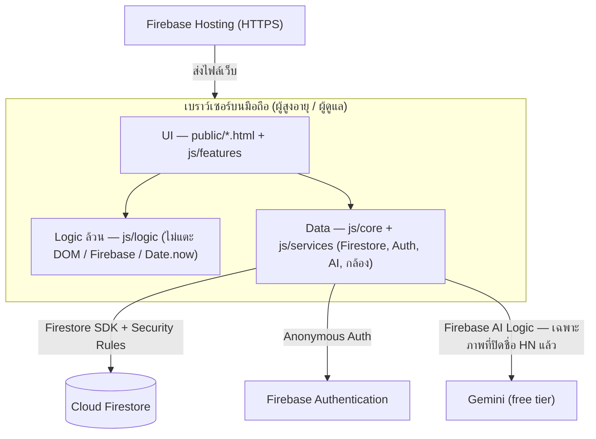
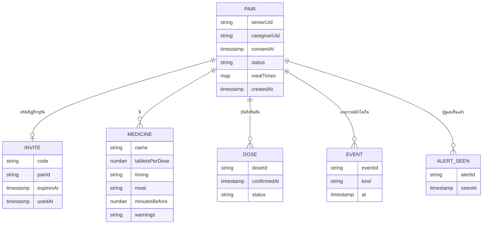
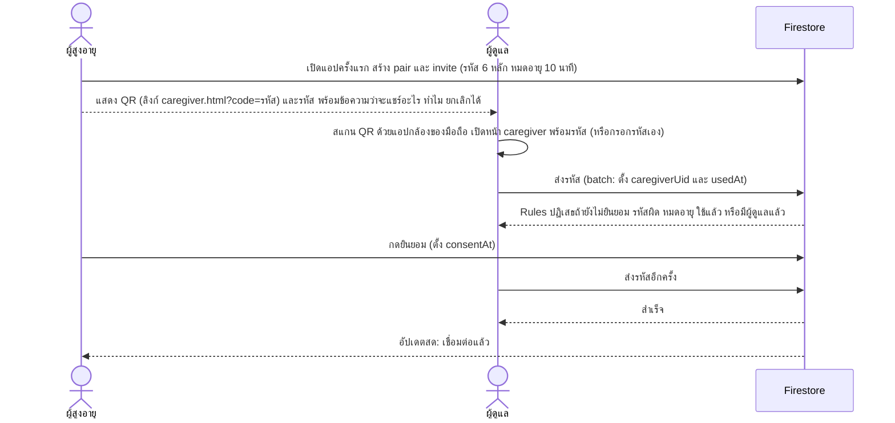
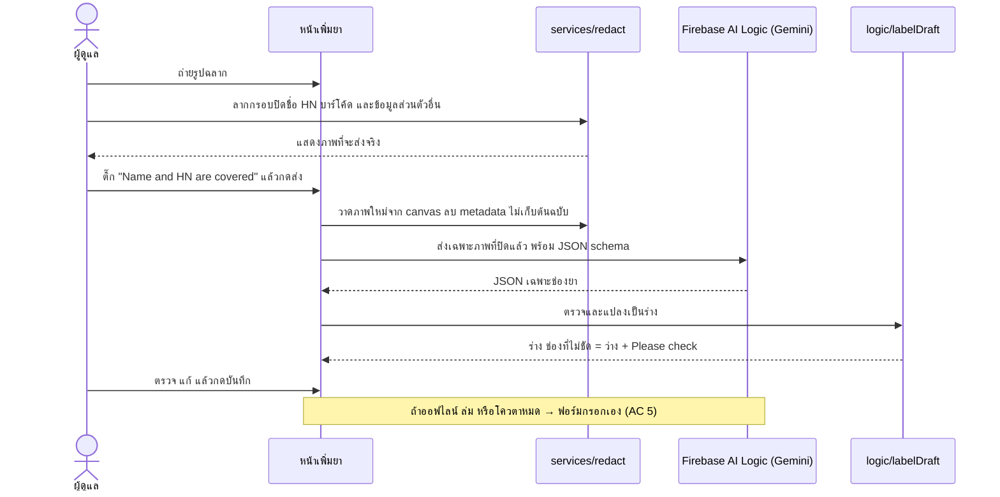
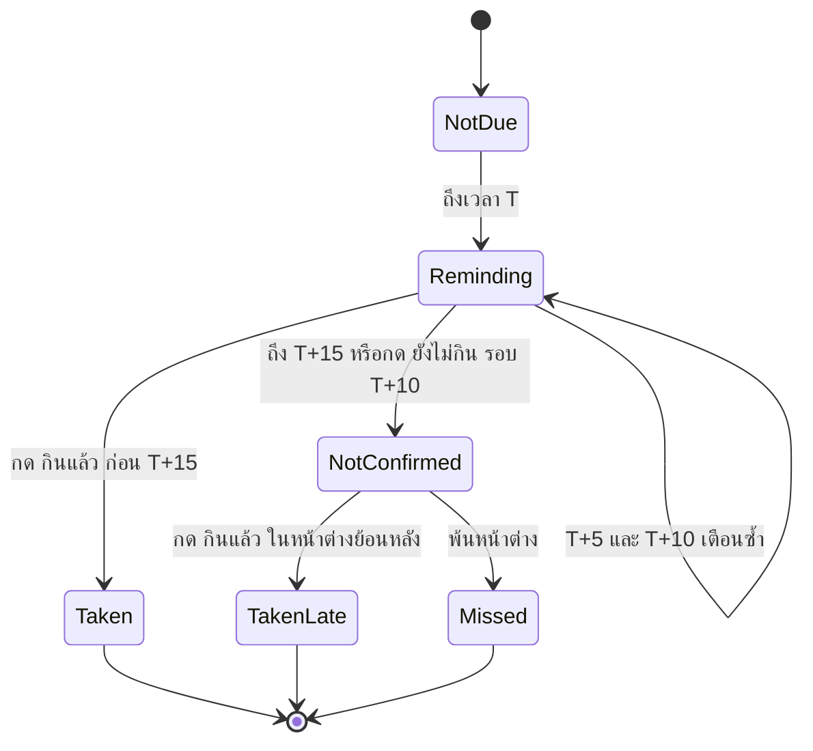
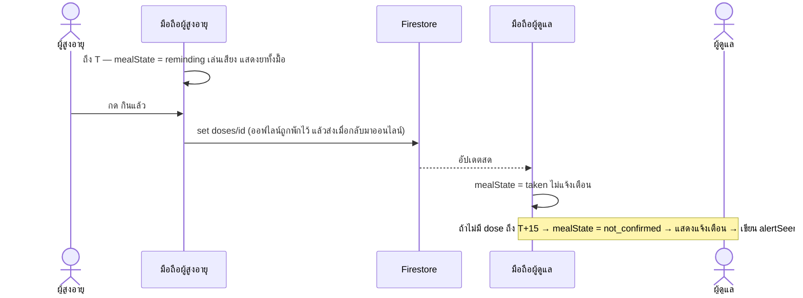

# Architecture & Design — MedMind

> เอกสารออกแบบ (M2 Design) · **ฉบับร่างเริ่มต้น 31 ต.ค. 2569** — ร่างด้วย AI จาก SRS v1.2 แล้ว **System Designer ต้องตรวจ แก้ และตัดสินใจข้อใน §11** ก่อนถือเป็นฉบับสมบูรณ์ (บันทึกใน `docs/AI_USAGE_LOG.md`)
> Requirement อยู่ที่ [`docs/02-requirements/M2-SRS_MedMind.pdf`](../02-requirements/M2-SRS_MedMind.pdf) (สำเนาอ่านง่าย: [`spec.md`](../02-requirements/spec.md)) — เอกสารนี้ไม่เปลี่ยน requirement ถ้าต้องเปลี่ยนให้แก้ SRS ก่อน

## 1. ขอบเขตของเอกสาร
อธิบายว่าระบบ**สร้างอย่างไร**เพื่อให้ตอบ SRS ได้ครบ FR-01–05 (Must) และ FR-09 (Could): สถาปัตยกรรม, เหตุผลการเลือกเทคโนโลยี (ADR), โมดูลและสัญญาระหว่างโมดูล, โครงข้อมูล, พฤติกรรม (sequence / state), ความปลอดภัย, การทดสอบ ทุกหน้าจอและทุกตารางข้อมูลต้องโยงกลับไปที่ FR ได้ (ตารางใน §8)

## 2. สถาปัตยกรรมภาพรวม
รูปแบบ **Layered + Client–Server, Monolith ฝั่งไคลเอนต์** (ไม่มี server code ของเราเอง) — ตามที่ M3 สอน: UI → Logic → Data, cohesion สูง coupling ต่ำ



| ชั้น | โฟลเดอร์ | หน้าที่ | กติกา |
|---|---|---|---|
| UI | `public/*.html`, `public/css`, `public/js/features` | แสดงผล รับการกด ต่อ logic กับ data | ทุกหน้ามีป้าย "Covers: FR-xx" · escape ข้อความผู้ใช้ · ขนาด/สีตาม NFR-03 |
| Logic | `public/js/logic` | กฎธุรกิจ (BR), เวลาเตือน, state ของมื้อ, ตรวจร่างยา | **ฟังก์ชันล้วน** รับเวลาเป็นพารามิเตอร์ · ทุกฟังก์ชันมีเทสต์ |
| Data / Services | `public/js/core`, `public/js/services` | Firestore, Auth, เรียก AI, วาดภาพปิดชื่อ, เสียงเตือน | ไม่มีกฎธุรกิจ · แยกเพื่อสลับเป็นของปลอมในเทสต์ได้ |

**Demo mode (ADR-8):** เปิด `demo.html` (หรือ `?demo=1`) → แอปใช้ `localRepo` + `clock` จำลอง + ร่างฉลากตัวอย่าง ไม่แตะ Firebase/AI เพื่อให้ผู้ตรวจคลิกเดินครบทุก Must FR และทางผิด (เช่น AI ล่ม → กรอกเอง, ไม่ยืนยันถึง T+15 → แจ้งผู้ดูแล) ในเบราว์เซอร์เดียว

**เทคโนโลยี (สรุป):** HTML/CSS/JavaScript (ES modules) ไม่มี build · Firebase Spark: Anonymous Auth + Cloud Firestore + Hosting · Firebase AI Logic (Gemini free tier) · เทสต์ด้วย `node --test` · ตรวจกฎความปลอดภัยด้วย Firebase Emulator

## 3. การตัดสินใจสำคัญ (ADR)
| # | Context | Decision | Consequence |
|---|---|---|---|
| ADR-1 | ทีมนักศึกษาปี 1, เวลาน้อย, อาจารย์ต้องเปิดดูในเบราว์เซอร์ได้ (M4) | เว็บแอป **vanilla JS ES modules ไม่มี build / framework** | เรียนรู้น้อย รันได้ด้วย static server · ต้องมีวินัยแยกโมดูลเอง (กติกาใน CLAUDE.md) · ไม่มี type check — ใช้ JSDoc + เทสต์ |
| ADR-2 | ต้องแชร์สถานะข้ามสองมือถือ แต่ไม่มีงบ/บัตร | **Firebase Spark**: Anonymous Auth + Firestore + Hosting | ฟรี ไม่ผูกบัตร มีโควตารายวัน (NFR-13 วัดผล) · **ไม่มี Cloud Functions** (ต้องแพ็ก Blaze) → ไม่มี push ตอนปิดหน้าเว็บ (SRS §6 ข้อ 6) |
| ADR-3 | ต้องมีฟีเจอร์ AI และอ่านฉลากไทยให้แม่น แต่ห้ามให้ key รั่ว | อ่านฉลากด้วย **Gemini ผ่าน Firebase AI Logic** (proxy ถือ key; ใช้ structured output) · ผู้ดูแลปิดชื่อ/HN/บาร์โค้ดก่อนส่ง (BR-19) | แม่นกว่า OCR ในเครื่อง · รูปที่ปิดแล้วออกนอกเครื่อง → ต้องมี consent และข้อความเตือนว่า free tier อาจนำข้อมูลไปปรับปรุงผลิตภัณฑ์ · พึ่งโควตาและความพร้อมของบริการ → ต้องมีทางสำรอง "กรอกเอง" |
| ADR-4 | ต้องเทสต์ NFR/AC ได้โดยไม่พึ่งเครือข่ายและนาฬิกาจริง | แยก **logic เป็นฟังก์ชันล้วน** รับ `now` เป็นพารามิเตอร์ | เทสต์ด้วยนาฬิกาจำลอง (NFR-01) ง่าย · UI/Data ต้องส่งเวลาเข้าไปเสมอ |
| ADR-5 | ไม่มี server เพื่อรันตัวจับเวลาแจ้งเตือน | **คำนวณเตือน/แจ้งผู้ดูแลบนเครื่อง** จากข้อมูลที่แชร์ + นาฬิกา (state ของมื้อเป็น *ค่าที่คำนวณได้* ไม่ใช่ค่าที่เก็บ) | เตือนได้เฉพาะตอนเปิดหน้าเว็บ (ข้อจำกัดใน SRS §2.2) · ต้องมีกฎเปิดหน้ากลับ (BR-18) |
| ADR-6 | กดซ้ำต้องไม่เกิดบันทึกซ้ำ (NFR-07, BR-12) และออฟไลน์ต้องไม่หาย | **id ของบันทึกยืนยัน = `วันที่_เวลาเตือน`** (`2026-11-02_0800`) เขียนด้วย `set` · เปิด offline persistence ของ Firestore | กดซ้ำ = เขียนทับค่าเดิม · ต้องกันไม่ให้ทับเวลาเดิม (ตรวจด้วย Rules: ห้ามแก้ `confirmedAt` เมื่อมีอยู่แล้ว) |
| ADR-7 | PDPA: ข้อมูลยา/สถานะการกินยาเป็นข้อมูลสุขภาพ | **เก็บเท่าที่ FR ใช้** ไม่เก็บรูป/ชื่อ/HN · ลบทั้งคู่เมื่อ unpair (BR-17) | Schema ไม่มีช่องข้อมูลส่วนตัว · การลบต้องลบทุก sub-collection (ทำเป็น batch) |
| ADR-8 | M4 ให้คะแนน prototype ที่ "เปิดในเบราว์เซอร์ได้ ไม่ต้องมี server/DB" และคลิกเดินครบทุก Must FR แต่ระบบจริงต้องใช้ 2 มือถือ จับคู่ รอเวลา และใช้ AI — ผู้ตรวจคนเดียวเดิน flow ไม่ได้ | เพิ่ม **Demo mode** (`public/demo.html`): ข้อมูลตัวอย่าง + **นาฬิกาจำลอง** + เห็นจอผู้สูงอายุและผู้ดูแลคู่กันในหน้าเดียว · ใช้ `localRepo` (เก็บในหน่วยความจำ/`localStorage`) แทน Firestore และใช้ร่างฉลากตัวอย่างแทนการเรียก AI · ใช้ logic ชุดเดียวกับระบบจริง | ผู้ตรวจเปิดลิงก์เดียวแล้วเดินครบทุก FR ได้ (รวมทางผิด) · ต้องออกแบบ `core/repo.js` แบบ Repository ที่สลับได้สองแบบ (ADR-4 ช่วยให้ทำได้) · ต้องเขียนกำกับชัดว่าหน้านี้เป็นโหมดสาธิต ไม่ใช่ข้อมูลจริง · **ใช้บนคอม/นำเสนอเท่านั้น ไม่ใช่หน้าที่มือถือผู้ใช้เปิด** (ดู ADR-9) |
| ADR-9 | ผู้ใช้จริงมีคนละเครื่อง: มือถือผู้สูงอายุต้องแสดง QR และมือถือผู้ดูแลต้องใช้กล้องสแกน QR และถ่ายฉลาก — ถ้าแสดง 2 บทบาทในจอเดียวจะใช้ข้ามเครื่องไม่ได้ | **แยกแอปตามบทบาท 1 เครื่อง = 1 บทบาท**: `index.html` (เลือกบทบาทครั้งแรก แล้วจำไว้ในเครื่อง) → `senior.html` หรือ `caregiver.html` · **QR เป็นลิงก์** `https://<โดเมน>/caregiver.html?code=<รหัส 6 หลัก>` ให้ผู้ดูแลสแกนด้วยแอปกล้องของมือถือได้เลย (ไม่ต้องมีตัวสแกนในแอป) + ช่องกรอกรหัสสำรอง · ถ่ายฉลากด้วย `<input type="file" accept="image/*" capture="environment">` (เปิดกล้องของเครื่อง ทำงานได้ทั้ง Android/iPhone) | ทดสอบจับคู่ข้ามเครื่องและถ่ายฉลากจริงบนมือถือได้ · ต้องเปิดผ่าน **HTTPS** (Firebase Hosting / preview channel) เพราะ Firebase Auth, AI Logic และกล้องต้องใช้ secure context · ถ้าผู้ดูแลเปิดลิงก์ QR ในเบราว์เซอร์อื่นจากที่เคยใช้ จะได้ตัวตนใหม่ (Anonymous Auth ผูกกับเบราว์เซอร์) — ให้แนะนำใช้เบราว์เซอร์เดียวกันเสมอ |

## 4. Use case
แผนภาพอยู่ใน SRS §5.2 (สำเนา: [`diagrams/use-case-diagram.png`](diagrams/use-case-diagram.png)) — 3 actors, UC-1–7, sub-case 5 ตัว (รวม "Cover name and HN" ตาม BR-19)

## 5. โมดูลและสัญญาระหว่างโมดูล
เจ้าของตามตารางทีมใน README (ผู้รับผิดชอบชั่วคราว — ปรับได้ตามที่ทีมตกลง) ตัวหนา = ไฟล์ส่วนรวมที่หลายฟีเจอร์พึ่งพา

| ไฟล์ | ชั้น | FR / BR | หน้าที่ | เจ้าของ |
|---|---|---|---|---|
| `core/firebase.js` | Data | ทุก FR | เริ่ม Firebase, Anonymous Auth, เปิด offline persistence | **System Designer** |
| `core/repo.js` | Data | ทุก FR | ฟังก์ชันอ่าน/เขียนข้อมูลตาม §6 — มี 2 แบบที่หน้าตาเหมือนกัน: `firestoreRepo` (ระบบจริง) และ `localRepo` (Demo mode, ADR-8) | **System Designer** |
| `core/demoData.js`, `public/demo.html` | Data / UI | ทุก FR, ADR-8 | ข้อมูลตัวอย่าง (คู่ทดสอบ, ยา, เวลามื้อ, ร่างฉลากตัวอย่าง) + หน้าสาธิต 2 บทบาท + ปุ่มเลื่อนนาฬิกา (+5 นาที / ไปเวลาเตือนถัดไป) | **Prototype Developer** + ทุกคนเพิ่มข้อมูลของ FR ตัวเอง |
| `core/clock.js` | Data | NFR-01, ADR-8 | `now()` ที่เปลี่ยนเป็นนาฬิกาจำลองได้ในเทสต์และ Demo mode | **System Designer** |
| `logic/pairing.js` | Logic | FR-01, BR-01/02/17 | สร้างรหัส 6 หลัก, ตรวจหมดอายุ/ใช้แล้ว, ตรวจพร้อมเชื่อมต่อ | FR-01 |
| `logic/schedule.js` | Logic | FR-02/03, BR-05/06/07 | `reminderTime(timing, mealTimes)`, `groupMeals(medicines, mealTimes)`, ตรวจฟอร์มยา | FR-02 |
| `logic/labelDraft.js` | Logic | FR-02, BR-04/05/07 | แปลง JSON จาก AI → ร่างยา, ช่องไม่ชัด = null + "Please check", ยาเมื่อมีอาการ = ไม่รองรับ | FR-02 |
| `services/redact.js` | Data | FR-02, BR-19, NFR-14 | วาดกรอบปิด, วาดภาพใหม่จาก canvas (ลบ metadata), ย่อภาพ | FR-02 |
| `services/aiLabel.js` | Data | FR-02, ADR-3 | เรียก Firebase AI Logic พร้อม JSON schema, จัดการโควตา/ออฟไลน์ → โยนข้อผิดพลาดให้ UI ไปกรอกเอง | FR-02 |
| `logic/mealTimeline.js` | Logic | FR-03, BR-08/13/15/16/18 | `mealState(...)` — แกนของไทม์ไลน์ (ดู §5.1) | FR-03 |
| `logic/confirm.js` | Logic | FR-04, BR-10/11/12/15 | สร้างบันทึกยืนยัน (`doseId`), ตรวจว่ายืนยันได้ไหม | FR-04 |
| `logic/status.js` | Logic | FR-05, BR-13/14/18 | สถานะรายวัน, แจ้งเตือนที่ต้องแสดง (ครั้งเดียวต่อมื้อ), ข้อความถึงผู้ดูแล | FR-05 |
| `logic/weeklySummary.js` | Logic | FR-09 (Could) | รวมสถานะ 7 วัน → ข้อมูลสำหรับ prompt (ไม่มีชื่อ/HN/ยา) | ภายหลัง |
| `features/*.js` | UI | ตามชื่อ | ต่อหน้าจอเข้ากับ logic + data | เจ้าของ FR นั้น |

### 5.0 หน้าเว็บ (entry points) — 1 เครื่อง = 1 บทบาท (ADR-9)
| ไฟล์ | ใครเปิด | ทำอะไร | ข้อมูล |
|---|---|---|---|
| `public/index.html` | ทุกคน ครั้งแรก | splash + เลือกบทบาท แล้วจำบทบาทไว้ในเครื่อง (`localStorage`) · เปิดครั้งถัดไปพาไปหน้าบทบาทเลย | — |
| `public/senior.html` | มือถือผู้สูงอายุ | จับคู่ (QR + รหัส + ยินยอม), หน้าหลักวันนี้, หน้าเตือน, ยืนยัน, ตั้งค่า/ยกเลิกจับคู่ | `firestoreRepo` |
| `public/caregiver.html` | มือถือผู้ดูแล | จับคู่ (สแกน QR ด้วยกล้องมือถือ / กรอกรหัส), ตั้งเวลามื้อ, เพิ่มยาด้วยการถ่ายฉลาก → ปิดชื่อ/HN → AI ร่าง → ตรวจ → บันทึก, สถานะรายวัน, การแจ้งเตือน, ตั้งค่า/ยกเลิกจับคู่ | `firestoreRepo` |
| `public/demo.html` | ผู้ตรวจ / นำเสนอบนคอม | จอผู้สูงอายุ + ผู้ดูแลคู่กัน + ปุ่มเลื่อนนาฬิกา (ADR-8) | `localRepo` + ข้อมูลตัวอย่าง |

ทั้ง `senior.html`, `caregiver.html` และ `demo.html` ใช้ `logic/` และ `features/` **ชุดเดียวกัน** ต่างกันแค่ repo ที่ส่งเข้าไปและหน้าจอที่แสดง

**ทดสอบข้ามเครื่องบนมือถือจริง:** deploy ขึ้น Firebase Hosting preview channel (ได้ลิงก์ HTTPS ชั่วคราว) → มือถือ A เปิด `index.html` เลือก "ผู้สูงอายุ" → มือถือ B เลือก "ผู้ดูแล" แล้วสแกน QR บนจอ A ด้วยแอปกล้อง → จับคู่ → B ถ่ายฉลากจริง (ปิดชื่อ/HN ก่อนส่ง) → A ได้รับเตือนตามเวลาที่บันทึก · การเปิดผ่าน IP ในวง Wi-Fi (`http://192.168.x.x`) ไม่ใช่ HTTPS กล้อง/Firebase อาจใช้ไม่ได้

### 5.1 สัญญากลาง (รูปข้อมูลที่ทุกโมดูลใช้ร่วมกัน)
```js
// Medicine — บันทึกหลังผู้ดูแลตรวจร่างแล้ว (BR-04, BR-05)
{ id, name, tabletsPerDose, instructionText,
  timing: 'after_meal' | 'before_meal' | 'at_bedtime',
  meal: 'breakfast' | 'lunch' | 'dinner' | 'bedtime',
  minutesBefore: number | null,        // ใช้เมื่อ timing = 'before_meal'
  warnings: string | null, contraindications: string | null }

// Meal — กลุ่มยาที่เวลาเตือนเท่ากัน (BR-06) คำนวณได้ ไม่เก็บ
{ dateKey: '2026-11-02', reminderTime: '08:00', medicines: [Medicine, ...] }
// id ของมื้อ = `${dateKey}_${reminderTime ไม่มี :}`  เช่น '2026-11-02_0800'

// Dose — บันทึกยืนยัน 1 มื้อ (เก็บใน Firestore, id = id ของมื้อ → ไม่ซ้ำ)
{ confirmedAt: <เวลาที่กดจริงบนเครื่อง>, status: 'taken' | 'taken_late' }

// mealState({ now, meal, dose, nextMealStart, notYetLastRoundAt }) → ผลลัพธ์ที่คำนวณ
// เวลาทุกตัวเป็นตัวเลข milliseconds (เช่น new Date(2026, 10, 2, 8, 5).getTime()) · now = เวลาที่ส่งเข้ามา ห้ามเรียก Date.now() ในฟังก์ชัน
{ state: 'not_due' | 'reminding' | 'taken' | 'not_confirmed' | 'taken_late' | 'missed',
  round: 0 | 1 | 2 | null,      // รอบเตือนปัจจุบัน T, T+5, T+10 (เฉพาะ state = 'reminding')
  canConfirm: boolean,           // ยังกด "กินแล้ว" ได้ไหม (BR-15)
  caregiverAlert: null | 'not_confirmed' | 'confirmed_late' }  // ต้องแจ้งผู้ดูแลไหม (BR-13)
```
กฎของ `mealState` (T = เวลาเตือนของมื้อ):

| เงื่อนไข | state |
|---|---|
| `now < T` | `not_due` |
| มี Dose และ `confirmedAt ≤ T+15` | `taken` |
| มี Dose และ `confirmedAt > T+15` | `taken_late` (+ `caregiverAlert = 'confirmed_late'`) |
| ไม่มี Dose และ `T ≤ now < T+15` | `reminding` — `round = floor((now−T)/5)` (0, 1, 2) |
| ไม่มี Dose และ `now ≥ T+15` และอยู่ในหน้าต่างยืนยันย้อนหลัง (ถึงเวลาเตือนของมื้อถัดไปที่เริ่มหลัง T+15; ไม่มี = 23:59) | `not_confirmed` (+ `caregiverAlert = 'not_confirmed'`, `canConfirm = true`) |
| นอกหน้าต่างนั้น | `missed` (`canConfirm = false`) |
| ไม่มี Dose แต่มี `notYetLastRoundAt` (กด "ยังไม่กิน" รอบ T+10) | `caregiverAlert = 'not_confirmed'` ทันที ไม่รอ T+15 (BR-11) |

เปิดหน้ากลับ (BR-18): ฟังก์ชันคืนเฉพาะ `round` *ปัจจุบัน* — UI จึงไม่เล่นรอบที่ผ่านไปแล้ว

## 6. โครงข้อมูล (Cloud Firestore)

| Collection / path | เอกสาร (ย่อ) | ใช้ใน FR | ข้อควรระวัง |
|---|---|---|---|
| `pairs/{pairId}` | `seniorUid`, `caregiverUid`(null จนจับคู่), `consentAt`(null จนกดยินยอม), `status`, `mealTimes{breakfast,lunch,dinner,bedtime}` | FR-01, FR-02 | ไม่มีชื่อ/เบอร์/วันเกิด (NFR-09) |
| `invites/{code}` | `pairId`, `seniorUid`, `expiresAt`(+10 นาที), `usedAt` | FR-01 | รหัส 6 หลักใช้ครั้งเดียว (BR-01) |
| `pairs/{pairId}/medicines/{id}` | ตาม Medicine ใน §5.1 | FR-02 | เขียนได้เฉพาะผู้ดูแล (BR-03) · ไม่มีรูป |
| `pairs/{pairId}/doses/{doseId}` | `confirmedAt`, `status` | FR-04, FR-05 | id ตายตัว → กดซ้ำไม่ซ้ำ (ADR-6) |
| `pairs/{pairId}/events/{doseId}` | `kind='not_yet_last_round'`, `at` | FR-04, FR-05 | เขียนโดยเครื่องผู้สูงอายุ เพื่อให้ผู้ดูแลแจ้งทันที (BR-11) |
| `pairs/{pairId}/alertSeen/{doseId}` | `seenAt` | FR-05 | ผู้ดูแลเขียนเมื่อแสดงการแจ้งแล้ว → "ครั้งเดียวต่อมื้อ" (BR-13) |

**Unpair (BR-17 / NFR-10):** ลบ `pairs/{pairId}` พร้อมทุกเอกสารใน sub-collection (batch) และ invite ที่เกี่ยวข้อง · หลังลบ กฎจะปฏิเสธทุกคำขอเพราะหา pair ไม่เจอ · ต้องมีเทสต์นับเอกสารที่เหลือ = 0

## 7. พฤติกรรม

### 7.1 FR-01 จับคู่ (ลำดับตาม AC 1–6: QR แสดงก่อนยินยอม แต่จับคู่ได้หลังยินยอมเท่านั้น)


### 7.2 FR-02 อ่านฉลาก (BR-04, BR-19)


### 7.3 FR-03/04/05 ไทม์ไลน์ของมื้อ



## 8. ตาราง FR → ปฏิบัติการ → ข้อมูล → หน้าจอ
| FR | ปฏิบัติการ (operation) | ข้อมูล (entity) | หน้าจอ (ดู design-system.md) |
|---|---|---|---|
| FR-01 | สร้าง pair+invite, กดยินยอม, จับคู่ด้วยรหัส/QR, ยกเลิกจับคู่ | `pairs`, `invites` | S-01 เริ่ม+ยินยอม, C-01 จับคู่, S-04 / C-09 ยกเลิกจับคู่ |
| FR-02 | ตั้งเวลามื้อ, ถ่ายรูป, ปิดชื่อ/HN, ส่งให้ AI, ตรวจร่าง, บันทึกยา | `pairs.mealTimes`, `medicines` | C-02 เวลามื้อ, C-03 ถ่ายรูป, C-04 ปิดชื่อ+ยืนยันส่ง, C-05 ตรวจร่าง |
| FR-03 | คำนวณ `mealState`, เล่นเสียง, แสดงยาทั้งมื้อ, เตือนซ้ำ | `medicines`, `doses` (อ่าน) | S-03 หน้าเตือน |
| FR-04 | กด กินแล้ว / ยังไม่กิน, ยืนยันย้อนหลัง | `doses`, `events` | S-03 หน้าเตือน, S-02 หน้าหลัก |
| FR-05 | แจ้งเตือนเมื่อไม่ยืนยัน, สถานะรายวัน, แจ้งยืนยันช้า | `doses`, `events`, `alertSeen` (อ่าน/เขียน) | C-07 สถานะรายวัน, C-08 แจ้งเตือน |
| FR-09 (Could) | สรุปรายสัปดาห์ด้วย AI จากสถานะมื้อ (ไม่ส่งชื่อ/HN/ยา) | `doses` (อ่าน) | C-10 สรุปรายสัปดาห์ |

## 9. ความปลอดภัยและความเป็นส่วนตัว
| NFR / BR | กลไก | ตรวจด้วย |
|---|---|---|
| NFR-04 ผู้ดูแลเห็นเฉพาะคู่ของตน | Security Rules: ทุกเส้นทางใต้ `pairs/{id}` ต้องเป็น `seniorUid` หรือ `caregiverUid` ของ pair นั้น (ร่างใน `firestore-rules-draft.md`) | Emulator: ลองอ่าน pair อื่น → ถูกปฏิเสธ |
| NFR-05 ไม่เชื่อมต่อก่อนยินยอม | Rules: จับคู่ได้เมื่อ `consentAt != null` | Emulator (FR-01 AC 2) |
| NFR-06 ไม่บันทึกยาก่อนผู้ดูแลตรวจ | UI ให้บันทึกจากหน้าตรวจร่างเท่านั้น · Rules: เฉพาะผู้ดูแลเขียน `medicines` | เทสต์ logic + AC 1, 6 |
| NFR-09 เก็บเท่าที่จำเป็น | Schema §6 ไม่มีช่องชื่อ/HN/เบอร์/วันเกิด · ไม่เก็บรูป · JSON schema ของ AI ไม่มีช่องชื่อ | ตรวจทุกฟิลด์ใน §6 + ตรวจว่า Firestore ไม่มีรูป |
| NFR-10 ลบหลัง unpair | ลบ pair + ลูกทั้งหมด (batch) · Rules ปฏิเสธเมื่อไม่มี pair | Emulator: นับเอกสารที่เหลือ = 0 |
| NFR-14 / BR-19 ไม่ส่งชื่อ/HN ให้ AI | ปิดกรอบ + ภาพที่จะส่งจริง + ติ๊กยืนยัน + วาดภาพใหม่ลบ metadata | ทดสอบ 20 ฉลาก ตรวจภาพที่ถูกส่งด้วยตา (บันทึกในเครื่องเฉพาะ test build) |
| API key | อยู่ที่ proxy ของ Firebase AI Logic ไม่อยู่ในแอป · เปิด App Check | ตรวจว่าไม่มี key ใน repo (`check:secrets`) |

## 10. กลยุทธ์การทดสอบ
| ระดับ | เครื่องมือ | ครอบคลุม |
|---|---|---|
| Unit (logic ล้วน) | `node --test tests/` | AC ของ FR-01–05 ที่เป็นกฎ: `mealState`, `reminderTime`, `groupMeals`, `labelDraft`, `confirm`, `status`, `pairing` · NFR-01 ด้วยนาฬิกาจำลอง · NFR-07 (ไม่ซ้ำ) |
| Rules | Firebase Emulator | NFR-04, 05, 10 |
| Manual (บนมือถือ 2 เครื่อง) | ตาราง MT ใน `docs/TRACEABILITY.md` + ผลใน Final Report §5 | NFR-02, 03, 08, 11, 12, 13, 14 และ AC ที่ต้องเห็นหน้าจอ |
| Usability | Heuristic evaluation (ทีมอื่นประเมินตาม 10 ข้อของ Nielsen + ระดับความรุนแรง) และทดสอบ 5 คนแบบ think-aloud (UX primer §5.2, §5.4) | MT-14, MT-07 |

## 11. ความเสี่ยงและเรื่องที่ต้องตัดสินใจ (System Designer)
- [ ] เลือกและ **pin เวอร์ชัน Firebase JS SDK** (เวอร์ชันที่ออกมาแล้วอย่างน้อย 14 วัน) และวิธี import จาก CDN
- [ ] เลือกผู้ให้บริการ **App Check** แบบไม่มีค่าใช้จ่าย (เอกสารเตือนว่าบางแบบมีค่าใช้จ่าย) แล้วทดสอบกับ AI Logic
- [ ] เลือกไลบรารี **สร้าง QR** (การสแกนใช้แอปกล้องของมือถือเปิดลิงก์ ตาม ADR-9 — ตัวสแกนในแอปเป็นทางเลือก) และเช็ก license
- [ ] ตรวจ **โมเดล Gemini และโควตาของ free tier** ตอนใช้จริง + ตั้ง per-user rate limit · ข้อความยินยอมต้องบอกว่า free tier อาจนำข้อมูลไปปรับปรุงผลิตภัณฑ์
- [ ] **สถานะ Increment 1 ที่ยังไม่มีการจับคู่:** ใช้คู่ทดสอบจาก `core/demoData.js` (ใช้ร่วมกับ Demo mode) เขียนลง Firestore ด้วยสคริปต์ seed — งานแรกของ Increment 1
- [ ] รูปแบบหน้า/URL เมื่อโฮสต์ (Firebase Hosting หรือ GitHub Pages) และลิงก์เดโมสำหรับอาจารย์
- [ ] ไฟล์เสียงเตือน: แหล่งที่มา/ลิขสิทธิ์
- [ ] **ขอบเขตที่ T+15 พอดี:** `mealState` ตีความ `confirmedAt ≤ T+15` เป็น `taken` และ `> T+15` เป็น `taken_late` — SRS ไม่ได้ระบุกรณีกดที่ T+15 พอดี ควรเพิ่ม AC ใน SRS แล้วให้เทสต์ TC-03 ครอบ
- [ ] นาฬิกาสองเครื่องไม่ตรงกัน: ยอมรับตามสมมติฐานใน SRS §2.2 หรือเพิ่มการชดเชยเวลา (ต้องแก้ SRS ก่อนถ้าเพิ่ม)
- [ ] โค้ดเดิมจาก repo ทีมเดิม (`SE-Project`) จะนำกลับมาใช้หรือไม่ — ถ้าใช้ ต้องให้เจ้าของโค้ดนั้นเป็นคนนำมา อธิบายได้ และบันทึกใน AI log / คำอธิบาย PR
