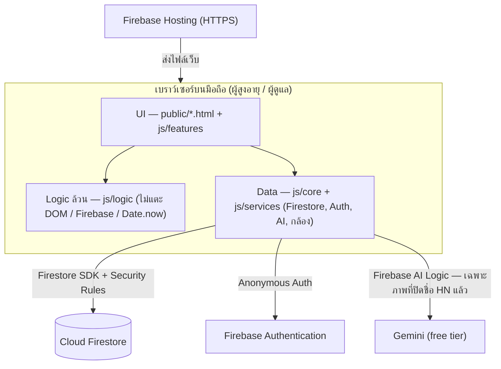
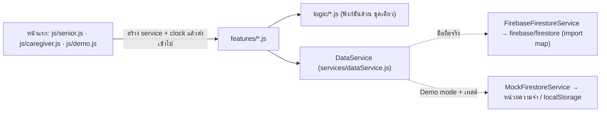
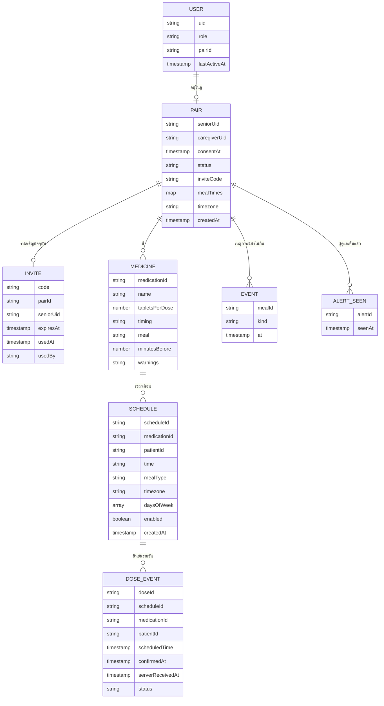
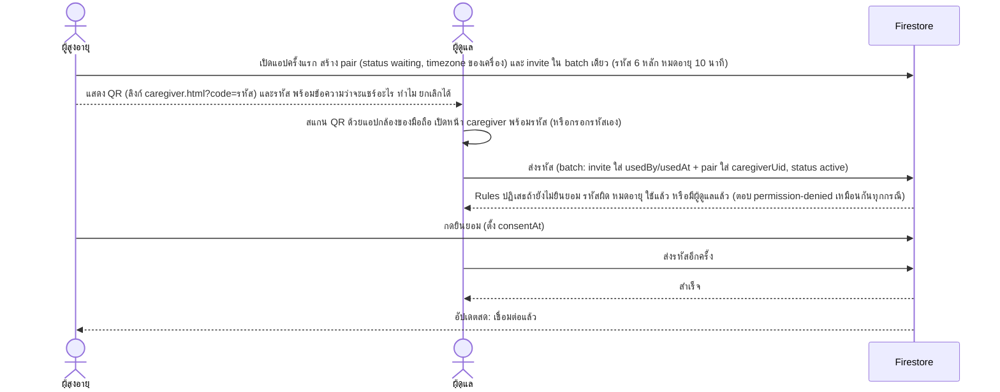
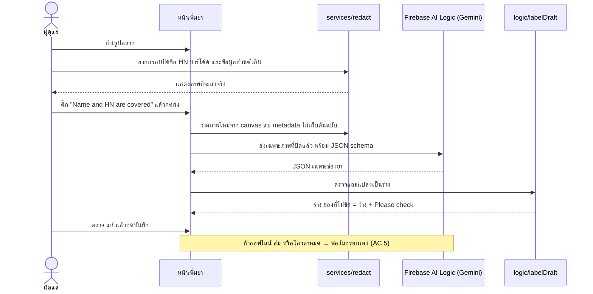
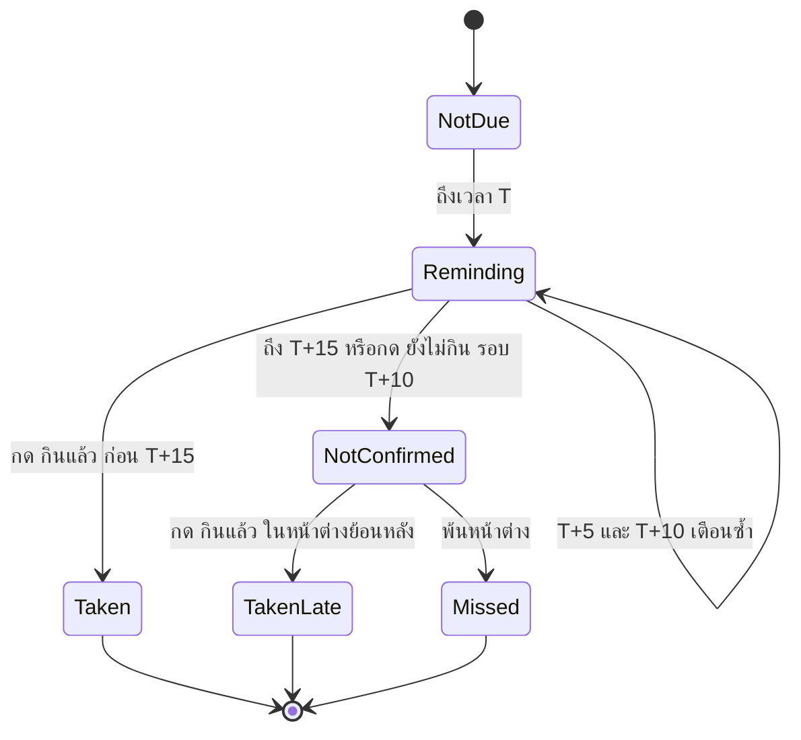
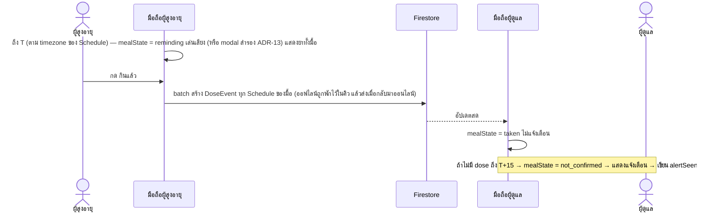

# Architecture & Design — MedMind

> เอกสารออกแบบ (M2 Design) · **ฉบับร่างเริ่มต้น 31 ต.ค. 2569** — ร่างด้วย AI จาก SRS v1.2 แล้ว **System Designer ต้องตรวจ แก้ และตัดสินใจข้อใน §11** ก่อนถือเป็นฉบับสมบูรณ์ (บันทึกใน `docs/AI_USAGE_LOG.md`)
> **ปรับ 1 พ.ย. 2569 เพื่อเตรียม Increment 1** ตาม SRS v1.3 (ฉบับร่าง): แยก Schedule กับ DoseEvent + เขตเวลา (ADR-11, §5.1), `users.lastActiveAt` (FR-05), Service abstraction (§5.2), import map จาก CDN (ADR-10, §5.3), ตัดสิทธิ์ทันทีเมื่อยกเลิกจับคู่ (ADR-12, §6), เสียงเตือน + ทางสำรอง (ADR-13) และตัดสินข้อใน §11 แล้ว 3 ข้อ — System Designer ยังต้องตรวจรับ
> Requirement อยู่ที่ [`docs/02-requirements/M2-SRS_MedMind.pdf`](../02-requirements/M2-SRS_MedMind.pdf) (สำเนาอ่านง่าย: [`spec.md`](../02-requirements/spec.md)) — เอกสารนี้ไม่เปลี่ยน requirement ถ้าต้องเปลี่ยนให้แก้ SRS ก่อน

## 1. ขอบเขตของเอกสาร
อธิบายว่าระบบ**สร้างอย่างไร**เพื่อให้ตอบ SRS ได้ครบ FR-01–05 (Must) และ FR-09 (Could): สถาปัตยกรรม, เหตุผลการเลือกเทคโนโลยี (ADR), โมดูลและสัญญาระหว่างโมดูล, โครงข้อมูล, พฤติกรรม (sequence / state), ความปลอดภัย, การทดสอบ ทุกหน้าจอและทุกตารางข้อมูลต้องโยงกลับไปที่ FR ได้ (ตารางใน §8)

## 2. สถาปัตยกรรมภาพรวม
รูปแบบ **Layered + Client–Server, Monolith ฝั่งไคลเอนต์** (ไม่มี server code ของเราเอง) — ตามที่ M3 สอน: UI → Logic → Data, cohesion สูง coupling ต่ำ



| ชั้น | โฟลเดอร์ | หน้าที่ | กติกา |
|---|---|---|---|
| UI | `public/*.html`, `public/css`, `public/js/features` | แสดงผล รับการกด ต่อ logic กับ data | ทุกหน้ามีป้าย "Covers: FR-xx" · escape ข้อความผู้ใช้ · ขนาด/สีตาม NFR-03 |
| Logic | `public/js/logic` | กฎธุรกิจ (BR), เวลาเตือน, state ของมื้อ, ตรวจร่างยา | **ฟังก์ชันล้วน** รับเวลาเป็นพารามิเตอร์ · ทุกฟังก์ชันมีเทสต์ |
| Data / Services | `public/js/core`, `public/js/services` | Firestore, Auth, เรียก AI, วาดภาพปิดชื่อ, เสียงเตือน | ไม่มีกฎธุรกิจ · แยกเพื่อสลับเป็นของปลอมในเทสต์ได้ |

**Demo mode (ADR-8):** เปิด `demo.html` (หรือ `?demo=1`) → แอปใช้ `MockFirestoreService` + `clock` จำลอง + ร่างฉลากตัวอย่าง ไม่แตะ Firebase/AI เพื่อให้ผู้ตรวจคลิกเดินครบทุก Must FR และทางผิด (เช่น AI ล่ม → กรอกเอง, ไม่ยืนยันถึง T+15 → แจ้งผู้ดูแล) ในเบราว์เซอร์เดียว

**เทคโนโลยี (สรุป):** HTML/CSS/JavaScript (ES modules) ไม่มี build · Firebase JS SDK **12.19.0** (modular) โหลดจาก CDN ของ Google ผ่าน **import map** (ADR-10) · Firebase Spark: Anonymous Auth + Cloud Firestore + Hosting · Firebase AI Logic (Gemini free tier) · เทสต์ด้วย `node --test` · ตรวจกฎความปลอดภัยด้วย Firebase Emulator

## 3. การตัดสินใจสำคัญ (ADR)
| # | Context | Decision | Consequence |
|---|---|---|---|
| ADR-1 | ทีมนักศึกษาปี 1, เวลาน้อย, อาจารย์ต้องเปิดดูในเบราว์เซอร์ได้ (M4) | เว็บแอป **vanilla JS ES modules ไม่มี build / framework** | เรียนรู้น้อย รันได้ด้วย static server · ต้องมีวินัยแยกโมดูลเอง (กติกาใน CLAUDE.md) · ไม่มี type check — ใช้ JSDoc + เทสต์ |
| ADR-2 | ต้องแชร์สถานะข้ามสองมือถือ แต่ไม่มีงบ/บัตร | **Firebase Spark**: Anonymous Auth + Firestore + Hosting | ฟรี ไม่ผูกบัตร มีโควตารายวัน (NFR-13 วัดผล) · **ไม่มี Cloud Functions** (ต้องแพ็ก Blaze) → ไม่มี push ตอนปิดหน้าเว็บ (SRS §6 ข้อ 6) |
| ADR-3 | ต้องมีฟีเจอร์ AI และอ่านฉลากไทยให้แม่น แต่ห้ามให้ key รั่ว | อ่านฉลากด้วย **Gemini ผ่าน Firebase AI Logic** (proxy ถือ key; ใช้ structured output) · ผู้ดูแลปิดชื่อ/HN/บาร์โค้ดก่อนส่ง (BR-19) | แม่นกว่า OCR ในเครื่อง · รูปที่ปิดแล้วออกนอกเครื่อง → ต้องมี consent และข้อความเตือนว่า free tier อาจนำข้อมูลไปปรับปรุงผลิตภัณฑ์ · พึ่งโควตาและความพร้อมของบริการ → ต้องมีทางสำรอง "กรอกเอง" |
| ADR-4 | ต้องเทสต์ NFR/AC ได้โดยไม่พึ่งเครือข่ายและนาฬิกาจริง | แยก **logic เป็นฟังก์ชันล้วน** รับ `now` เป็นพารามิเตอร์ | เทสต์ด้วยนาฬิกาจำลอง (NFR-01) ง่าย · UI/Data ต้องส่งเวลาเข้าไปเสมอ |
| ADR-5 | ไม่มี server เพื่อรันตัวจับเวลาแจ้งเตือน | **คำนวณเตือน/แจ้งผู้ดูแลบนเครื่อง** จากข้อมูลที่แชร์ + นาฬิกา (state ของมื้อเป็น *ค่าที่คำนวณได้* ไม่ใช่ค่าที่เก็บ) | เตือนได้เฉพาะตอนเปิดหน้าเว็บ (ข้อจำกัดใน SRS §2.2) · ต้องมีกฎเปิดหน้ากลับ (BR-18) |
| ADR-6 | กดซ้ำต้องไม่เกิดบันทึกซ้ำ (NFR-07, BR-12) และออฟไลน์ต้องไม่หาย | **id ของ DoseEvent = `วันที่_scheduleId`** (`2026-11-02_aB3x…`) สร้างทุกรายการของมื้อใน batch เดียว · เปิด offline persistence ของ Firestore เป็นคิวการเขียนตอนออฟไลน์ | Rules ให้ **สร้างได้ครั้งเดียว ห้ามแก้** → กดซ้ำ/ส่งซ้ำไม่ทับเวลาเดิม · แอปถือว่า "ถูกปฏิเสธเพราะมีอยู่แล้ว" = ยืนยันสำเร็จ (§6) |
| ADR-7 | PDPA: ข้อมูลยา/สถานะการกินยาเป็นข้อมูลสุขภาพ | **เก็บเท่าที่ FR ใช้** ไม่เก็บรูป/ชื่อ/HN · `users` เก็บแค่ `role`, `pairId`, `lastActiveAt` · **เก็บจนยกเลิกจับคู่ แล้วลบทั้งหมดทันที** (BR-17, ตัดสินแล้ว §11) | Schema ไม่มีช่องข้อมูลส่วนตัว · การลบต้องลบทุก sub-collection (ทำเป็น batch) · ระหว่างยังจับคู่อยู่ข้อมูลสะสมไปเรื่อย ๆ — การจำกัดอายุข้อมูลเป็นงานภายหลังที่ต้องแก้ SRS ก่อน |
| ADR-8 | M4 ให้คะแนน prototype ที่ "เปิดในเบราว์เซอร์ได้ ไม่ต้องมี server/DB" และคลิกเดินครบทุก Must FR แต่ระบบจริงต้องใช้ 2 มือถือ จับคู่ รอเวลา และใช้ AI — ผู้ตรวจคนเดียวเดิน flow ไม่ได้ | เพิ่ม **Demo mode** (`public/demo.html`): ข้อมูลตัวอย่าง + **นาฬิกาจำลอง** + เห็นจอผู้สูงอายุและผู้ดูแลคู่กันในหน้าเดียว · ใช้ `MockFirestoreService` (เก็บในหน่วยความจำ/`localStorage`) แทน Firestore และใช้ร่างฉลากตัวอย่างแทนการเรียก AI · ใช้ logic ชุดเดียวกับระบบจริง | ผู้ตรวจเปิดลิงก์เดียวแล้วเดินครบทุก FR ได้ (รวมทางผิด) · ต้องมี Service abstraction ที่สลับได้สองแบบ (§5.2; ADR-4 ช่วยให้ทำได้) · ต้องเขียนกำกับชัดว่าหน้านี้เป็นโหมดสาธิต ไม่ใช่ข้อมูลจริง · **ใช้บนคอม/นำเสนอเท่านั้น ไม่ใช่หน้าที่มือถือผู้ใช้เปิด** (ดู ADR-9) |
| ADR-9 | ผู้ใช้จริงมีคนละเครื่อง: มือถือผู้สูงอายุต้องแสดง QR และมือถือผู้ดูแลต้องใช้กล้องสแกน QR และถ่ายฉลาก — ถ้าแสดง 2 บทบาทในจอเดียวจะใช้ข้ามเครื่องไม่ได้ | **แยกแอปตามบทบาท 1 เครื่อง = 1 บทบาท**: `index.html` (เลือกบทบาทครั้งแรก แล้วจำไว้ในเครื่อง) → `senior.html` หรือ `caregiver.html` · **QR เป็นลิงก์** `https://<โดเมน>/caregiver.html?code=<รหัส 6 หลัก>` ให้ผู้ดูแลสแกนด้วยแอปกล้องของมือถือได้เลย (ไม่ต้องมีตัวสแกนในแอป) + ช่องกรอกรหัสสำรอง · ถ่ายฉลากด้วย `<input type="file" accept="image/*" capture="environment">` (เปิดกล้องของเครื่อง ทำงานได้ทั้ง Android/iPhone) | ทดสอบจับคู่ข้ามเครื่องและถ่ายฉลากจริงบนมือถือได้ · ต้องเปิดผ่าน **HTTPS** (Firebase Hosting / preview channel) เพราะ Firebase Auth, AI Logic และกล้องต้องใช้ secure context · ถ้าผู้ดูแลเปิดลิงก์ QR ในเบราว์เซอร์อื่นจากที่เคยใช้ จะได้ตัวตนใหม่ (Anonymous Auth ผูกกับเบราว์เซอร์) — ให้แนะนำใช้เบราว์เซอร์เดียวกันเสมอ · **สอดคล้องกับ ADR-8:** ทั้ง `senior.html`, `caregiver.html` และ `demo.html` ใช้ import map ชุดเดียวกัน (ADR-10) และ `logic/` + `features/` ชุดเดียวกัน ต่างกันแค่ service ที่หน้าแรกสร้างส่งเข้าไป (`FirebaseFirestoreService` บนมือถือจริง, `MockFirestoreService` ใน Demo mode — §5.2) |
| ADR-10 | ไม่มี build step (ADR-1) แต่ต้องใช้ Firebase modular SDK และต้องรู้แน่ว่าทุกเครื่องโหลดเวอร์ชันเดียวกัน | โหลด **Firebase JS SDK 12.19.0** (ออก 9 ก.ย. 2569 — เกิน 14 วันตาม §11) จาก CDN ทางการ `https://www.gstatic.com/firebasejs/12.19.0/…` ผ่าน **ES module import map** ใน `<head>` ของทุกหน้า (ตัวอย่าง §5.3) · โค้ดเขียน `import … from 'firebase/firestore'` เหมือนโปรเจกต์ที่มี bundler · `package.json` pin `firebase` เป็น `12.19.0` ตรงกัน | ไม่ต้อง `npm install` เพื่อรันเว็บ และเทสต์ logic ยังรันด้วย Node ได้โดยไม่ติด Firebase · เปลี่ยนเวอร์ชัน = แก้ import map ทุกหน้า + `package.json` ใน PR เดียว · import map ต้องใช้ Chrome/Edge 89+, Firefox 108+, Safari/iOS 16.4+ — มือถือเก่ากว่านี้เปิดแอปไม่ได้ (ตรวจใน MT-16) · ต้องมีเน็ตครั้งแรกเพื่อโหลด SDK |
| ADR-11 | ฉลาก 1 ใบมีได้หลายเวลา, มื้อเดียวมีหลายยา, ต้องยืนยันออฟไลน์ไม่ซ้ำ และเวลาเตือนต้องไม่เลื่อนเองเมื่อมือถือเปลี่ยนเขตเวลา | แยก **Schedule** (1 เอกสาร = ยา 1 ตัว × 1 เวลา พร้อม `timezone` แบบ IANA) ออกจาก **DoseEvent** (การยืนยัน 1 Schedule ใน 1 วัน) · มื้อ (Meal) เป็นค่าที่คำนวณจาก Schedule ที่เวลาเท่ากัน ไม่เก็บ · เขตเวลาของคู่ (`pairs.timezone`) ตั้งจากมือถือผู้สูงอายุตอนสร้างคู่ และทุก Schedule ต้องใช้ค่านี้ | ยืนยัน 1 ครั้ง = DoseEvent หลายรายการใน batch เดียว (ทั้งหมดหรือไม่มีเลย) · เวลาเตือนคำนวณใน `timezone` ของ Schedule เสมอ (`logic/zonedTime.js`) — มือถือที่เขตเวลาไม่ตรงได้คำเตือน ไม่ใช่การเลื่อนเงียบ (FR-03 ข้อ 6) · เปลี่ยนเวลามื้อ/เขตเวลา = ผู้ดูแลเขียน Schedule ใหม่ทั้งชุดใน batch |
| ADR-12 | ยกเลิกจับคู่ต้องตัดสิทธิ์ทันที (BR-17, FR-05 ข้อ 10) แต่ไม่มี server code และ batch ลบได้ครั้งละ ≤ 500 เอกสาร จึงลบทุกอย่างพร้อมกันไม่ได้ | **ตัดสิทธิ์ก่อน ลบทีหลัง:** เขียน `pairs.status = 'unpairing'` ครั้งเดียว → Security Rules (ทำงานฝั่ง server) ปฏิเสธการอ่าน/เขียนข้อมูลสุขภาพทุกเส้นทางทันที แล้วจึงลบลูกเป็น batch และลบ pair (§6) | สิทธิ์หายที่ server ตั้งแต่การเขียนครั้งแรก ไม่ต้องรอลบเสร็จ · ถ้าลบค้างกลางทาง เครื่องที่เปิดถัดไปลบต่อได้ · แอปต้องตัด listener และล้าง cache ในเครื่องเอง เพราะสำเนาที่ดาวน์โหลดไปแล้วไม่ถูก Rules ลบ |
| ADR-13 | เสียงเตือนต้องดังได้จริงบนเบราว์เซอร์มือถือ ซึ่งเล่นเสียงได้หลังแตะหน้าจอเท่านั้น (SRS §2.2) และต้องไม่ติดปัญหาลิขสิทธิ์ไฟล์เสียง | เสียงหลัก = **Web Audio API** สร้างเสียงด้วย `OscillatorNode` (ไม่มีไฟล์เสียง) ปลดล็อก `AudioContext` ตอนแตะครั้งแรก · ทางสำรอง: (1) ยังไม่ได้แตะ / `AudioContext` ใช้ไม่ได้ / ถูกพัก → **modal เต็มจอ** (`role="alertdialog"`) + แถบ "แตะหน้าจอเพื่อเปิดเสียง" + ชื่อแท็บกะพริบ (2) `navigator.vibrate()` เมื่อเครื่องรองรับ · ไม่ใช้ Notification API / service worker (SRS §6 ข้อ 6) | หน้าเตือนแสดงครบเสมอแม้ไม่มีเสียง (FR-03 ข้อ 1 ยังผ่านเมื่อแตะแล้ว) · iPhone ไม่รองรับการสั่น · ทดสอบบนมือถือจริงใน MT-04, MT-18 |

## 4. Use case
แผนภาพอยู่ใน SRS §5.2 (สำเนา: [`diagrams/use-case-diagram.png`](diagrams/use-case-diagram.png)) — 3 actors, UC-1–7, sub-case 5 ตัว (รวม "Cover name and HN" ตาม BR-19)

## 5. โมดูลและสัญญาระหว่างโมดูล
เจ้าของตามตารางทีมใน README (ผู้รับผิดชอบชั่วคราว — ปรับได้ตามที่ทีมตกลง) ตัวหนา = ไฟล์ส่วนรวมที่หลายฟีเจอร์พึ่งพา

| ไฟล์ | ชั้น | FR / BR | หน้าที่ | เจ้าของ |
|---|---|---|---|---|
| `core/firebase.js` | Data | ทุก FR | เริ่ม Firebase (import จาก `firebase/app` ตาม import map), Anonymous Auth, App Check, เปิด offline persistence — ใช้เฉพาะ `FirebaseFirestoreService` และ `services/aiLabel.js` | **System Designer** |
| `services/dataService.js` | Data | ทุก FR | สัญญากลาง (JSDoc `DataService`) + รหัสข้อผิดพลาดกลาง `DataError` — ไม่มีโค้ด Firebase (§5.2) | **System Designer** |
| `services/firebaseFirestoreService.js` | Data | ทุก FR | `class FirebaseFirestoreService` อ่าน/เขียนตาม §6 ผ่าน Firestore จริง | **System Designer** |
| `services/mockFirestoreService.js` | Data | ทุก FR, ADR-8 | `class MockFirestoreService` หน้าตาเหมือนกัน เก็บในหน่วยความจำ/`localStorage` จำลองกฎสำคัญของ Rules — ใช้ใน Demo mode และเทสต์ | **System Designer** + **Prototype Developer** |
| `core/demoData.js`, `public/demo.html` | Data / UI | ทุก FR, ADR-8 | ข้อมูลตัวอย่าง (คู่ทดสอบ, ยา, เวลามื้อ, ร่างฉลากตัวอย่าง) + หน้าสาธิต 2 บทบาท + ปุ่มเลื่อนนาฬิกา (+5 นาที / ไปเวลาเตือนถัดไป) | **Prototype Developer** + ทุกคนเพิ่มข้อมูลของ FR ตัวเอง |
| `core/clock.js` | Data | NFR-01, ADR-8 | `now()` ที่เปลี่ยนเป็นนาฬิกาจำลองได้ในเทสต์และ Demo mode | **System Designer** |
| `logic/pairing.js` | Logic | FR-01, BR-01/02/17 | สร้างรหัส 6 หลัก, ตรวจหมดอายุ/ใช้แล้ว, ตรวจพร้อมเชื่อมต่อ | FR-01 |
| `logic/schedule.js` | Logic | FR-02/03, BR-05/06/07 | `reminderTime(timing, mealTimes)`, `buildSchedules(medicine, mealTimes, timezone)` → Schedule[], `groupMeals(schedules, medicines, dateKey)` → Meal[], ตรวจฟอร์มยา | FR-02 |
| `logic/zonedTime.js` | Logic | FR-03 ข้อ 6, ADR-11 | `zonedTimeToMs(dateKey, time, timeZone)`, `dateKeyInZone(ms, timeZone)`, `isValidTimeZone(tz)`, `timeZoneMismatch(deviceTz, scheduleTz)` — ใช้ `Intl` เท่านั้น ไม่อ่านเขตเวลาของเครื่องเอง | FR-03 |
| `services/alertSound.js` | Data | FR-03, ADR-13 | ปลดล็อก `AudioContext` ตอนแตะครั้งแรก, เล่นเสียงเตือนด้วย `OscillatorNode`, บอก UI ว่าต้องใช้ทางสำรองไหม (`'sound' \| 'modal_only'`) | FR-03 |
| `logic/labelDraft.js` | Logic | FR-02, BR-04/05/07 | แปลง JSON จาก AI → ร่างยา, ช่องไม่ชัด = null + "Please check", ยาเมื่อมีอาการ = ไม่รองรับ | FR-02 |
| `services/redact.js` | Data | FR-02, BR-19, NFR-14 | วาดกรอบปิด, วาดภาพใหม่จาก canvas (ลบ metadata), ย่อภาพ | FR-02 |
| `services/aiLabel.js` | Data | FR-02, ADR-3 | เรียก Firebase AI Logic พร้อม JSON schema, จัดการโควตา/ออฟไลน์ → โยนข้อผิดพลาดให้ UI ไปกรอกเอง | FR-02 |
| `logic/mealTimeline.js` | Logic | FR-03, BR-08/13/15/16/18 | `mealState(...)` — แกนของไทม์ไลน์ (ดู §5.1) | FR-03 |
| `logic/confirm.js` | Logic | FR-04, BR-10/11/12/15 | `buildDoseEvents(meal, confirmedAt, existing)` → DoseEvent ที่ยังขาด (id = `วันที่_scheduleId`, แยก `scheduledTime` / `confirmedAt`), ตรวจว่ายืนยันได้ไหม | FR-04 |
| `logic/status.js` | Logic | FR-05, BR-13/14/18 | สถานะรายวัน, แจ้งเตือนที่ต้องแสดง (ครั้งเดียวต่อมื้อ), ข้อความถึงผู้ดูแล | FR-05 |
| `logic/activity.js` | Logic | FR-05 ข้อ 8–9 | `activityStatus({ now, lastActiveAt, fromCache })` → `'active' \| 'inactive' \| 'unknown'` และ `shouldSendHeartbeat({ now, lastSentAt, visible })` | FR-05 |
| `logic/weeklySummary.js` | Logic | FR-09 (Could) | รวมสถานะ 7 วัน → ข้อมูลสำหรับ prompt (ไม่มีชื่อ/HN/ยา) | ภายหลัง |
| `features/*.js` | UI | ตามชื่อ | ต่อหน้าจอเข้ากับ logic + data | เจ้าของ FR นั้น |

### 5.0 หน้าเว็บ (entry points) — 1 เครื่อง = 1 บทบาท (ADR-9)
| ไฟล์ | ใครเปิด | ทำอะไร | ข้อมูล |
|---|---|---|---|
| `public/index.html` | ทุกคน ครั้งแรก | splash + เลือกบทบาท แล้วจำบทบาทไว้ในเครื่อง (`localStorage`) · เปิดครั้งถัดไปพาไปหน้าบทบาทเลย | — |
| `public/senior.html` | มือถือผู้สูงอายุ | จับคู่ (QR + รหัส + ยินยอม), หน้าหลักวันนี้, หน้าเตือน, ยืนยัน, ตั้งค่า/ยกเลิกจับคู่ · ส่ง `lastActiveAt` (FR-05) | `FirebaseFirestoreService` |
| `public/caregiver.html` | มือถือผู้ดูแล | จับคู่ (สแกน QR ด้วยกล้องมือถือ / กรอกรหัส), ตั้งเวลามื้อ, เพิ่มยาด้วยการถ่ายฉลาก → ปิดชื่อ/HN → AI ร่าง → ตรวจ → บันทึก, สถานะรายวัน + สถานะการใช้งานแอป, การแจ้งเตือน, ตั้งค่า/ยกเลิกจับคู่ | `FirebaseFirestoreService` |
| `public/demo.html` | ผู้ตรวจ / นำเสนอบนคอม | จอผู้สูงอายุ + ผู้ดูแลคู่กัน + ปุ่มเลื่อนนาฬิกา (ADR-8) | `MockFirestoreService` + ข้อมูลตัวอย่าง |

ทั้ง `senior.html`, `caregiver.html` และ `demo.html` ใช้ `logic/` และ `features/` **ชุดเดียวกัน** ต่างกันแค่ service ที่ส่งเข้าไปและหน้าจอที่แสดง (§5.2)

**ทดสอบข้ามเครื่องบนมือถือจริง:** deploy ขึ้น Firebase Hosting preview channel (ได้ลิงก์ HTTPS ชั่วคราว) → มือถือ A เปิด `index.html` เลือก "ผู้สูงอายุ" → มือถือ B เลือก "ผู้ดูแล" แล้วสแกน QR บนจอ A ด้วยแอปกล้อง → จับคู่ → B ถ่ายฉลากจริง (ปิดชื่อ/HN ก่อนส่ง) → A ได้รับเตือนตามเวลาที่บันทึก · การเปิดผ่าน IP ในวง Wi-Fi (`http://192.168.x.x`) ไม่ใช่ HTTPS กล้อง/Firebase อาจใช้ไม่ได้

### 5.1 สัญญากลาง (รูปข้อมูลที่ทุกโมดูลใช้ร่วมกัน)
```js
// Medicine — บันทึกหลังผู้ดูแลตรวจร่างแล้ว (BR-04, BR-05) · id ของเอกสาร = medicationId
{ id, name, tabletsPerDose, instructionText,
  timing: 'after_meal' | 'before_meal' | 'at_bedtime',
  meal: 'breakfast' | 'lunch' | 'dinner' | 'bedtime',
  minutesBefore: number | null,        // ใช้เมื่อ timing = 'before_meal'
  warnings: string | null, contraindications: string | null }

// Schedule — 1 เอกสาร = ยา 1 ตัว × 1 เวลา (FR-03, BR-06, ADR-11) · สร้างโดย logic/schedule.js ไม่ใช่ AI
{ id,                          // scheduleId (id อัตโนมัติของ Firestore)
  medicationId,                // id ของ Medicine
  patientId,                   // = pairs.seniorUid (ผู้สูงอายุของคู่)
  time: '06:30',               // เวลาเตือน HH:MM ตามนาฬิกาใน timezone (BR-06: 30 นาทีก่อนอาหารเช้า 07:00 → 06:30)
  mealType: 'breakfast' | 'lunch' | 'dinner' | 'bedtime',
  timezone: 'Asia/Bangkok',    // ชื่อ IANA = pairs.timezone (มาจากมือถือผู้สูงอายุ) — ไม่ใช่เขตเวลาของมือถือผู้ดูแล
  daysOfWeek: [0, 1, 2, 3, 4, 5, 6],  // 0 = อาทิตย์ · MVP เตือนทุกวันเสมอ (ยังไม่มีหน้าจอเลือกวัน)
  enabled: true,               // false = หยุดเตือน โดยไม่ลบประวัติ
  createdAt }                  // เวลา server — Schedule ที่สร้างหลัง T ของวันนั้น เริ่มเตือนวันถัดไป

// Meal — กลุ่ม Schedule ที่ enabled และ time เท่ากันในวันนั้น (BR-06) คำนวณได้ ไม่เก็บ
{ dateKey: '2026-11-02',       // วันที่ตามปฏิทินใน timezone (logic/zonedTime.js)
  time: '08:00', timezone: 'Asia/Bangkok',
  scheduledTime: number,       // T เป็น ms = zonedTimeToMs(dateKey, time, timezone)
  schedules: [Schedule, ...], medicines: [Medicine, ...] }
// id ของมื้อ = `${dateKey}_${time ไม่มี :}` เช่น '2026-11-02_0800' (ใช้กับ events และ alertSeen)

// DoseEvent — การยืนยัน 1 Schedule ใน 1 วัน (FR-04) · id = `${dateKey}_${scheduleId}` → ไม่ซ้ำ (ADR-6)
{ scheduleId, medicationId, patientId,
  scheduledTime: Timestamp,    // T ของวันนั้น
  confirmedAt: Timestamp,      // เวลาที่กดบนเครื่อง (ตอนออฟไลน์ก็ใช้เวลานี้) — ใช้คิดสถานะเสมอ
  serverReceivedAt: Timestamp, // serverTimestamp() = เวลาที่ฐานข้อมูลได้รับจริง — ใช้ตรวจย้อนหลัง/วัด NFR-12 เท่านั้น
  status: 'taken' | 'taken_late' }  // 'taken' เมื่อ confirmedAt ≤ scheduledTime + 15 นาที (Rules ตรวจให้ตรง)

// mealState({ now, meal, doseEvents, nextMealStart, notYetLastRoundAt }) → ผลลัพธ์ที่คำนวณ
// เวลาทุกตัวเป็นตัวเลข milliseconds · now = เวลาที่ส่งเข้ามา ห้ามเรียก Date.now() ในฟังก์ชัน
// doseEvents = DoseEvent ของ schedule ในมื้อนี้ (service แปลง Timestamp → ms ให้แล้ว)
{ state: 'not_due' | 'reminding' | 'taken' | 'not_confirmed' | 'taken_late' | 'missed',
  round: 0 | 1 | 2 | null,      // รอบเตือนปัจจุบัน T, T+5, T+10 (เฉพาะ state = 'reminding')
  canConfirm: boolean,           // ยังกด "กินแล้ว" ได้ไหม (BR-15)
  caregiverAlert: null | 'not_confirmed' | 'confirmed_late' }  // ต้องแจ้งผู้ดูแลไหม (BR-13)

// activityStatus({ now, lastActiveAt, fromCache }) → 'active' | 'inactive' | 'unknown' (FR-05 ข้อ 8–9)
// lastActiveAt = users/{seniorUid}.lastActiveAt เป็น ms หรือ null · fromCache = ข้อมูลมาจาก cache เพราะเครื่องผู้ดูแลออฟไลน์
```
กฎของ `mealState` (T = `meal.scheduledTime`; "ยืนยันแล้ว" = มี DoseEvent **ครบทุก Schedule ของมื้อ** และ `confirmedAt` = ค่าที่น้อยที่สุดในชุดนั้น):

| เงื่อนไข | state |
|---|---|
| `now < T` | `not_due` |
| ยืนยันแล้ว และ `confirmedAt ≤ T+15` | `taken` |
| ยืนยันแล้ว และ `confirmedAt > T+15` | `taken_late` (+ `caregiverAlert = 'confirmed_late'`) |
| ยังไม่ยืนยัน และ `T ≤ now < T+15` | `reminding` — `round = floor((now−T)/5)` (0, 1, 2) |
| ยังไม่ยืนยัน และ `now ≥ T+15` และอยู่ในหน้าต่างยืนยันย้อนหลัง (ถึงเวลาเตือนของมื้อถัดไปที่เริ่มหลัง T+15; ไม่มี = 23:59 ใน timezone ของมื้อ) | `not_confirmed` (+ `caregiverAlert = 'not_confirmed'`, `canConfirm = true`) |
| นอกหน้าต่างนั้น | `missed` (`canConfirm = false`) |
| ยังไม่ยืนยัน แต่มี `notYetLastRoundAt` (กด "ยังไม่กิน" รอบ T+10) | `caregiverAlert = 'not_confirmed'` ทันที ไม่รอ T+15 (BR-11) |

เปิดหน้ากลับ (BR-18): ฟังก์ชันคืนเฉพาะ `round` *ปัจจุบัน* — UI จึงไม่เล่นรอบที่ผ่านไปแล้ว · หน้าต่างยืนยันย้อนหลังคิดจาก `confirmedAt` (เวลาที่กด) ไม่ใช่เวลาที่ส่งถึง server — การยืนยันที่กดทันเวลาตอนออฟไลน์ยังนับว่าทันแม้ส่งถึงช้า (BR-13, FR-04 ข้อ 8)

กฎของ `activityStatus` (FR-05 คำนิยาม — ค่าคงที่ `HEARTBEAT_MS = 5 นาที`, `ACTIVE_WINDOW_MS = 10 นาที`):

| เงื่อนไข (ตรวจตามลำดับ) | ผล |
|---|---|
| `lastActiveAt == null` หรือ `fromCache == true` | `unknown` |
| `lastActiveAt − now > 5 นาที` (นาฬิกาเครื่องผู้ดูแลคลาดมาก) | `unknown` |
| `now − lastActiveAt ≤ 10 นาที` | `active` |
| อื่น ๆ | `inactive` |

`lastActiveAt` ประทับด้วยเวลา server (`serverTimestamp()`) เมื่อหน้าผู้สูงอายุเปิด / กลับมาแสดง (`visibilitychange`) และอย่างมากทุก 5 นาทีขณะยังแสดงอยู่ (`shouldSendHeartbeat`) · **ไม่ได้แปลว่าเชื่อมต่ออยู่ตอนนี้หรือกินยาแล้ว** — หน้าจอแสดง "เปิดล่าสุด HH:MM" เสมอ และไม่ใช้คำว่า "ออนไลน์"

**เขตเวลา (FR-03 ข้อ 6, ADR-11):** `pairs.timezone` ตั้งจาก `Intl.DateTimeFormat().resolvedOptions().timeZone` ของมือถือผู้สูงอายุตอนสร้างคู่ · ทุก Schedule ใช้ค่านี้ (Rules บังคับ) · `zonedTimeToMs` แปลงวันที่ + HH:MM ในเขตเวลานั้นเป็น ms (เวลาที่ไม่มีจริงช่วงปรับเวลาฤดูร้อน → นาทีแรกที่มีจริงถัดไป; เวลาที่ซ้ำ → ครั้งแรก — ประเทศไทยไม่มีการปรับเวลา แต่ต้องมีเทสต์) · เมื่อเขตเวลาของมือถือ ≠ `timezone` ของ Schedule: คำนวณตาม Schedule ต่อไป แสดงเวลาพร้อมชื่อเขตเวลา และแสดงแถบเตือน **ไม่เขียนอะไรลงฐานข้อมูลเอง** จนกว่าผู้ดูแลจะแก้ (ผู้ดูแลแก้ `pairs.timezone` + เขียน Schedule ใหม่ทั้งชุดใน batch)

### 5.2 Service abstraction — ระบบจริงกับ Demo mode ใช้ logic ชุดเดียวกัน (ADR-8)

| กติกา | รายละเอียด |
|---|---|
| ใครสร้าง service | เฉพาะไฟล์หน้าแรก (`js/senior.js`, `js/caregiver.js` สร้าง `new FirebaseFirestoreService(...)`; `js/demo.js` สร้าง `new MockFirestoreService({ clock, seed: demoData })`) · `logic/` และ `features/` **ห้าม import ไฟล์ service** — รับผ่านพารามิเตอร์ (`initReminder({ service, clock, sound, ... })`) · ตัวอ่านฉลาก (`services/aiLabel.js` จริง / ร่างตัวอย่างใน Demo mode) และ `services/alertSound.js` ก็ส่งเข้าแบบเดียวกัน |
| ไม่มีกฎธุรกิจใน service | service แค่อ่าน/เขียน/ฟังการเปลี่ยนแปลง และแปลง `Timestamp` ↔ ms · BR ทุกข้ออยู่ใน `logic/` |
| เมธอดที่ทั้งสองคลาสต้องมี (ชื่อและผลลัพธ์เหมือนกัน) | คู่: `createPair({ timezone })`, `createInvite(pairId)`, `giveConsent(pairId)`, `joinWithCode(code)`, `watchPair(pairId, cb)`, `startUnpair(pairId)`, `finishUnpair(pairId)` · ยา/ตาราง: `saveMedicineWithSchedules(pairId, medicine, schedules)`, `replaceSchedules(pairId, { mealTimes, timezone, schedules })`, `watchMedicines(pairId, cb)`, `watchSchedules(pairId, cb)` · ยืนยัน: `confirmMeal(pairId, doseEvents)`, `watchDoseEvents(pairId, dateKey, cb)`, `recordNotYet(pairId, mealId, at)`, `markAlertSeen(pairId, alertId)`, `watchAlertSeen(pairId, cb)` · การใช้งาน: `touchLastActive()`, `watchActivity(seniorUid, cb)` → `{ lastActiveAt, fromCache }` · ทุก `watch…` คืนฟังก์ชันยกเลิก |
| ข้อผิดพลาด | ทั้งสองคลาสโยน `DataError` รหัสเดียวกัน: `'permission-denied'`, `'already-exists'`, `'not-found'`, `'unavailable'` · `confirmMeal` ที่เจอ DoseEvent อยู่แล้ว → **ถือว่าสำเร็จ** และคืนค่าที่เก็บไว้เดิม (ADR-6) |
| Mock ต้องจำลองกฎที่มีผลต่อ AC | DoseEvent สร้างได้ครั้งเดียว · `status = 'unpairing'` → ปฏิเสธการอ่าน/เขียนข้อมูลสุขภาพ · รหัสเชิญใช้ครั้งเดียว/หมดอายุตาม `clock` · `serverReceivedAt`/`lastActiveAt` = `clock.now()` — เพื่อให้ทางผิดใน Demo mode เหมือนระบบจริง |
| ตรวจว่าเหมือนกันจริง | `tests/dataService.contract.test.js` = เทสต์ชุดเดียวที่รันกับ `MockFirestoreService` ด้วย `node --test` (และรันกับ `FirebaseFirestoreService` บน Emulator เมื่อพร้อม) · เทสต์ใน `tests/` ไม่ import Firebase จึงไม่ต้อง `npm install` |

### 5.3 โหลด Firebase จาก CDN ด้วย import map (ADR-10)
```html
<!-- ใส่ใน <head> ของ senior.html, caregiver.html และ demo.html ก่อน <script type="module"> ทุกตัว
     เวอร์ชันต้องตรงกับ "firebase" ใน package.json — เปลี่ยนพร้อมกันใน PR เดียว -->
<script type="importmap">
{
  "imports": {
    "firebase/app":       "https://www.gstatic.com/firebasejs/12.19.0/firebase-app.js",
    "firebase/auth":      "https://www.gstatic.com/firebasejs/12.19.0/firebase-auth.js",
    "firebase/firestore": "https://www.gstatic.com/firebasejs/12.19.0/firebase-firestore.js",
    "firebase/ai":        "https://www.gstatic.com/firebasejs/12.19.0/firebase-ai.js",
    "firebase/app-check": "https://www.gstatic.com/firebasejs/12.19.0/firebase-app-check.js"
  }
}
</script>
<script type="module" src="js/senior.js"></script>
```
`demo.html` มี import map เดียวกันเพื่อให้ทุกหน้าเหมือนกัน แต่ `js/demo.js` ไม่ import ไฟล์ที่ใช้ Firebase จึงไม่โหลด SDK เลย · ตรวจแล้ว (1 พ.ย. 2569) ว่าทั้ง 5 URL ของ 12.19.0 มีอยู่จริง

## 6. โครงข้อมูล (Cloud Firestore)

| Collection / path | เอกสาร (ย่อ) | ใช้ใน FR | ข้อควรระวัง |
|---|---|---|---|
| `users/{uid}` | `role: 'senior' \| 'caregiver'`, `pairId`, `lastActiveAt` (เวลา server — เขียนเฉพาะเครื่องผู้สูงอายุ) | FR-05 | อ่านได้เฉพาะเจ้าของและผู้ดูแลของคู่ที่ `active` · ไม่ใช่หลักฐานว่าเชื่อมต่ออยู่ (§5.1) |
| `pairs/{pairId}` | `seniorUid`, `caregiverUid`(null จนจับคู่), `consentAt`(null จนกดยินยอม), `status: 'waiting' \| 'active' \| 'unpairing'`, `inviteCode`, `mealTimes{breakfast,lunch,dinner,bedtime}`, `timezone` (IANA), `createdAt` | FR-01, FR-02, FR-03 | ไม่มีชื่อ/เบอร์/วันเกิด (NFR-09) · `status` คือสวิตช์สิทธิ์ (ADR-12) |
| `invites/{code}` | `pairId`, `seniorUid`, `expiresAt`(≤ +10 นาทีจากเวลา server), `usedAt`, `usedBy` | FR-01 | รหัส 6 หลักใช้ครั้งเดียว (BR-01) · อ่านไม่ได้ |
| `pairs/{pairId}/medicines/{medicationId}` | ตาม Medicine ใน §5.1 | FR-02 | เขียนได้เฉพาะผู้ดูแล (BR-03) · ไม่มีรูป |
| `pairs/{pairId}/schedules/{scheduleId}` | ตาม Schedule ใน §5.1 | FR-02, FR-03 | เขียนได้เฉพาะผู้ดูแล · `timezone` ต้อง = `pairs.timezone` · `patientId` ต้อง = `seniorUid` |
| `pairs/{pairId}/doses/{dateKey_scheduleId}` | ตาม DoseEvent ใน §5.1 | FR-04, FR-05 | สร้างได้ครั้งเดียวโดยผู้สูงอายุ ห้ามแก้ (ADR-6) · `serverReceivedAt` ต้อง = เวลา server |
| `pairs/{pairId}/events/{mealId}` | `kind='not_yet_last_round'`, `at` | FR-04, FR-05 | เขียนโดยเครื่องผู้สูงอายุ เพื่อให้ผู้ดูแลแจ้งทันที (BR-11) |
| `pairs/{pairId}/alertSeen/{mealId_kind}` | `seenAt` | FR-05 | id = `${mealId}_not_confirmed` หรือ `${mealId}_confirmed_late` → แต่ละแบบแสดงครั้งเดียวต่อมื้อ (BR-13) |

**ยืนยันออฟไลน์ (FR-04 ข้อ 7–8):** `confirmMeal` สร้าง DoseEvent ที่ยังขาดของมื้อใน `writeBatch` เดียว (ทั้งหมดหรือไม่มีเลย) → Firestore offline persistence เก็บไว้เป็นคิวและส่งเมื่อกลับมาออนไลน์ · หน้าจอผู้สูงอายุแสดง "กินแล้ว" ทันทีจาก cache · `confirmedAt` = เวลาที่กด (จาก `clock.now()`), `serverReceivedAt` = `serverTimestamp()` ซึ่งกลายเป็นเวลาที่ server ได้รับจริงตอนส่งถึง · ถ้ากดซ้ำ id เดิมทำให้ไม่เกิดรายการใหม่ ถ้า Rules ปฏิเสธเพราะมีอยู่แล้ว แอปอ่านค่าเดิมมาแสดง (ไม่ทับเวลาเดิม)

**Unpair (BR-17, NFR-10, FR-05 ข้อ 10, ADR-12) — ตัดสิทธิ์ก่อน ลบทีหลัง:**
1. ฝ่ายที่กดยกเลิก (หลังยืนยันซ้ำ) เขียน `pairs/{pairId}`: `status = 'unpairing'`, `mealTimes = null` — **เขียนครั้งเดียว Rules ก็ปฏิเสธการอ่าน/เขียน `medicines`, `schedules`, `doses`, `events`, `alertSeen` และ `users/{seniorUid}` ของผู้ดูแลทันที**
2. ลบเอกสารใน `medicines`, `schedules`, `doses`, `events`, `alertSeen` เป็น batch ละไม่เกิน 500 (ต้องทดสอบขีดจำกัดจำนวน `get()` ของ Rules ใน Emulator ถ้าไม่ผ่านให้ลด batch เช่น 100)
3. ผู้สูงอายุลบ `invites` ของคู่และ `users/{ตัวเอง}` · ผู้ดูแลลบ `users/{ตัวเอง}` (invite ที่ผู้ดูแลลบไม่ได้หมดอายุเองใน ≤ 10 นาที และใช้ไม่ได้เพราะ pair ไม่ได้อยู่ในสถานะ `waiting`)
4. ลบ `pairs/{pairId}` → หลังจากนี้ทุกคำขอถูกปฏิเสธเพราะหา pair ไม่เจอ
5. ทั้งสองเครื่อง เมื่อเห็น `status ≠ 'active'` หรือ pair หายไป: ยกเลิก listener ทุกตัว ล้าง cache ในเครื่อง (`terminate()` + `clearIndexedDbPersistence()`) แล้วกลับหน้าเริ่มต้น (ผู้สูงอายุเห็น QR ใหม่ — FR-01 ข้อ 6)

ถ้าขั้น 2–4 ค้าง (ปิดแอป/เน็ตหลุด) เครื่องที่เปิดถัดไปและเห็น `status = 'unpairing'` ทำต่อจนจบ · ถ้าผู้ดูแลเป็นฝ่ายยกเลิกและผู้สูงอายุไม่เปิดแอปอีก `users/{seniorUid}` และ invite เก่ายังค้างแต่ไม่มีใครอื่นอ่านได้ · เทสต์ R-8 นับเอกสารที่เหลือ = 0 · การที่ listener ซึ่งเปิดค้างอยู่ถูกตัดทันทีหรือไม่ **ต้องยืนยันใน Emulator (R-14)** ไม่ถือว่ารู้แล้ว — ขั้น 5 จึงเป็นหน้าที่ของแอปเสมอ

**นโยบายเก็บ/ลบข้อมูล (PDPA — ตัดสินแล้ว §11):** เก็บข้อมูลของคู่เท่าที่ FR ใช้ **จนกว่าจะยกเลิกจับคู่** แล้วลบตามขั้นด้านบนทันที · ไม่เก็บรูปฉลากเลย (ภาพที่ปิดชื่อแล้วอยู่ในหน่วยความจำจนส่งเสร็จ) · ทีมไม่เปิด backup / export ของ Firestore · บัญชี Anonymous Auth (มีแค่ uid ไม่มีข้อมูลส่วนตัว) ยังอยู่ใน Firebase Auth หลังยกเลิก — ลบได้จาก Console ถ้ามีผู้ขอ · การจำกัดอายุข้อมูลระหว่างยังจับคู่ (เช่น ลบ DoseEvent ที่เก่ากว่า N วัน) **ยังไม่ทำ** ต้องแก้ SRS ก่อน (บันทึกเป็นงานใน backlog)

## 7. พฤติกรรม

### 7.1 FR-01 จับคู่ (ลำดับตาม AC 1–6: QR แสดงก่อนยินยอม แต่จับคู่ได้หลังยินยอมเท่านั้น)


### 7.2 FR-02 อ่านฉลาก (BR-04, BR-19)


### 7.3 FR-03/04/05 ไทม์ไลน์ของมื้อ



## 8. ตาราง FR → ปฏิบัติการ → ข้อมูล → หน้าจอ
| FR | ปฏิบัติการ (operation) | ข้อมูล (entity) | หน้าจอ (ดู design-system.md) |
|---|---|---|---|
| FR-01 | สร้าง pair+invite, กดยินยอม, จับคู่ด้วยรหัส/QR, ยกเลิกจับคู่ (ตัดสิทธิ์ก่อน ลบทีหลัง) | `pairs`, `invites`, `users` | S-01 เริ่ม+ยินยอม, C-01 จับคู่, S-04 / C-09 ยกเลิกจับคู่ |
| FR-02 | ตั้งเวลามื้อ, ถ่ายรูป, ปิดชื่อ/HN, ส่งให้ AI, ตรวจร่าง, บันทึกยา + สร้าง Schedule | `pairs.mealTimes`, `medicines`, `schedules` | C-02 เวลามื้อ, C-03 ถ่ายรูป, C-04 ปิดชื่อ+ยืนยันส่ง, C-05 ตรวจร่าง |
| FR-03 | คำนวณมื้อจาก Schedule ตามเขตเวลา, `mealState`, เล่นเสียง/modal สำรอง, แสดงยาทั้งมื้อ, เตือนซ้ำ, เตือนเขตเวลาไม่ตรง | `schedules`, `medicines`, `doses` (อ่าน) | S-03 หน้าเตือน |
| FR-04 | กด กินแล้ว (DoseEvent ทุก Schedule ของมื้อ) / ยังไม่กิน, ยืนยันย้อนหลัง, ยืนยันออฟไลน์ | `doses`, `events` | S-03 หน้าเตือน, S-02 หน้าหลัก |
| FR-05 | แจ้งเตือนเมื่อไม่ยืนยัน, สถานะรายวัน, แจ้งยืนยันช้า, สถานะการใช้งานแอป (Active / Inactive / Unknown) | `doses`, `events`, `alertSeen` (อ่าน/เขียน), `users.lastActiveAt` (อ่าน) | C-07 สถานะรายวัน, C-08 แจ้งเตือน |
| FR-09 (Could) | สรุปรายสัปดาห์ด้วย AI จากสถานะมื้อ (ไม่ส่งชื่อ/HN/ยา) | `doses` (อ่าน) | C-10 สรุปรายสัปดาห์ |

## 9. ความปลอดภัยและความเป็นส่วนตัว
| NFR / BR | กลไก | ตรวจด้วย |
|---|---|---|
| NFR-04 ผู้ดูแลเห็นเฉพาะคู่ของตน | Security Rules: ทุกเส้นทางใต้ `pairs/{id}` ต้องเป็น `seniorUid` หรือ `caregiverUid` ของ pair นั้น **และ `status == 'active'`** (ร่างใน `firestore-rules-draft.md`) | Emulator: ลองอ่าน pair อื่น → ถูกปฏิเสธ (R-1) |
| ตัวตนทุกคำขอ = `request.auth.uid` | ทุกฟิลด์ที่ระบุตัวคน (`seniorUid`, `caregiverUid`, `usedBy`, `patientId`, `users/{uid}`) ต้องเท่ากับ `request.auth.uid` หรือเท่ากับค่าใน pair · ไม่เชื่อ uid ที่แอปส่งมาเอง | Emulator R-11, R-12, R-15, R-16 |
| NFR-05 ไม่เชื่อมต่อก่อนยินยอม | Rules: จับคู่ได้เมื่อ `consentAt != null` (ตั้งด้วยเวลา server) | Emulator (FR-01 AC 2, R-2) |
| BR-01 รหัสเชิญใช้ครั้งเดียว + หมดอายุ | สร้าง: รหัส 6 หลัก, `request.time < expiresAt ≤ request.time + 10 นาที` · ใช้: `usedAt == null` และ `request.time < expiresAt` ตรวจ **สองที่โดยอิสระ** (rule ของ invite และ rule ของ pair) · แก้ได้แค่ `usedAt`/`usedBy` (ต่ออายุเองไม่ได้) · `usedAt` = เวลา server · อ่าน invite ไม่ได้ | Emulator R-3, R-9, R-10 |
| ความเสี่ยงเดารหัส (brute force) — **ยังปิดไม่ได้ทั้งหมด** | รหัสมี 1,000,000 ค่า อายุ ≤ 10 นาที ใช้ครั้งเดียว · Rules **ไม่มี rate limit ต่อเครื่อง/IP** และ Anonymous Auth สร้าง uid ใหม่ได้เรื่อย ๆ การจำกัดต่อ uid จึงไม่ช่วย · ตัวอย่าง: ถ้ายิงได้ 100 ครั้ง/วินาทีตลอด 10 นาที = 60,000 ครั้ง ≈ 6% ของรหัสทั้งหมด · สิ่งที่ลดได้: ต้องยินยอมก่อน (ช่วงโจมตีได้ = หลังยินยอมจนผู้ดูแลจริงเข้าร่วม ซึ่งมักสั้น), ใช้ครั้งเดียว, ตอบ `permission-denied` เหมือนกันทุกกรณี (ไม่บอกว่ารหัสมีจริง), ผู้สูงอายุเห็นว่าใครเชื่อมต่อและยกเลิกได้ทันที, App Check ลดสคริปต์ที่ไม่ได้มาจากแอป (กันไม่ได้ 100%) · ปิดได้จริงต้องเพิ่มความยาวรหัสหรือมี server นับครั้ง → **ต้องแก้ BR-01 ใน SRS ก่อน** | ลองยิงเดาใน Emulator (บันทึกผล) |
| BR-17 / FR-05 ข้อ 10 ตัดสิทธิ์ทันที | `status = 'unpairing'` เขียนครั้งเดียว → Rules (ฝั่ง server) ปฏิเสธข้อมูลสุขภาพทุกเส้นทาง แล้วจึงลบ (ADR-12, §6) · แอปตัด listener + ล้าง cache | Emulator R-8, R-14 + MT-19 |
| FR-05 `lastActiveAt` | เขียนได้เฉพาะ `users/{ตัวเอง}` และค่าต้อง = `request.time` (ปลอมเวลาไม่ได้) · อ่านได้เฉพาะเจ้าของและผู้ดูแลของคู่ที่ `active` · หน้าจอไม่อ้างว่าเชื่อมต่ออยู่ | Emulator R-15, R-16 |
| NFR-06 ไม่บันทึกยาก่อนผู้ดูแลตรวจ | UI ให้บันทึกจากหน้าตรวจร่างเท่านั้น · Rules: เฉพาะผู้ดูแลเขียน `medicines` และ `schedules` | เทสต์ logic + AC 1, 6 · R-6 |
| NFR-09 เก็บเท่าที่จำเป็น | Schema §6 ไม่มีช่องชื่อ/HN/เบอร์/วันเกิด · `users` มีแค่ `role`, `pairId`, `lastActiveAt` · ไม่เก็บรูป · JSON schema ของ AI ไม่มีช่องชื่อ | ตรวจทุกฟิลด์ใน §6 + ตรวจว่า Firestore ไม่มีรูป |
| NFR-10 ลบหลัง unpair | ตัดสิทธิ์ก่อน แล้วลบ pair + ลูกทั้งหมด (batch) · Rules ปฏิเสธเมื่อไม่มี pair | Emulator: นับเอกสารที่เหลือ = 0 (R-8) |
| NFR-14 / BR-19 ไม่ส่งชื่อ/HN ให้ AI | ปิดกรอบ + ภาพที่จะส่งจริง + ติ๊กยืนยัน + วาดภาพใหม่ลบ metadata | ทดสอบ 20 ฉลาก ตรวจภาพที่ถูกส่งด้วยตา (บันทึกในเครื่องเฉพาะ test build) |
| API key | อยู่ที่ proxy ของ Firebase AI Logic ไม่อยู่ในแอป · เปิด App Check | ตรวจว่าไม่มี key ใน repo (`check:secrets`) |

## 10. กลยุทธ์การทดสอบ
| ระดับ | เครื่องมือ | ครอบคลุม |
|---|---|---|
| Unit (logic ล้วน) | `node --test tests/` | AC ของ FR-01–05 ที่เป็นกฎ: `mealState`, `reminderTime`, `buildSchedules`, `groupMeals`, `zonedTime` (FR-03 ข้อ 6), `labelDraft`, `confirm` (`buildDoseEvents` — FR-04 ข้อ 8), `status`, `activity` (FR-05 ข้อ 8–9), `pairing` · NFR-01 ด้วยนาฬิกาจำลอง · NFR-07 (ไม่ซ้ำ) |
| Contract (service) | `node --test tests/dataService.contract.test.js` กับ `MockFirestoreService` (และ `FirebaseFirestoreService` บน Emulator เมื่อพร้อม) | ระบบจริงกับ Demo mode ทำงานเหมือนกัน: DoseEvent ซ้ำ = สำเร็จไม่ทับ, unpairing = ปฏิเสธ, รหัสใช้ครั้งเดียว |
| Rules | Firebase Emulator | NFR-04, 05, 10 · BR-01 · FR-05 ข้อ 10 · R-1…R-18 ใน `firestore-rules-draft.md` |
| Manual (บนมือถือ 2 เครื่อง) | ตาราง MT ใน `docs/TRACEABILITY.md` + ผลใน Final Report §5 | NFR-02, 03, 08, 11, 12, 13, 14 และ AC ที่ต้องเห็นหน้าจอ · import map บนมือถือจริง (MT-16) · เขตเวลา (MT-17) · เสียง/modal สำรอง (MT-18) · ตัดสิทธิ์หลังยกเลิก (MT-19) |
| Usability | Heuristic evaluation (ทีมอื่นประเมินตาม 10 ข้อของ Nielsen + ระดับความรุนแรง) และทดสอบ 5 คนแบบ think-aloud (UX primer §5.2, §5.4) | MT-14, MT-07 |

## 11. ความเสี่ยงและเรื่องที่ต้องตัดสินใจ (System Designer)
- [x] เลือกและ **pin เวอร์ชัน Firebase JS SDK** (เวอร์ชันที่ออกมาแล้วอย่างน้อย 14 วัน) และวิธี import จาก CDN — **ตัดสินแล้ว 1 พ.ย. 2569:** 12.19.0 (ออก 9 ก.ย. 2569) โหลดจาก `www.gstatic.com/firebasejs/12.19.0/` ผ่าน import map (ADR-10, §5.3) · ไม่ใช้ 13.x เพราะ 13.1.0 ออกได้ 11 วัน และ 13.0.0 เป็นเวอร์ชันแรกของ major ใหม่ · `package.json` pin ตรงกัน
- [x] **เสียงเตือนและทางสำรอง** (แทนข้อ "ไฟล์เสียงเตือน: แหล่งที่มา/ลิขสิทธิ์") — **ตัดสินแล้ว:** สร้างเสียงด้วย Web Audio API ไม่มีไฟล์เสียง จึงไม่มีเรื่องลิขสิทธิ์ · ทางสำรองเป็น modal เต็มจอ + แถบให้แตะเพื่อเปิดเสียง + สั่นเมื่อรองรับ (ADR-13)
- [x] **นโยบายเก็บ/ลบข้อมูลตาม PDPA** — **ตัดสินแล้ว:** เก็บจนยกเลิกจับคู่ แล้วตัดสิทธิ์ทันทีและลบทั้งหมด (§6, ADR-7, ADR-12) · การจำกัดอายุข้อมูลระหว่างจับคู่เป็นงานภายหลังที่ต้องแก้ SRS ก่อน
- [ ] เลือกผู้ให้บริการ **App Check** แบบไม่มีค่าใช้จ่าย (เอกสารเตือนว่าบางแบบมีค่าใช้จ่าย) แล้วทดสอบกับ AI Logic
- [ ] เลือกไลบรารี **สร้าง QR** (การสแกนใช้แอปกล้องของมือถือเปิดลิงก์ ตาม ADR-9 — ตัวสแกนในแอปเป็นทางเลือก) และเช็ก license
- [ ] ตรวจ **โมเดล Gemini และโควตาของ free tier** ตอนใช้จริง + ตั้ง per-user rate limit · ข้อความยินยอมต้องบอกว่า free tier อาจนำข้อมูลไปปรับปรุงผลิตภัณฑ์
- [ ] **สถานะ Increment 1 ที่ยังไม่มีการจับคู่:** ใช้คู่ทดสอบจาก `core/demoData.js` (ใช้ร่วมกับ Demo mode) เขียนลง Firestore ด้วยสคริปต์ seed — งานแรกของ Increment 1
- [ ] รูปแบบหน้า/URL เมื่อโฮสต์ (Firebase Hosting หรือ GitHub Pages) และลิงก์เดโมสำหรับอาจารย์
- [ ] **ขอบเขตที่ T+15 พอดี:** `mealState` ตีความ `confirmedAt ≤ T+15` เป็น `taken` และ `> T+15` เป็น `taken_late` — SRS ไม่ได้ระบุกรณีกดที่ T+15 พอดี ควรเพิ่ม AC ใน SRS แล้วให้เทสต์ TC-03 ครอบ
- [ ] นาฬิกาสองเครื่องไม่ตรงกัน: ยอมรับตามสมมติฐานใน SRS §2.2 หรือเพิ่มการชดเชยเวลา (ต้องแก้ SRS ก่อนถ้าเพิ่ม)
- [ ] โค้ดเดิมจาก repo ทีมเดิม (`SE-Project`) จะนำกลับมาใช้หรือไม่ — ถ้าใช้ ต้องให้เจ้าของโค้ดนั้นเป็นคนนำมา อธิบายได้ และบันทึกใน AI log / คำอธิบาย PR
