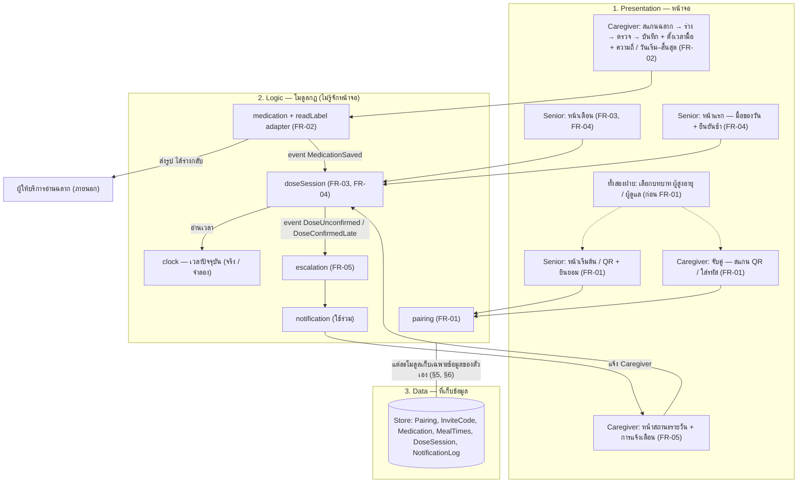
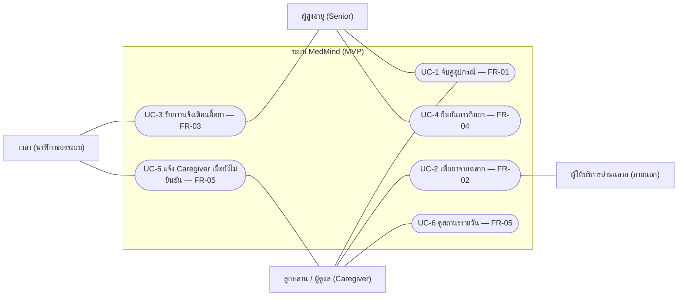
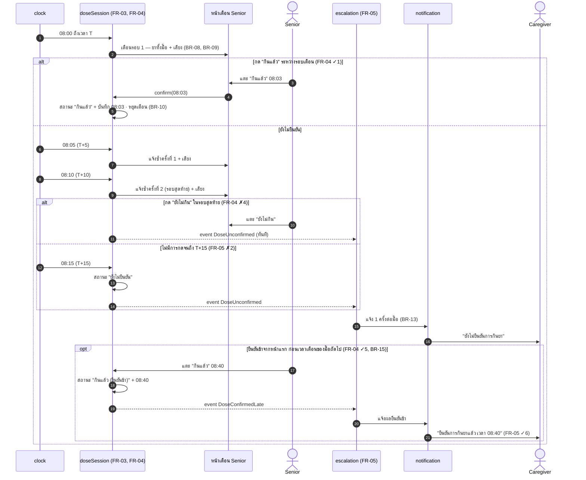
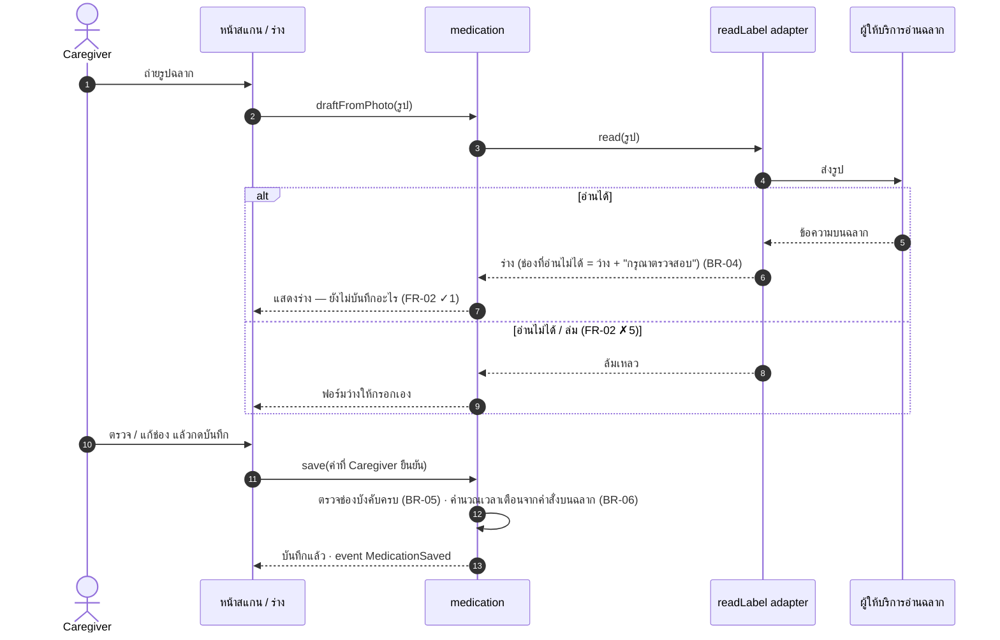
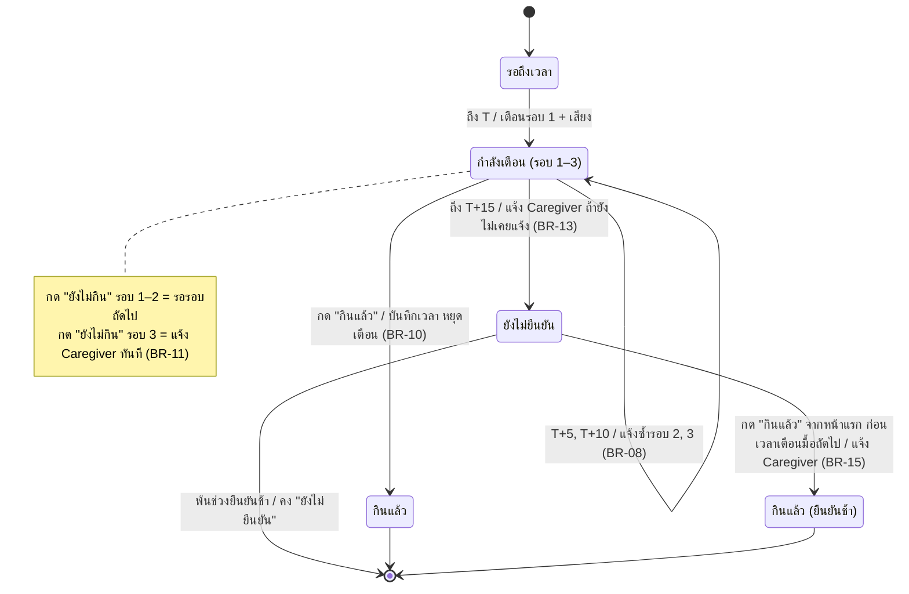
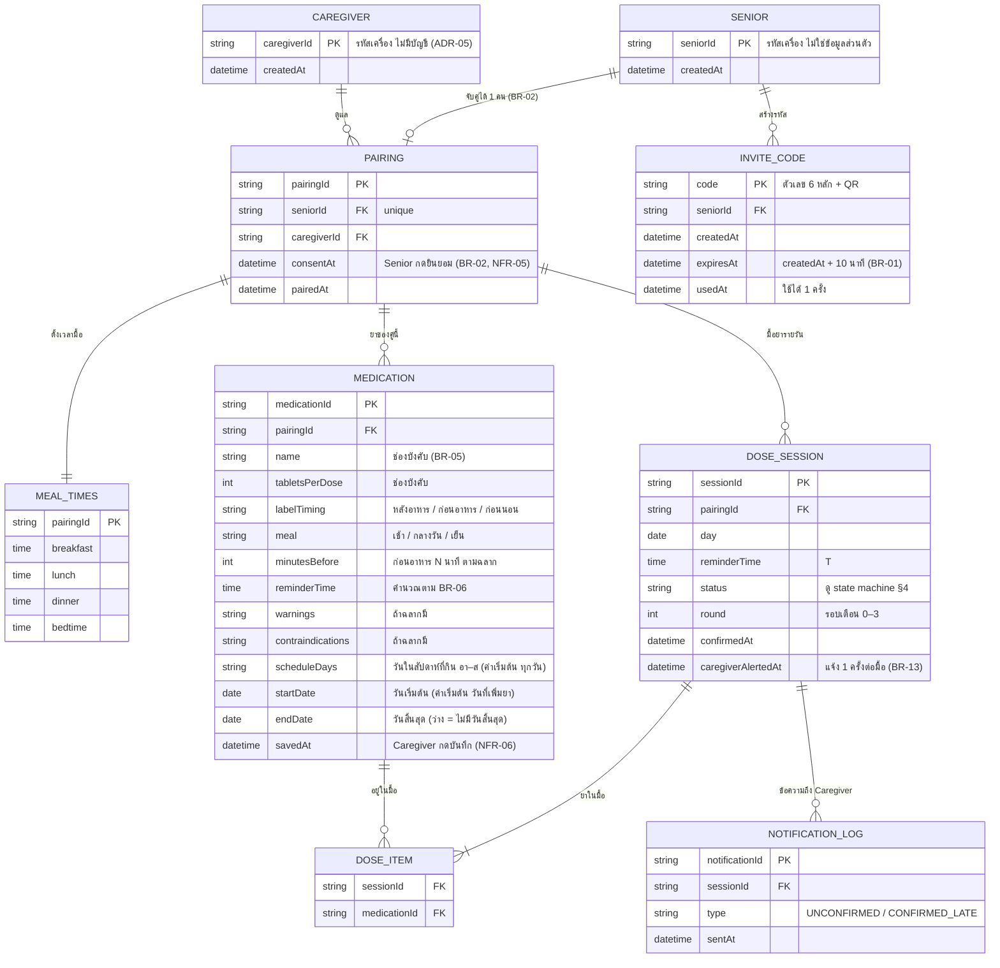

# Architecture & Design — MedMind

> diagram ทุกอันเขียนด้วย Mermaid (GitHub แสดงเป็นภาพให้อัตโนมัติ) · ทุก diagram และตารางติดป้าย FR · กฎและตัวเลขทั้งหมดอ้างจาก SRS [`docs/02-requirements/spec.md`](../02-requirements/spec.md) (BR-01..17, FR-01..05, NFR-01..10) — เอกสารนี้ไม่เพิ่มกฎใหม่
>
> การตัดสินใจที่ SRS เดิมยังไม่ได้ระบุ บันทึกไว้ใน §8

---

## 1. Architecture (มาจาก FR)

ระบบเป็น **เว็บแอปที่ใช้ผ่านเบราว์เซอร์** (SRS §2.2) แบ่งเป็น 3 ชั้น — หน้าจอไม่ตัดสินกฎเอง กฎเวลาเตือนและการแจ้งผู้ดูแลทั้งหมดอยู่ในชั้นตรรกะ เพื่อให้ทดสอบด้วยนาฬิกาจำลองได้ (NFR-01)

| ชั้น | ทำอะไร | ไม่ทำอะไร |
|---|---|---|
| Presentation | แสดงข้อมูลและรับการกดของผู้ใช้ เช่น ปุ่ม "กินแล้ว" / "ยังไม่กิน" | ไม่คำนวณเวลาเตือน ไม่ตัดสินว่าต้องแจ้งผู้ดูแลหรือไม่ |
| Logic | กฎทั้งหมด: รหัสเชิญและการจับคู่ (BR-01, 02, 17), ร่างจากฉลากและเวลาเตือน (BR-03..07), รอบเตือน ยืนยัน แจ้งผู้ดูแล (BR-08..16) | ไม่อ่านเวลาเครื่องเอง — รับเวลาจาก `clock` |
| Data | เก็บเฉพาะข้อมูลที่ FR-01..05 ใช้ (NFR-09) และให้อ่านได้เฉพาะคู่ที่จับคู่กัน (NFR-04) | ไม่เก็บร่างจากฉลากจนกว่า Caregiver จะกดบันทึก (BR-04) |

### 1.1 การตัดสินใจหลัก (ADR)

**ADR-01 — เตือนเฉพาะขณะเปิด MedMind ไว้**
- *Context:* ระบบเป็นเว็บแอป เบราว์เซอร์แจ้งเตือนไม่ได้เมื่อปิดหน้าหรือล็อกจอ และไม่เล่นเสียงจนกว่าผู้ใช้แตะหน้าครั้งแรก (SRS §2.2)
- *Decision:* MVP เตือน Senior และแจ้ง Caregiver เฉพาะขณะหน้าเว็บเปิดค้างไว้ · เสียงเตือนเริ่มเล่นได้หลังผู้ใช้แตะหน้าครั้งแรก
- *Consequence:* ไม่ต้องมีระบบ push · ถ้าผู้ใช้ปิดหน้า จะไม่ได้รับการเตือน (อยู่นอก MVP ตาม §2.2)

**ADR-02 — กฎเวลาอยู่ในโมดูลตรรกะ และรับเวลาจาก `clock`**
- *Context:* NFR-01 ต้องพิสูจน์ว่าแจ้งซ้ำที่ T+5, T+10 และแจ้ง Caregiver ไม่เกิน T+15 ทุกครั้ง
- *Decision:* `doseSession` และ `escalation` เป็นโค้ดที่ไม่ผูกกับหน้าจอ และถามเวลาจาก `clock` · ใช้งานจริงใช้เวลาเครื่อง · ตอนทดสอบและใน prototype ใช้นาฬิกาจำลองที่เลื่อนเวลาได้
- *Consequence:* automated test ไม่ต้องรอเวลาจริง 15 นาที · prototype สาธิตการเตือนครบ 3 รอบได้ในไม่กี่วินาที

**ADR-03 — การอ่านฉลากอยู่หลัง adapter `readLabel` และได้แค่ "ร่าง"**
- *Context:* ผลอ่านฉลากอาจผิด (SRS §6) และผู้ให้บริการภายนอกอาจล่ม (SRS §1.2)
- *Decision:* `readLabel` คืนค่าเป็นร่างเท่านั้น ช่องที่อ่านไม่ได้เป็นค่าว่าง + "กรุณาตรวจสอบ" (BR-04) · ข้อมูลยาถูกบันทึกเมื่อ Caregiver กดบันทึกเท่านั้น · อ่านไม่ได้ → เปิดฟอร์มว่างให้กรอกเอง (FR-02 ✗5)
- *Consequence:* เปลี่ยนผู้ให้บริการได้โดยไม่แตะโมดูลอื่น · prototype ใช้ร่างจำลองแทนการอ่านจริง (NFR-08 ตรวจได้เมื่อมีการอ่านฉลากจริง)

**ADR-04 — ทุกการอ่านข้อมูลผ่าน Pairing**
- *Context:* Caregiver ต้องเห็นเฉพาะ Senior ที่จับคู่ไว้ (NFR-04) และหลังยกเลิกการจับคู่ต้องดูไม่ได้และข้อมูลถูกลบ (NFR-10, BR-17)
- *Decision:* ข้อมูลยา มื้อ และสถานะทั้งหมดผูกกับ `pairingId` · ทุกคำขอตรวจว่า Caregiver เป็นเจ้าของ pairing นั้น · ยกเลิกการจับคู่ = ลบ Pairing พร้อมข้อมูลที่ผูกอยู่
- *Consequence:* ทดสอบ NFR-04 และ NFR-10 ได้ที่จุดเดียว

**ADR-05 — Caregiver ผูกกับเครื่อง ไม่มีบัญชี**
- *Context:* SRS กำหนดว่า Senior ไม่มีบัญชีหรือรหัสผ่าน (BR-02) แต่ไม่ได้กำหนดวิธีระบุตัว Caregiver
- *Decision:* Caregiver ระบุตัวด้วยรหัสเครื่องแบบเดียวกับ Senior — ไม่มีชื่อผู้ใช้ รหัสผ่าน หรืออีเมล (ทางที่ง่ายที่สุด)
- *Consequence:* ไม่ต้องเก็บข้อมูลบัญชี (สอดคล้อง NFR-09) และ prototype ไม่ต้องมีหน้าเข้าสู่ระบบ · ถ้าเปลี่ยนเครื่องหรือล้างข้อมูลเบราว์เซอร์ ต้องจับคู่ใหม่ (FR-01)

---

## 2. Use Case Diagram

ตรงกับตาราง use case ใน SRS §5.1 (UC-1..6) · FR-05 มี 2 use case (UC-5, UC-6) เพราะรวมการแจ้งเตือนกับหน้าสถานะรายวัน

---

## 3. Sequence Diagrams

### 3.1 เตือน → ยืนยัน → แจ้งผู้ดูแล (FR-03 → FR-04 → FR-05)

ตัวอย่างมื้อ 08:00 (T = 08:00) · เวลาในตัวอย่างตรงกับ AC ใน SRS

### 3.2 เพิ่มยาจากฉลาก (FR-02)

---

## 4. State Machine — DoseSession (หนึ่งมื้อของหนึ่งวัน)

- กด "กินแล้ว" ซ้ำในสถานะ "กินแล้ว" → ไม่สร้างบันทึกใหม่ (BR-12, NFR-07)
- มื้อเวลาซ้อนกัน: แต่ละมื้อมี DoseSession ของตัวเอง เดินตาม state machine นี้แยกกัน (BR-16)
- ช่วงยืนยันช้าสิ้นสุดที่เวลาเตือนของมื้อถัดไปที่เริ่มหลัง T+15 ของมื้อนี้ ถ้าไม่มีให้ถึง 23:59 (BR-15)
- หน้าสถานะของ Caregiver แสดงคำตามสถานะในแผนภาพนี้ตรงตัว — ช่วง T ถึง T+15 แสดง "กำลังเตือน" (BR-14, FR-05 ✓3)

---

## 5. Data Model / ERD

เก็บเฉพาะข้อมูลที่ FR-01..05 ใช้ · **ไม่มี** เลขบัตรประชาชน ที่อยู่ วันเกิด เบอร์โทร หรือเลข HN ของผู้สูงอายุ (NFR-09) · Senior ไม่มีบัญชีหรือรหัสผ่าน (BR-02)

| Entity | รองรับ FR | หมายเหตุ |
|---|---|---|
| SENIOR, CAREGIVER, INVITE_CODE, PAIRING | FR-01 | ยกเลิกการจับคู่ = ลบ PAIRING และทุกอย่างที่ผูกอยู่ (BR-17, NFR-10) |
| MEDICATION, MEAL_TIMES | FR-02 | ร่างจากฉลากไม่ถูกเก็บ — เก็บเมื่อ Caregiver กดบันทึกเท่านั้น (BR-04, NFR-06) |
| DOSE_SESSION, DOSE_ITEM | FR-03, FR-04 | ยาที่เวลาเตือนตรงกันรวมเป็นมื้อเดียว (BR-06) · หนึ่งมื้อมีบันทึกยืนยันได้รายการเดียว (NFR-07) |
| NOTIFICATION_LOG | FR-05 | ใช้ตรวจว่าแจ้ง Caregiver ครั้งเดียวต่อมื้อ (BR-13, NFR-01) |

---

## 6. Module & Event (cohesion / coupling)

| Module | FR | ข้อมูลที่เป็นเจ้าของ | รับ event | ส่ง event |
|---|---|---|---|---|
| `pairing` | FR-01 | SENIOR, CAREGIVER, INVITE_CODE, PAIRING | — | `Unpaired` |
| `medication` (+ adapter `readLabel`) | FR-02 | MEDICATION, MEAL_TIMES | `Unpaired` (ลบข้อมูล) | `MedicationSaved` |
| `doseSession` | FR-03, FR-04 | DOSE_SESSION, DOSE_ITEM | `MedicationSaved` (สร้างมื้อ), `Unpaired` (ลบข้อมูล) | `DoseConfirmed`, `DoseUnconfirmed`, `DoseConfirmedLate` |
| `escalation` | FR-05 | — | `DoseUnconfirmed`, `DoseConfirmedLate` | — (เรียก `notification`) |
| `notification` | ใช้ร่วม | NOTIFICATION_LOG | — | — |

Event: `MedicationSaved` → `DoseConfirmed` / `DoseUnconfirmed` → `DoseConfirmedLate` (BR-15) · `Unpaired` (BR-17)

- **Cohesion:** แต่ละโมดูลดูแล FR ของตัวเองและเป็นเจ้าของข้อมูลของตัวเองเท่านั้น — เช่น กฎรอบเตือนทั้งหมดอยู่ใน `doseSession` ที่เดียว
- **Coupling:** โมดูลคุยกันผ่าน event ไม่อ่านข้อมูลของกันและกันโดยตรง — `escalation` ไม่ต้องรู้ว่ามื้อมียาอะไร รู้แค่ว่ามื้อไหนยังไม่ยืนยัน · เปลี่ยนผู้ให้บริการอ่านฉลากได้โดยแก้แค่ `readLabel`

---

## 7. Coverage: FR → Design (sync-check)

| FR / NFR | Architecture §1 | Use Case §2 | Sequence §3 | State §4 | ERD §5 | Module §6 |
|---|---|---|---|---|---|---|
| FR-01 จับคู่ | S1, C1 · ADR-04 | UC-1 | — | — | SENIOR, CAREGIVER, INVITE_CODE, PAIRING | `pairing` |
| FR-02 สแกนฉลาก | C2 · ADR-03 | UC-2 | §3.2 | — | MEDICATION, MEAL_TIMES | `medication` |
| FR-03 แจ้งเตือน | S2 · ADR-01, ADR-02 | UC-3 | §3.1 | Waiting → Reminding | DOSE_SESSION, DOSE_ITEM | `doseSession` |
| FR-04 ยืนยัน | S2, S3 | UC-4 | §3.1 | Taken, TakenLate | DOSE_SESSION (confirmedAt) | `doseSession` |
| FR-05 แจ้ง Caregiver + สถานะ | C3 | UC-5, UC-6 | §3.1 | Unconfirmed | NOTIFICATION_LOG | `escalation`, `notification` |
| NFR-01 | ADR-02 | — | §3.1 | §4 | NOTIFICATION_LOG | `escalation` |
| NFR-04, NFR-05, NFR-10 | ADR-04 | UC-1 | — | — | PAIRING (consentAt) | `pairing` |
| NFR-06, NFR-09 | ADR-03 · ชั้น Data | UC-2 | §3.2 | — | §5 ทั้งหมด | `medication` |
| NFR-07 | — | — | — | หมายเหตุ §4 | DOSE_SESSION | `doseSession` |

ทุก Must FR (FR-01..05) มีที่อยู่ใน design อย่างน้อย 4 ส่วน — ไม่มี FR ที่ไม่มีที่อยู่ · FR-06..08 (Should / Could) อยู่นอก MVP จึงยังไม่ออกแบบ

---

## 8. การตัดสินใจเพิ่มเติม (SRS เดิมยังไม่ได้ระบุ)

| # | เรื่อง | ตัดสินว่า | แก้ที่ |
|---|---|---|---|
| 1 | หน้าสถานะของ Caregiver แสดงคำไหนระหว่าง T ถึง T+15 | แสดง "กำลังเตือน" | `spec.md` BR-14, FR-05 ✓3 · §4 |
| 2 | Caregiver ระบุตัวตนอย่างไร | ผูกกับเครื่อง ไม่มีบัญชี (ง่ายที่สุด) | ADR-05 · §5 CAREGIVER |
