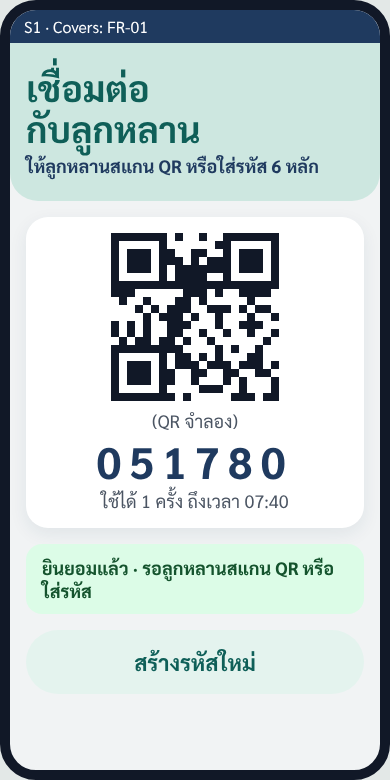
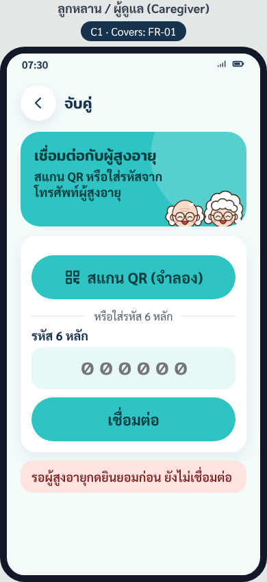
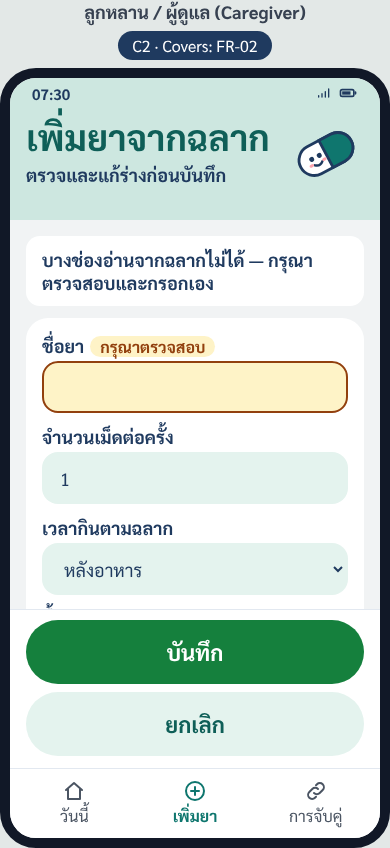
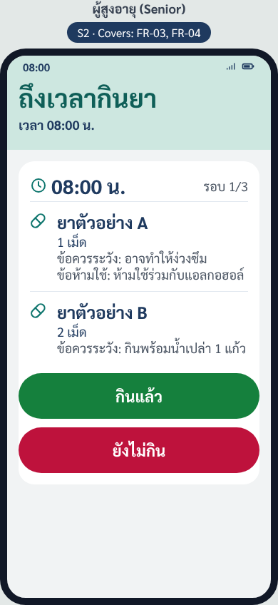
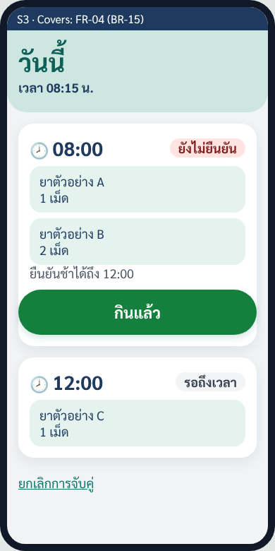
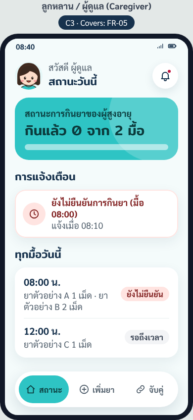

# Design System & Screen Map — MedMind

> ใช้กับทุกหน้าของ prototype — สี ฟอนต์ ขนาด ชุดเดียวกันทั้งหมด · ตัวเลขขนาดมาจาก NFR-03 ใน SRS [`docs/02-requirements/spec.md`](../02-requirements/spec.md) · หน้าจอ S1–S3, C1–C3 ใช้รหัสเดียวกับ [`architecture.md`](architecture.md) §1

---

## 1. Tokens

แนวหน้าตา (ธีมฟ้ามิ้นต์): สไตล์แอปการแพทย์ทั่วไป — พื้นมิ้นต์จางเกือบขาว · แถวบนมีรูปโปรไฟล์วงกลม + คำทักทาย · การ์ดหลักสีฟ้ามิ้นต์สดบอกข้อมูลสำคัญ (มื้อถัดไป / "กินแล้ว 2 จาก 6 มื้อ") · การ์ดสีขาวมุมโค้งมีเงาอ่อน · ปุ่มทรงแคปซูล · เมนูล่างของ Caregiver เป็นแถบลอยทรงแคปซูล · หัวข้อใช้ฟอนต์ Mitr · ไอคอนเส้นชุดเดียวที่วาดเอง (`prototype/src/icons.js`) + ตัวละครการ์ตูนคุณตา คุณยาย และลูกหลาน ที่ทีมวาดเองเป็นเวกเตอร์ (ใช้บนหน้าเลือกบทบาท รูปโปรไฟล์ และการ์ดหลัก) ไม่ใช้ภาพ stock หรือ emoji · ทุกสีตรวจ contrast แล้ว (§1.4) — **ห้ามใช้ตัวอักษรสีขาวบนฟ้ามิ้นต์สด `#2EC4C4`** (ได้แค่ 2.14 : 1) ให้ใช้ตัวอักษรเข้ม `--color-on-mint` แทน

> ต้นแบบหน้าจอธีมนี้อยู่บน design canvas (Claude Design) · [`prototype/index.html`](../../prototype/index.html) ใช้เลย์เอาต์และค่าเดียวกัน ([`prototype/src/tokens.css`](../../prototype/src/tokens.css)) · ภาพหน้าจอใน §2 ยังเป็นธีมเดิม (มิ้นต์เขียว) — ต้องแคปใหม่

### 1.1 สี

| Token | ค่า | ใช้กับ |
|---|---|---|
| `--color-bg` | `#F4FBFB` | พื้นหลังหน้า (มิ้นต์จางเกือบขาว) |
| `--color-mint` | `#2EC4C4` | สีหลักของแบรนด์: การ์ดหลัก · แถบหัวหน้าเตือน (S2) · ปุ่มหลักทั่วไป (เช่น "สแกน QR", "เชื่อมต่อ") · แท็บที่เลือกในเมนูล่าง · วงกลมลูกศรบนหน้าเลือกบทบาท |
| `--color-on-mint` | `#0B3B3C` | ตัวอักษร/ไอคอนทุกตัวที่วางบน `--color-mint` (เขียวน้ำเงินเข้ม) |
| `--color-mint-dark` | `#0B7A7D` | ลิงก์ · ชื่อแบรนด์ "MedMind" · ตัวอักษรบนปุ่มรองและปุ่มสีขาว · ไอคอนในวงกลมมิ้นต์อ่อน |
| `--color-mint-soft` | `#E6F8F8` | ปุ่มรอง ("สร้างรหัสใหม่", "ยกเลิก") · ช่องกรอก · วงกลมไอคอน · พื้นหลังรูปโปรไฟล์ |
| `--color-surface` | `#FFFFFF` | การ์ด · เมนูล่างแบบลอย · ปุ่มวงกลม (ย้อนกลับ, กระดิ่ง) |
| `--color-text` | `#17324D` | ข้อความหลัก ชื่อยา (กรมท่าเข้ม) |
| `--color-text-muted` | `#52606D` | ข้อความรอง · แท็บที่ไม่ได้เลือก |
| `--color-taken` | `#15803D` | ปุ่ม **"กินแล้ว"** (เขียว) · ปุ่ม "บันทึก" · ปุ่ม "ยินยอม" |
| `--color-not-yet` | `#BE123C` | ปุ่ม **"ยังไม่กิน"** (แดงอมชมพู) · ปุ่มยืนยันยกเลิกการจับคู่ · จุดแจ้งเตือนบนกระดิ่ง |
| `--color-check-bg` / `--color-check-text` | `#FEF3C7` / `#92400E` | ช่อง "กรุณาตรวจสอบ" ในร่างจากฉลาก (BR-04) · ข้อความ "รอผู้สูงอายุกดยินยอม" |
| `--color-check-field` / `--color-check-border` | `#FFFBEB` / `#D97706` | พื้นและขอบของช่องกรอกที่อ่านจากฉลากไม่ได้ |
| `--color-covers-bg` | `#17324D` | ป้าย "Covers: FR-x" เหนือจอโทรศัพท์ (เฉพาะ `prototype/index.html`) |

**ป้ายสถานะมื้อยา** (หน้าแรก S3 และหน้าสถานะรายวัน C3 · คำตาม BR-14) — คงค่าเดิม

| สถานะ | ตัวอักษร / พื้น |
|---|---|
| "กินแล้ว" + เวลา | `#14532D` / `#DCFCE7` |
| "กินแล้ว (ยืนยันช้า)" + เวลา | `#134E4A` / `#CCFBF1` |
| "กำลังเตือน" | `#1E3A8A` / `#DBEAFE` |
| "ยังไม่ยืนยัน" | `#7F1D1D` / `#FFE4E1` |
| "รอถึงเวลา" | `#374151` / `#F3F4F6` |

**ตัวละครการ์ตูน** (ภาพประกอบ ไม่ใช่ข้อความ จึงไม่อยู่ในเกณฑ์ contrast): เส้น `#4A2E22` · ผิว `#FCDCC8` · แก้ม `#F7A1A1` · ผมขาว `#FFFFFF` · แว่น `#5B3A29` · เสื้อคุณตาคุณยาย `#FFC93C` · ผมลูกหลาน `#3B2A20` · เสื้อลูกหลาน `#2EC4C4`

### 1.2 ตัวอักษรและขนาด (NFR-03)

| Token | ค่า | ใช้กับ | เกณฑ์ NFR-03 |
|---|---|---|---|
| `--font-family` | `"Sarabun", "Noto Sans Thai", "Leelawadee UI", "Tahoma", sans-serif` | ข้อความทั่วไป ปุ่ม ช่องกรอก | — |
| `--font-display` | `"Mitr", "Sarabun", sans-serif` (น้ำหนัก 500) | หัวข้อใหญ่ เวลามื้อบนการ์ดหลัก รหัสเชิญ | — |
| `--font-hero` | 30–36 px / Mitr | หัวข้อใหญ่ เช่น "ถึงเวลากินยา", "ยินดีต้อนรับ" · เวลามื้อบนการ์ดหลัก 46 px | — |
| `--font-medicine` | 24 px / ตัวหนา | ชื่อยาบนหน้าเตือน (S2) | ≥ 24 px ✓ |
| `--font-title` | 22–28 px | เวลามื้อในรายการ · หัวข้อส่วน | — |
| `--font-body` | 18 px | ข้อความทั่วไป ช่องกรอก | ≥ 18 px ✓ |
| `--font-small` | 16 px / ตัวหนา | ป้ายสถานะ · ป้ายบนการ์ดหลัก · ชื่อแท็บในเมนูล่าง | — (ไม่ใช่ข้อความหลักที่ผู้สูงอายุต้องอ่าน) |
| `--font-button` | 20–22 px / ตัวหนา | ข้อความบนปุ่ม | — |
| `--button-height` | 64 px · กว้างเต็มจอ | ปุ่ม "กินแล้ว" / "ยังไม่กิน" | ≥ 64 px, เต็มจอ ✓ |

### 1.3 ระยะ มุม และเงา

| Token | ค่า |
|---|---|
| ระยะ | 8 · 12 · 16 · 20 · 24 px · ขอบซ้ายขวาของจอ 20 px |
| `--radius-card` | 22–28 px (การ์ดหลักและการ์ดใหญ่ 28 px · การ์ดรายการ 22 px) |
| `--radius-field` | 16–18 px (ช่องกรอก) |
| `--radius-button` | 999 px (ปุ่มทรงแคปซูล) |
| `--radius-badge` | 999 px |
| `--shadow-card` | `0 8px 24px rgba(23, 50, 77, 0.08)` |
| `--shadow-nav` | `0 10px 30px rgba(23, 50, 77, 0.14)` (เมนูล่างแบบลอย) |
| ระยะห่างระหว่างปุ่ม "กินแล้ว" กับ "ยังไม่กิน" | ≥ 12 px (ใช้ 14 px · กันกดพลาด) |

### 1.4 ความต่างสี (NFR-03: ≥ 4.5:1)

คำนวณด้วยสูตร contrast ratio ของ WCAG 2.2 จากค่าสีในตารางด้านบน — ยังไม่ได้วัดซ้ำบนหน้าจริงด้วยตัวตรวจ contrast

| คู่สี | Contrast | ผ่าน ≥ 4.5:1 |
|---|---|---|
| ตัวขาวบนปุ่ม "กินแล้ว" `#15803D` | 5.02 : 1 | ✓ |
| ตัวขาวบนปุ่ม "ยังไม่กิน" `#BE123C` | 6.29 : 1 | ✓ |
| ตัวเข้ม `#0B3B3C` บนฟ้ามิ้นต์สด `#2EC4C4` (ปุ่มหลัก การ์ดหลัก แท็บที่เลือก) | 5.75 : 1 | ✓ |
| ~~ตัวขาวบนฟ้ามิ้นต์สด `#2EC4C4`~~ — **ห้ามใช้** | 2.14 : 1 | ✗ |
| ข้อความหลักบนการ์ดขาว | 13.13 : 1 | ✓ |
| ข้อความหลักบนพื้นหน้า `#F4FBFB` | 12.53 : 1 | ✓ |
| ข้อความหลักบนมิ้นต์อ่อน `#E6F8F8` (ช่องกรอก) | 11.97 : 1 | ✓ |
| ข้อความหลักบนช่องที่ต้องตรวจสอบ `#FFFBEB` | 12.66 : 1 | ✓ |
| ฟ้ามิ้นต์เข้ม `#0B7A7D` บนการ์ดขาว / ปุ่มสีขาว (ลิงก์) | 5.13 : 1 | ✓ |
| ฟ้ามิ้นต์เข้ม `#0B7A7D` บนพื้นหน้า (ชื่อแบรนด์ ลิงก์ "ยกเลิกการจับคู่") | 4.89 : 1 | ✓ |
| ฟ้ามิ้นต์เข้ม `#0B7A7D` บนมิ้นต์อ่อน `#E6F8F8` (ปุ่มรอง) | 4.68 : 1 | ✓ |
| ข้อความรองบนการ์ดขาว | 6.46 : 1 | ✓ |
| ข้อความรองบนพื้นหน้า | 6.16 : 1 | ✓ |
| ป้าย "กินแล้ว" | 8.30 : 1 | ✓ |
| ป้าย "กินแล้ว (ยืนยันช้า)" | 8.41 : 1 | ✓ |
| ป้าย "กำลังเตือน" | 8.49 : 1 | ✓ |
| ป้าย "ยังไม่ยืนยัน" | 8.32 : 1 | ✓ |
| ป้าย "รอถึงเวลา" | 9.37 : 1 | ✓ |
| ข้อความแจ้ง "ยังไม่ยืนยันการกินยา" `#7F1D1D` บนการ์ดขาว | 10.02 : 1 | ✓ |
| ช่อง "กรุณาตรวจสอบ" | 6.37 : 1 | ✓ |
| ป้าย "Covers: FR-x" (ตัวขาวบน `#17324D`) | 13.13 : 1 | ✓ |

ขอบช่องที่ต้องตรวจสอบ `#D97706` บนพื้นขาวได้ 3.19 : 1 — ผ่านเกณฑ์ขอบ/องค์ประกอบ UI ของ WCAG (≥ 3 : 1) และไม่ได้ใช้เป็นสีตัวอักษร

ปุ่ม "กินแล้ว" กับ "ยังไม่กิน" ต่างกันทั้งสีและข้อความ (และไอคอน ✓ / ✕) — ไม่ใช้สีอย่างเดียวบอกความหมาย (สำหรับผู้ที่แยกสีเขียว/แดงไม่ออก)

---

## 2. Screen Map: หน้าจอ ↔ FR

ทุกหน้ามีป้าย **"Covers: FR-x"** เหนือจอโทรศัพท์ เพื่อชี้ได้ตอน demo ว่าหน้านี้ = requirement ข้อไหน · ภาพหน้าจอจาก [`prototype/index.html`](../../prototype/index.html) (ธีมเดิม — รอแคปใหม่ตามธีมฟ้ามิ้นต์)

| รหัส | หน้าจอ | ผู้ใช้ | Covers | องค์ประกอบหลัก | ภาพหน้าจอ |
|---|---|---|---|---|---|
| R0 | เลือกบทบาท | ทุกคน | — (ก่อน FR-01) | การ์ดใหญ่ 2 ใบ: "ผู้สูงอายุ" (ตัวละครคุณตาคุณยาย) → S1 · "ผู้ดูแล / ลูกหลาน" (ตัวละครลูกหลาน) → C1 | (ยังไม่มีภาพ) |
| S1 | เริ่มต้น / QR + ยินยอม | Senior | FR-01 | QR + รหัสเชิญ 6 หลัก (ไม่ต้องสมัครหรือพิมพ์) · ปุ่ม "ยินยอม" · ปุ่ม "สร้างรหัสใหม่" |  |
| C1 | จับคู่ + ยกเลิกการจับคู่ | Caregiver | FR-01 | สแกน QR หรือใส่รหัส 6 หลัก · ผลจับคู่ "เชื่อมต่อแล้ว" · ปุ่ม "ยกเลิกการจับคู่" |  |
| C2 | สแกนฉลาก → ร่าง → ตั้งเวลามื้อ | Caregiver | FR-02 | ถ่ายรูปฉลาก · ฟอร์มร่าง (ชื่อยา, จำนวนเม็ดต่อครั้ง, มื้อ/เวลา, ข้อควรระวัง, ข้อห้ามใช้) · ตั้งเวลามื้อเช้า/กลางวัน/เย็น + เวลาเข้านอน · ปุ่ม "บันทึก" / "ยกเลิก" |  |
| S2 | หน้าเตือน | Senior | FR-03, FR-04 | เวลามื้อ · ยาทุกตัวในมื้อ (ชื่อยา 24 px, จำนวนเม็ด, ข้อควรระวัง, ข้อห้ามใช้) · ปุ่ม "กินแล้ว" (เขียว) / "ยังไม่กิน" (แดง) · เสียงเตือน · ไม่มีรูปยา |  |
| S3 | หน้าแรก | Senior | FR-04 (BR-15) | มื้อของวันพร้อมป้ายสถานะ · ปุ่ม "กินแล้ว" สำหรับมื้อที่อยู่ในช่วงยืนยันช้า · จุดแตะเพื่อเปิดเสียงครั้งแรก · ลิงก์ "ยกเลิกการจับคู่" (BR-17) |  |
| C3 | แจ้งเตือน + สถานะรายวัน | Caregiver | FR-05 | ข้อความ "ยังไม่ยืนยันการกินยา" / "ยืนยันการกินยาแล้ว เวลา …" · รายการทุกมื้อของวันพร้อมป้ายสถานะ 5 แบบ (§1.1) |  |

**เส้นทางผู้ใช้ (user journey)**
- Caregiver: R0 เลือก "ผู้ดูแล" → C1 จับคู่ → C2 เพิ่มยา → C3 ดูสถานะ / รับการแจ้งเตือน
- Senior: R0 เลือก "ผู้สูงอายุ" → S1 ยินยอม → S3 หน้าแรก → S2 หน้าเตือนเมื่อถึงเวลา → กลับ S3

---

## 3. Error / Empty states

| หน้าจอ | กรณี | สิ่งที่แสดง | อ้างอิง |
|---|---|---|---|
| C1 | Senior ยังไม่กดยินยอม | "รอผู้สูงอายุกดยินยอม" · ยังไม่เชื่อมต่อ | FR-01 ✗2 |
| C1 | รหัสผิด / เกิน 10 นาที / ใช้แล้ว | "รหัสไม่ถูกต้องหรือหมดอายุ ขอรหัสใหม่จากผู้สูงอายุ" · ไม่เชื่อมต่อ | FR-01 ✗4, BR-01 |
| C1 | Senior มีผู้ดูแลแล้ว | "ผู้สูงอายุท่านนี้มีผู้ดูแลแล้ว" · ไม่เชื่อมต่อ | FR-01 ✗5, BR-02 |
| C1, S3 | กดยกเลิกการจับคู่ | กล่องยืนยันอีกครั้ง "ข้อมูลยาและประวัติการยืนยันจะถูกลบ" · ปุ่มยืนยัน (แดง) / ยกเลิก · หลังยืนยัน Senior เห็น QR ใหม่ | FR-01 ✗6, BR-17 |
| C1, C2 | ไม่อนุญาตใช้กล้อง | C1: ใช้ช่องใส่รหัส 6 หลักแทน · C2: เปิดฟอร์มให้กรอกเอง | SRS §2.2 |
| C2 | มีช่องที่อ่านไม่ได้ / ฉลาก "ก่อนอาหาร" ไม่ระบุนาที | ช่องว่าง + ป้าย "กรุณาตรวจสอบ" (สี §1.1) · ปุ่ม "บันทึก" กดไม่ได้จนช่องบังคับครบ | FR-02 ✗3, ✗10, BR-04 |
| C2 | ฉลากเป็นยาที่กินเมื่อมีอาการ | "ระบบยังไม่รองรับยาเมื่อมีอาการ" · ไม่สร้างตาราง | FR-02 ✗4, BR-07 |
| C2 | สแกนล้มเหลว | ฟอร์มว่างให้กรอกเอง | FR-02 ✗5 |
| C2 | กด "ยกเลิก" ในหน้าร่าง | กลับหน้าก่อน · ไม่บันทึกอะไร | FR-02 ✗7 |
| S2 | มื้อเวลาซ้อนกัน | แสดงทุกมื้อที่ยังไม่ยืนยัน เรียงตามเวลา แยกหัวข้อ แต่ละมื้อมีปุ่มของตัวเอง · เสียงครั้งเดียว | FR-03 ✗4, BR-16 |
| S2, S3 | ยังไม่ได้แตะหน้าจอหลังเปิด (เบราว์เซอร์ยังไม่ให้เล่นเสียง) | แถบ "แตะหน้าจอเพื่อเปิดเสียงเตือน" | SRS §2.2, ADR-01 |
| S3 | เลยช่วงยืนยันช้าแล้ว | ไม่มีปุ่ม "กินแล้ว" · ป้ายคง "ยังไม่ยืนยัน" | FR-04 ✗6, BR-15 |
| C3 | ยังไม่มีมื้อยาในวัน | "ยังไม่มีมื้อยาวันนี้" | FR-05 ✗4 |
